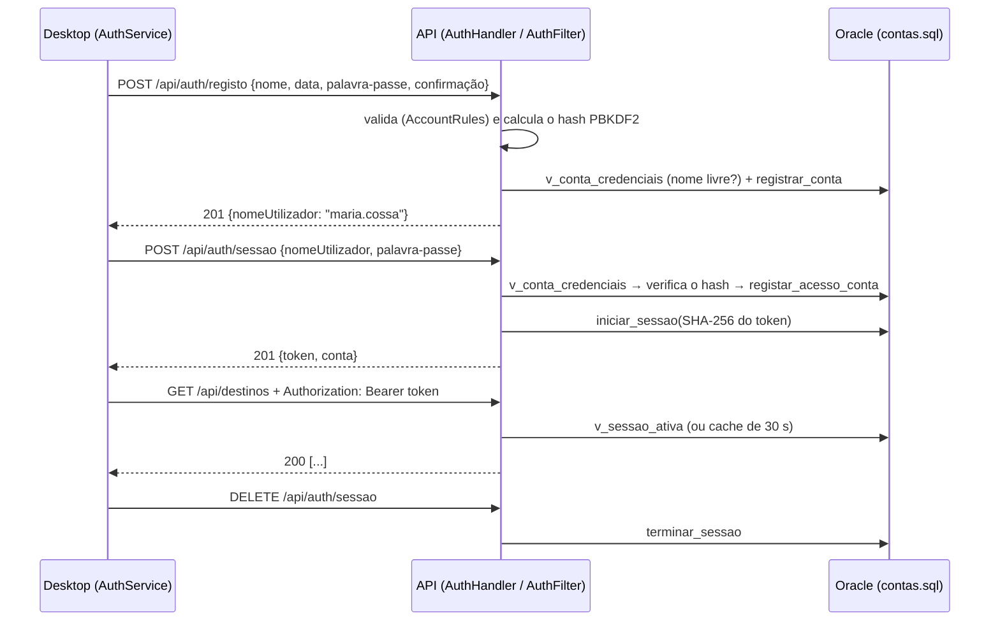

# Autenticação e nova interface (22-10-2026)

Este documento explica o redesign da aplicação desktop (identidade azul, fundos, animações) e o sistema de contas: registo, início e fim de sessão, perfil e proteção da API. Complementa o [manual técnico](README.md).

## 1. O que mudou

| Área | Antes | Agora |
|---|---|---|
| Acesso | A janela abria logo nos dados; a API respondia a qualquer pedido local | Boas-vindas → início de sessão ou registo; a API exige sessão em todos os endpoints de dados |
| Contas | Não existiam | Tabelas `Conta_Utilizador` e `Sessao_Utilizador` no Oracle, hash PBKDF2, bloqueio após 5 falhas |
| Identidade visual | Verde/ocre | Azul (`#2563EB` sobre `#0F172A`), símbolo próprio (sol sobre ondas), gradientes e luzes difusas |
| Fundos | Cor lisa | Fundo expressivo na autenticação (gradiente, luzes, anéis, rota tracejada); fundo discreto nas páginas de trabalho |
| Movimento | Só o indicador da barra lateral | Entrada dos ecrãs e dos cartões, transições entre ecrãs, notificações, alertas, força da palavra-passe, confirmação animada |
| Conta | — | Cartão da conta na barra lateral (avatar com iniciais, ponto de sessão ativa), menu da conta, ecrã "A minha conta", saudação no painel |

Nenhuma funcionalidade existente foi removida: os 15 módulos, o painel, os relatórios, os formulários, os atalhos de teclado e o tema escuro funcionam como antes (os 9 testes de interface antigos continuam a passar).

## 2. Ficheiros

### Novos

| Ficheiro | Função |
|---|---|
| `database/contas.sql` | Sequência `ID_conta`, tabelas `Conta_Utilizador` e `Sessao_Utilizador`, views `v_conta_credenciais` e `v_sessao_ativa`, procedures `registrar_conta`, `registar_acesso_conta`, `iniciar_sessao`, `terminar_sessao` |
| `backend/.../auth/PasswordHasher.java` | Hash PBKDF2-HMAC-SHA256 (600 000 iterações, sal de 16 bytes), comparação em tempo constante |
| `backend/.../auth/AccountRules.java` | Regras do registo (nome, data, palavra-passe) e geração do nome de utilizador |
| `backend/.../auth/SessionService.java` | Tokens aleatórios de 256 bits, SHA-256 para guardar, cache de 30 s das sessões válidas |
| `backend/.../auth/AuthFilter.java` | Filtro HTTP que exige `Authorization: Bearer` nos endpoints de dados |
| `backend/.../handler/AuthHandler.java` | `POST /api/auth/registo`, `POST/GET/DELETE /api/auth/sessao` |
| `backend/.../dao/ContaDAO.java`, `model/Conta.java` | Leitura pelas views e escrita pelas procedures de `contas.sql` |
| `frontend/.../auth/` | `AuthService`, `Session`, `TokenStore`, `AccountRules`, `AuthShell`, `WelcomeView`, `LoginView`, `RegisterView`, `AuthLayout`, `PasswordStrength`, `SuccessCheck` |
| `frontend/.../Workspace.java` | Área de trabalho de uma sessão (o que antes estava em `MainWindow`) |
| `frontend/.../pages/AccountPage.java` | Ecrã "A minha conta" |
| `frontend/.../ui/motion/Motion.java`, `MotionPanel.java` | Motor de animação e contentor com fade/deslocamento |
| `frontend/.../ui/components/` | `Backdrop`, `BrandMark`, `Avatar`, `AccountChip`, `FormField`, `DateInput`, `Alert` |
| Testes | `PasswordHasherTest`, `AuthHandlerHttpTest`, `AuthFlowUiTest`, `AccountRulesTest`, `TestSessions` |

### Modificados

`TurismoApiServer` (rotas `/api/auth`, filtro), `SchemaDAO` (41 views esperadas), `main.sql` e `apagarAtualizar.sql` (incluem `contas.sql`), `MainWindow` (alterna autenticação/área de trabalho), `MainApplication`, `ApiClient` (token e aviso de sessão expirada), `Palette` e `Theme` (identidade azul, novos tokens), `UI` (botão principal com gradiente e estado "a processar", botão de vidro, ligação), `Card` (sombra, realce, entrada), `Surface` (fundo discreto), `Sidebar` (gradiente, símbolo, item ativo), `Toast` (entrada/saída animadas), `BarChart` (marcas do eixo sem sobreposição), `DashboardPage` (saudação e entrada dos cartões), testes de interface antigos (abrem a janela com uma sessão de teste), `LiveApplicationE2ETest` (inicia sessão), READMEs.

## 3. Como funciona a autenticação



- **Registo:** só os quatro campos pedidos. O nome de utilizador é gerado (primeiro e último nome, sem acentos, com número se já existir) e mostrado no fim do registo.
- **Validação em dois sítios:** a aplicação valida cada campo para dar feedback imediato; a API volta a validar tudo e devolve os erros por campo (`422` com `fields`), que a aplicação mostra junto do campo certo sem perder o que foi escrito.
- **Início de sessão:** a mensagem de erro é sempre a mesma ("Nome de utilizador ou palavra-passe incorretos.") e, quando a conta não existe, a API faz na mesma o cálculo do hash, para o tempo de resposta não revelar que contas existem. 5 falhas seguidas bloqueiam a conta 5 minutos (`423`).
- **Sessão:** token de 32 bytes do `SecureRandom`, entregue uma única vez. A BD guarda só o SHA-256. Duração: 7 dias com "manter sessão iniciada", 12 horas sem.
- **Restaurar:** com "manter sessão", o token fica em `java.util.prefs` (preferências do utilizador do SO). Ao abrir, a aplicação mostra "A retomar a sessão…" e confirma-o em `GET /api/auth/sessao`. Se a API o recusar, o token é apagado e aparecem as boas-vindas; se a API estiver em baixo, o token fica guardado para a próxima vez.
- **Proteção das páginas:** a área de trabalho (`Workspace`) só é criada depois de uma sessão aceite. No servidor, o `AuthFilter` recusa com `401` qualquer pedido de dados sem token válido.
- **Sessão expirada durante o uso:** o `ApiClient` deteta o `401` e a janela volta ao início de sessão com o aviso "A sua sessão expirou".
- **Terminar sessão:** fecha os formulários abertos, descarta a área de trabalho (ecrãs e dados saem da memória), apaga o token guardado e revoga a sessão no servidor em segundo plano. A conta não é apagada.
- **Dados de outras contas:** os dados da agência (destinos, reservas…) são partilhados por todas as contas, como antes. O único dado privado é o perfil, que a API só devolve à sessão dona do token.

### Limitações conhecidas

- O token guardado com "manter sessão" está nas preferências do sistema operativo, que **não são cifradas**. Quem tiver acesso à conta do computador pode usá-lo até expirar ou até a sessão ser terminada.
- Foi usado PBKDF2 (incluído no JDK) em vez de Argon2id/bcrypt, para não acrescentar dependências; o número de iterações fica no próprio hash e pode subir sem invalidar contas.
- Não há recuperação de palavra-passe nem alteração de dados da conta (não foram pedidas e exigiriam um canal como o e-mail).
- A API usa HTTP simples porque só escuta em `127.0.0.1`. Se `api.bindAddress` for aberto à rede, deve ficar atrás de HTTPS.
- Não existem perfis/permissões: todas as contas veem e alteram os mesmos dados da agência.

## 4. Animações

Todas passam por `ui/motion/Motion`: um `javax.swing.Timer` a ~60 fps por animação, que **para sozinho no fim** (nenhum ciclo permanente). Só se animam a opacidade (`AlphaComposite`) e a translação da pintura, nunca o layout, por isso os controlos ficam no sítio certo e utilizáveis durante a animação. `MotionPanel` e `Card` são "origem de pintura" enquanto animam, para que um filho que se repinte sozinho (ex.: o indicador de carregamento) respeite a opacidade.

| Onde | Efeito | Duração |
|---|---|---|
| Boas-vindas | Símbolo, título, texto e botões entram um a um (fade + 14 px) | 360 ms, 70 ms de intervalo |
| Entre ecrãs de autenticação | Fade + deslocamento de 28 px (à direita ao avançar, à esquerda ao voltar) | 260 ms |
| Login → área de trabalho, logout → login | Fade + subida | 280–360 ms |
| Mudança de página | Fade + 8 px | 220 ms |
| Cartões do painel e da conta | Entram um a um na primeira vez | 280 ms, 60–70 ms de intervalo |
| Notificações | Entram a deslizar da direita, saem com fade | 220 / 180 ms |
| Erros de campo e alertas | Fade do texto | 140–220 ms |
| Força da palavra-passe | A barra enche suavemente | 220 ms |
| Conta criada | Círculo e visto desenhados | 520 ms, uma vez |
| Botões | Realce ao passar o rato, ligeira redução ao carregar, indicador a rodar durante o envio | imediato |

**Movimento reduzido:** no macOS a preferência "Reduzir movimento" é lida uma vez no arranque (fora da EDT); em qualquer sistema pode forçar-se com `-Dturismo.reduzirMovimento=true`. Nesse caso todas as animações saltam para o estado final.

## 5. Desempenho

- Fundos desenhados em código e guardados numa imagem: só são refeitos quando muda o tamanho da janela ou o tema; pintar o fundo é copiar essa imagem.
- Sombras dos cartões com três retângulos translúcidos (sem desfoque) e sem imagens externas, vídeos ou partículas.
- Nenhuma dependência nova: PBKDF2, SHA-256 e `SecureRandom` vêm do JDK; as animações usam só Swing.
- Pedidos à API sempre fora da EDT (`Task`); o teste `interfaceContinuaResponsivaDuranteUmPedidoLento` continua a confirmar que a EDT responde em menos de 250 ms durante um pedido de 2,5 s.
- A API guarda as sessões válidas em memória durante 30 s, para não consultar o Oracle (pool de 4 ligações) em cada pedido.
- O hash PBKDF2 demora cerca de 0,3 s: só acontece no registo e no início de sessão.

## 6. Testes executados (22-10-2026)

`mvn test` na raiz, com a VM do Oracle ligada:

| Suite | Resultado |
|---|---|
| Backend: `PasswordHasherTest` (7), `AuthHandlerHttpTest` (7), `TuristaHandlerHttpTest` (8), `PlSqlOutputTest` (7), utilitários (31) | todos passaram |
| Backend: `OracleIntegrationTest` (15) | 14 passaram, 1 *skipped* (como antes); confirma as 41 views |
| Frontend: `AuthFlowUiTest` (12), `MainWindowUiTest` (9), `ApiClientTest` (7), `ModulesTest` (8), `AccountRulesTest` (3) | todos passaram |
| Frontend: `LiveApplicationE2ETest` (4), com a API e a BD reais e uma conta de teste | todos passaram (corrido à parte, com as variáveis `TURISMO_E2E_*`) |

Verificado também por HTTP contra o Oracle real: registo, validação, nome duplicado (`…2`), login certo e errado, bloqueio à 5.ª falha (`423`), `401` sem token, acesso com token, `401` depois de terminar a sessão. As contas de teste usadas foram apagadas no fim.

O `AuthFlowUiTest` cobre: boas-vindas e estado do servidor, nenhum dado pedido antes do login, validação do registo (nome, data futura, palavras-passe diferentes, botão desativado), registo com sucesso e passagem para o login com o nome preenchido, erro de campo vindo da API sem perder dados, login errado, login certo com envio do token, ecrã "A minha conta", terminar sessão (token apagado, ecrãs descartados, revogação no servidor), sessão guardada válida e inválida, sessão expirada durante o uso e layout em janela estreita. As capturas ficam em `frontend/target/screenshots/40-*.png` a `47-*.png`.

## 7. Executar

```bash
# 1. Uma vez: criar as tabelas das contas (não apaga nada)
cd database && sqlplus yosef@//192.168.64.4:1521/XE @contas.sql && cd ..
# 2. Como antes
export TURISMO_DB_PASSWORD='...'
./scripts/executar.sh            # Windows: scripts\executar.bat
```

Na primeira utilização escolha **Criar conta**; depois inicie sessão com o nome de utilizador mostrado.

Para o teste ponta a ponta: `TURISMO_E2E_UTILIZADOR=... TURISMO_E2E_PALAVRA_PASSE=... mvn -pl frontend test -Dtest=LiveApplicationE2ETest`.
