# Gestão de Turismo em Moçambique — Manual Técnico

> [!note] Sobre este documento
> Manual técnico completo do projeto **Trabalho_turismo** (trabalho prático de Base de Dados I, ISCTEM 2026, Grupo 1). Descreve o sistema **tal como existe no código**, à data da análise. Não descreve uma arquitetura idealizada.
> Este documento foi produzido apenas por leitura do código, dos scripts e dos relatórios existentes. **Nenhum ficheiro da aplicação foi alterado.**

| Campo | Valor |
|---|---|
| Projeto Maven | `com.turismo:turismo-parent:1.0.0` (módulos `turismo-api` e `turismo-desktop`) |
| Linguagem | Java 21 (`maven.compiler.release=21`) |
| Base de dados | Oracle Database 10g Express Edition (via JDBC, driver `ojdbc11` 23.26.3.0.0) |
| Interface | Aplicação desktop Java Swing com FlatLaf |
| Comunicação | API REST própria (servidor HTTP do JDK) com JSON |
| Código próprio | 65 classes Java no backend (≈ 6 075 linhas), 38 no frontend (≈ 6 326 linhas), 15 ficheiros de teste |
| Data da análise | 20-10-2026 |
| Localização deste ficheiro | `documents/README.md` |

---

## Índice

> [!tip] Dois percursos de leitura
> **Percurso de aprendizagem** — leia pela ordem: capítulos 1 → 2 → 3 → 5 → 13 → 9 → 10 → 14 → 15.
> **Percurso de consulta** — procure diretamente no [Índice de classes](#Índice%20de%20classes), na [tabela de rotas](#15.2%20Tabela%20completa%20de%20rotas), na [tabela de entidades](#14.5%20Tabelas%20e%20relações) ou na [referência de ficheiros](#25.%20Referência%20de%20ficheiros%20importantes).

**Parte I — Compreender o projeto**
1. [Apresentação do projeto](#1.%20Apresentação%20do%20projeto)
2. [Objetivos e funcionalidades](#2.%20Objetivos%20e%20funcionalidades)
3. [Resumo do estado atual](#3.%20Resumo%20do%20estado%20atual)
4. [Conceitos essenciais antes de começar](#4.%20Conceitos%20essenciais%20antes%20de%20começar)
5. [Arquitetura geral](#5.%20Arquitetura%20geral)

**Parte II — Estrutura do projeto**

6. [Estrutura completa de diretórios](#6.%20Estrutura%20completa%20de%20diretórios)
7. [Explicação das pastas e dos ficheiros](#7.%20Explicação%20das%20pastas%20e%20dos%20ficheiros)
8. [Organização por camadas e pacotes](#8.%20Organização%20por%20camadas%20e%20pacotes)

**Parte III — O código, classe a classe**

9. [Classes do backend](#9.%20Classes%20do%20backend)
10. [Classes do frontend](#10.%20Classes%20do%20frontend)
11. [Classes de teste e código auxiliar](#11.%20Classes%20de%20teste%20e%20código%20auxiliar)
12. [Relações e dependências entre classes](#12.%20Relações%20e%20dependências%20entre%20classes)

**Parte IV — Funcionamento**

13. [Funcionamento interno dos principais processos](#13.%20Funcionamento%20interno%20dos%20principais%20processos)
14. [Base de dados e acesso a dados](#14.%20Base%20de%20dados%20e%20acesso%20a%20dados)
15. [API REST e rotas](#15.%20API%20REST%20e%20rotas)

**Parte V — Trabalhar com o projeto**

16. [Configuração e requisitos](#16.%20Configuração%20e%20requisitos)
17. [Compilação e execução](#17.%20Compilação%20e%20execução)
18. [Testes e validação](#18.%20Testes%20e%20validação)

**Parte VI — Estado e futuro**

19. [Problemas conhecidos](#19.%20Problemas%20conhecidos)
20. [Estado das funcionalidades](#20.%20Estado%20das%20funcionalidades)
21. [Trabalho pendente por prioridade](#21.%20Trabalho%20pendente%20por%20prioridade)
22. [Plano de desenvolvimento recomendado](#22.%20Plano%20de%20desenvolvimento%20recomendado)

**Parte VII — Referência**

23. [Glossário técnico](#23.%20Glossário%20técnico)
24. [Guia rápido para novos programadores](#24.%20Guia%20rápido%20para%20novos%20programadores)
25. [Referência de ficheiros importantes](#25.%20Referência%20de%20ficheiros%20importantes)
26. [Notas sobre esta análise](#26.%20Notas%20sobre%20esta%20análise)

> [!note] Ligações internas
> As ligações deste índice seguem a convenção do Obsidian (texto do título com espaços codificados como `%20`). Noutros visualizadores de Markdown, como o GitHub, a navegação por títulos pode não funcionar; o conteúdo continua legível.

---

# Parte I — Compreender o projeto

## 1. Apresentação do projeto

O **Trabalho_turismo** é um sistema de gestão para uma agência de turismo em Moçambique. Permite registar e consultar **destinos turísticos**, as suas **atrações** e **alojamentos**, os **transportes**, os **turistas** e as suas preferências, os **operadores turísticos**, as **reservas** e os **pagamentos**, bem como as relações entre estes elementos (visitas, alojamentos de cada reserva, operadores que acompanham turistas, etc.).

O projeto nasceu como trabalho prático da unidade curricular de **Base de Dados I** (ISCTEM, 2026, Grupo 1). Por isso, a base de dados Oracle é o centro do sistema: contém 15 tabelas, sequências, funções, procedimentos armazenados, *triggers* e *views*. A aplicação Java foi construída **à volta** dessa base de dados, para a tornar utilizável através de uma interface gráfica.

O sistema tem três partes que comunicam em cadeia:

| Parte | Pasta | O que é | Tecnologia |
|---|---|---|---|
| Aplicação desktop | `frontend/` | Janela que o utilizador usa: navegação, tabelas, formulários, painel inicial | Java Swing + FlatLaf |
| API REST | `backend/` | Servidor que recebe pedidos HTTP, valida os dados e fala com a base de dados | Servidor HTTP do JDK + JDBC + HikariCP + Gson |
| Base de dados | `database/` (scripts) | Onde os dados vivem e onde estão as regras de negócio em PL/SQL | Oracle 10g XE, numa máquina virtual |

> [!important] Regra de ouro da arquitetura
> A aplicação desktop **nunca** acede diretamente à base de dados. Todos os dados passam pela API REST. Esta separação foi confirmada no código: o módulo `frontend` não depende do driver Oracle nem de nenhuma classe do backend (ver `frontend/pom.xml`).

---

## 2. Objetivos e funcionalidades

### 2.1 Objetivo

Disponibilizar uma interface gráfica completa (consultar, criar, editar e eliminar) sobre as 15 tabelas da base de dados do trabalho prático. A aplicação deve reutilizar a lógica PL/SQL já existente (funções e procedimentos) e mostrar de forma honesta os erros da base de dados, sem os esconder como "listas vazias".

### 2.2 Funcionalidades presentes no código

| Área | Funcionalidade | Onde está |
|---|---|---|
| Navegação | Barra lateral agrupada com 16 ecrãs (painel + 15 módulos) | `MainWindow`, `Sidebar` |
| Painel inicial | Totais das tabelas, receita mensal e por nacionalidade, atrações por destino, reservas ativas, integridade do esquema | `DashboardPage`, `DashboardDAO` |
| Módulos CRUD | Um ecrã por tabela: tabela pesquisável e ordenável, detalhe do registo, ações, formulário | `CrudPage`, `Modules`, `FormDialog` |
| Relatórios | Separador "Relatórios" com o conteúdo das 24 *views* da base de dados | `ReportPanel`, `RelatorioDAO` |
| Ações especiais | Cancelar reserva, concluir pagamento (gera recibo), converter para dólares, ver ficha de destino, avaliar alojamento/operador | `Modules`, handlers e DAOs |
| Validação | No cliente (formulário) e no servidor (`Validator`), seguindo as regras de `tabelas.sql` | `FormDialog`, `Validator` |
| Listas de valores | Regiões, tipos, estados e métodos lidos das restrições `CHECK` da própria base de dados | `ConstraintCatalog`, `/api/dominios` |
| Erros | Erros Oracle traduzidos para português, com o código HTTP adequado | `DbErrors` |
| Estado da BD | Deteção de objetos PL/SQL inválidos e de *views* em falta, no arranque e na interface | `SchemaDAO`, `/api/estado`, `StatusBar` |
| Aparência | Tema claro e escuro, fonte IBM Plex Sans incluída, ícones Material Design | `Theme`, `Palette`, `Icons` |
| Acessibilidade | Atalhos de teclado, nomes acessíveis, estados com texto e cor | vários componentes `ui` |

O mapa completo do que funciona e do que está bloqueado está no [capítulo 20](#20.%20Estado%20das%20funcionalidades).

---

## 3. Resumo do estado atual

> [!warning] Resumo em três frases
> 1. **O código Java está completo** para as 15 tabelas: leitura, criação, edição, eliminação e ações especiais estão implementadas na API e na interface, e os 91 testes automáticos do último relatório passaram.
> 2. **A base de dados de desenvolvimento está incompleta**: na última execução registada, tinha 16 objetos PL/SQL inválidos (5 procedimentos e 11 *triggers*) e não tinha nenhuma das 24 *views*. Por causa disso, várias escritas falham na própria base de dados.
> 3. **O script de correção já existe** (`database/correcoes.sql`), mas segundo a documentação do projeto **ainda não foi aplicado**. Também nunca foi compilado no Oracle.

| Indicador | Valor | Evidência |
|---|---|---|
| Tabelas com módulo na interface | 15 de 15 | `Modules.all()`, `ModulesTest` |
| Contextos HTTP registados | 19 | `TurismoApiServer` (construtor) |
| Testes no último relatório Surefire | 91 executados, 0 falhas, 0 erros, 0 ignorados | `*/target/surefire-reports/*.txt` (20-10-2026 15:57) |
| Objetos PL/SQL inválidos na BD | 16 | `backend/server.log` |
| *Views* existentes na BD | 0 de 24 | `backend/server.log` |
| Escritas bloqueadas pela BD | Atrações, alojamentos, reservas, pagamentos, avaliações, eliminação de turistas e reservas | `IMPLEMENTATION_PLAN.md` §1, `OracleIntegrationTest` |
| Testado em Windows | Não | `RELATORIO_TESTES.md` |

> [!caution] Segurança
> O ficheiro `turista_diagnosis_workflow.js` (raiz do projeto) contém credenciais da base de dados em texto simples. Os valores não são reproduzidos aqui. Ver a [tarefa crítica C1](#21.1%20Prioridade%20crítica).

---

## 4. Conceitos essenciais antes de começar

Esta secção explica, em linguagem simples, os conceitos usados ao longo do documento. O [glossário](#23.%20Glossário%20técnico) tem a lista completa.

| Conceito | Explicação simples | Como aparece neste projeto |
|---|---|---|
| **API REST** | Conjunto de "endereços" (rotas) a que um programa pode fazer pedidos através de HTTP, como um browser faz a uma página. Cada rota representa um recurso (ex.: `/api/destinos`). | O backend é uma API REST; o frontend é o seu único cliente. |
| **HTTP** | Protocolo de pedido e resposta. O pedido tem um **método** (GET = ler, POST = criar, PUT = alterar, DELETE = apagar) e a resposta tem um **código de estado** (200 = sucesso, 404 = não encontrado, 422 = dados inválidos…). | `BaseHandler` e os handlers decidem o código de cada resposta. |
| **JSON** | Formato de texto para trocar dados estruturados, por exemplo `{"idDestino": "DT-001", "nomeDestino": "Bazaruto"}`. | Todas as respostas e corpos de pedido usam JSON (biblioteca Gson). |
| **JDBC** | Tecnologia Java que permite ligar a uma base de dados e executar SQL através de um *driver* (controlador) específico do fabricante. | O backend usa o driver Oracle `ojdbc11`. |
| **DAO** (*Data Access Object*) | Classe que concentra o acesso à base de dados de uma entidade, escondendo o SQL do resto do código. | Pacote `com.turismo.api.dao`: um DAO por tabela, todos herdam de `BaseDAO`. |
| **Model** (modelo) | Classe simples que representa uma linha de uma tabela como objeto Java (campos + *getters*/*setters*). | Pacote `com.turismo.api.model`: 15 classes. |
| **Handler** | Classe que recebe um pedido HTTP de uma rota, interpreta-o e devolve a resposta. Funciona como um "controlador". | Pacote `com.turismo.api.handler`: um handler por rota base. |
| **Pool de ligações** | Conjunto de ligações à base de dados já abertas e reutilizadas, em vez de abrir uma nova a cada pedido. Analogia: uma frota de táxis à espera, em vez de chamar um táxi novo de cada vez. | HikariCP com no máximo 4 ligações (`DatabaseConnection`). |
| **PreparedStatement** | Instrução SQL com marcadores `?` preenchidos separadamente. Evita injeção de SQL e trata os tipos corretamente. | Todas as consultas dos DAOs (`BaseDAO.prepare`). |
| **Transação** | Grupo de operações que é gravado na totalidade (`COMMIT`) ou anulado na totalidade (`ROLLBACK`). | `BaseDAO.inTransaction`. |
| **PL/SQL** | Linguagem de programação do Oracle para escrever **funções**, **procedimentos** (*procedures*) e **triggers** dentro da base de dados. | Scripts `functions.sql`, `procedures.sql`, `Triggers.sql`. |
| **Trigger** | Código PL/SQL que o Oracle executa automaticamente quando há um INSERT, UPDATE ou DELETE numa tabela. Se estiver **INVALID** (não compila), qualquer escrita nessa tabela falha com `ORA-04098`. | Causa principal das escritas bloqueadas. |
| **View** | Consulta SQL guardada com um nome, que se lê como se fosse uma tabela. | 24 *views* em `views.sql`, usadas nos relatórios. |
| **Sequência** | Gerador de números crescentes do Oracle (`NEXTVAL`). | Geram os códigos `DT-001`, `TR-002`, etc. |
| **EDT** (*Event Dispatch Thread*) | Única *thread* onde o Swing desenha e trata cliques. Se ficar bloqueada (ex.: à espera da rede), a janela "congela". | `Task` executa os pedidos fora da EDT. |
| **Maven** | Ferramenta que compila, testa e empacota projetos Java e descarrega as bibliotecas. | `pom.xml` na raiz, `backend/` e `frontend/`. |

---

## 5. Arquitetura geral

### 5.1 Diagrama de arquitetura

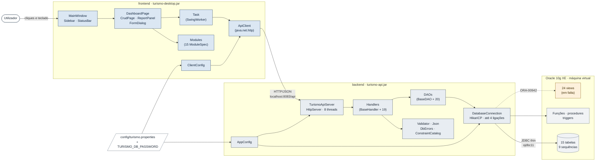

**Leitura do diagrama.** O utilizador interage apenas com a janela (`MainWindow`). Cada ecrã pede dados através de uma `Task`, que corre em segundo plano e usa o `ApiClient` para enviar um pedido HTTP à API. No backend, o `TurismoApiServer` encaminha o pedido para o *handler* da rota, que valida os dados e chama o DAO correspondente. O DAO obtém uma ligação do *pool* (`DatabaseConnection`) e executa SQL ou PL/SQL no Oracle. A seta tracejada para as *views* indica que o código as consulta, mas que na base de dados atual elas não existem e a leitura falha com `ORA-00942`.

### 5.2 Componentes, em linguagem simples

| Componente | Analogia | Responsabilidade real |
|---|---|---|
| `MainWindow` | O balcão de atendimento | Janela principal: barra lateral, área de conteúdo e barra de estado; cria cada ecrã quando é aberto pela primeira vez. |
| `CrudPage` | Um formulário de ficheiro de arquivo, genérico | Ecrã reutilizado pelos 15 módulos; o comportamento vem de um `ModuleSpec`. |
| `Modules` | O catálogo do arquivo | Define declarativamente os 15 módulos (colunas, campos, ações, relatórios). |
| `ApiClient` | O estafeta | Envia pedidos HTTP e converte as respostas JSON ou os erros. |
| `TurismoApiServer` | A receção do edifício | Arranca o servidor HTTP e liga cada rota ao seu *handler*. |
| Handlers | Os técnicos de cada departamento | Interpretam o pedido, validam e decidem a resposta HTTP. |
| `Validator` | O controlo de qualidade | Junta todos os erros de validação, campo a campo. |
| DAOs | Os arquivistas | Sabem o SQL de cada tabela e convertem linhas em objetos. |
| `DatabaseConnection` | A frota de táxis | Mantém e empresta ligações ao Oracle. |
| `DbErrors` | O tradutor | Converte erros `ORA-xxxxx` em mensagens em português com o código HTTP certo. |
| Oracle | O cofre com regras | Guarda os dados e aplica regras com restrições, *triggers* e PL/SQL. |

### 5.3 Percurso geral dos dados

1. **Pedido do utilizador** — o utilizador abre um módulo, pesquisa, grava um formulário ou carrega numa ação.
2. **Interface** — o ecrã (`CrudPage`, `FormDialog`, `DashboardPage`) valida localmente o que puder e cria uma `Task`.
3. **Cliente HTTP** — a `Task` chama o `ApiClient` fora da EDT. O `ApiClient` monta o URL a partir de `api.baseUrl` e envia JSON em UTF-8.
4. **Servidor** — o `HttpServer` do JDK entrega o pedido a uma das 8 *threads* de trabalho, que chama `BaseHandler.handle`.
5. **Handler** — decompõe o caminho em segmentos, escolhe a operação pelo método HTTP, lê e valida o corpo (`Json` + `Validator`).
6. **DAO** — executa SQL (`PreparedStatement`) ou PL/SQL (`CallableStatement`) numa ligação do *pool*. Nas escritas compostas, usa uma transação.
7. **Oracle** — aplica restrições e *triggers*, executa funções e procedimentos e devolve linhas ou erros.
8. **Resposta** — o DAO converte as linhas em *models*; o handler serializa-os com Gson; os erros são traduzidos por `DbErrors` e enviados como `{"error", "code", "fields"}`.
9. **Apresentação** — o `ApiClient` devolve um `JsonArray`/`JsonObject` ou lança uma `ApiException`; a `Task` entrega o resultado na EDT, que atualiza a tabela, o detalhe, um *toast* ou o estado de erro.

### 5.4 Quem faz o quê em cada operação

| Pergunta | Resposta no código |
|---|---|
| Quem inicia a operação? | O utilizador, através de um componente Swing (`CrudPage`, `FormDialog`, `DashboardPage`, `ReportPanel`). O `MainWindow` também inicia uma verificação periódica (`/estado`) a cada 60 s. |
| Quem recebe os dados? | No cliente, o `FormDialog` (lê os controlos). No servidor, o handler da rota (`Request.body(Class)`). |
| Quem valida? | **Três níveis**: (1) `FormDialog.validate` + `ModuleSpec.crossValidation` no cliente; (2) `Validator` no handler; (3) restrições `CHECK`, chaves e *triggers* no Oracle. |
| Quem executa a lógica? | Lógica simples: handlers e DAOs. Lógica de negócio: muitas vezes PL/SQL na base de dados (ex.: `Concluir_Pagamento` gera o recibo, `Regista_Visita` verifica a capacidade). |
| Quem consulta ou altera a BD? | Exclusivamente os DAOs (e `ConstraintCatalog` para ler restrições). |
| Quem transforma os resultados? | Os métodos `map(ResultSet)` de cada DAO (linha → *model*) e a classe `Json` (*model* → JSON). No cliente, `Format` e `RowsTableModel`. |
| Quem devolve a resposta? | `BaseHandler` (`Request.ok`, `created`, `sendError`). |
| O que acontece num erro? | `SQLException` → `DbErrors.translate` → `ApiException` com estado HTTP e código. O handler envia JSON de erro. O `ApiClient` converte-o em `ApiException` do frontend, que a interface mostra como estado de erro, faixa no formulário ou *toast*. Um erro **nunca** é apresentado como lista vazia. |
| Existe camada de serviços? | **Não.** Não há um pacote `service`; os handlers chamam os DAOs diretamente. Parte da lógica de negócio está no PL/SQL. |
| Existe autenticação? | **Não.** A API não tem autenticação nem autorização. Por omissão só escuta em `127.0.0.1` (`api.bindAddress`). |


---

# Parte II — Estrutura do projeto

## 6. Estrutura completa de diretórios

A árvore abaixo reflete os ficheiros encontrados no disco. O código-fonte próprio aparece em detalhe. As pastas geradas pela compilação (`target/`, `out/`, `out_test/`, `backend_out_test/`) estão **resumidas**, porque contêm centenas de ficheiros `.class` e bibliotecas que não são editadas à mão.

```text
Trabalho_turismo/
├── pom.xml                           projeto Maven "pai" (módulos backend e frontend)
├── README.md                         README curto original (execução e configuração)
├── IMPLEMENTATION_PLAN.md            auditoria, decisões e mapa de módulos
├── PROGRESS_CHECKLIST.md             estado de cada módulo
├── RELATORIO_TESTES.md               relatório da execução dos testes
├── executar.sh                       arranque completo em macOS/Linux
├── executar.bat                      arranque completo em Windows
├── .gitignore
├── .claude/settings.json             configuração local do assistente Claude Code
├── turista_diagnosis_workflow.js     ⚠ script de diagnóstico antigo com credenciais
├── TestDB.java · TestDB.class        utilitário antigo de teste de ligação (fora do Maven)
├── TestTuristaDAO.java · .class      utilitário antigo de teste do TuristaDAO (fora do Maven)
├── QueryTurista.class                classe compilada sem código-fonte correspondente
├── src/
│   └── Main.java                     "Hello, World" (modelo de projeto do IDE)
├── config/
│   ├── turismo.properties                    configuração (sem palavras-passe)
│   └── turismo.local.properties.example      modelo para a palavra-passe local
├── database/
│   ├── tabelas.sql                   DDL das 15 tabelas
│   ├── Sequences.sql                 9 sequências
│   ├── Index.sql                     10 índices
│   ├── Inserts.sql                   dados de exemplo
│   ├── functions.sql                 13 funções PL/SQL
│   ├── procedures.sql                16 procedures PL/SQL
│   ├── Triggers.sql                  33 triggers (auditoria, eliminação, validação)
│   ├── views.sql                     24 views
│   ├── Tabelas_de_Historico.sql      15 tabelas de auditoria
│   ├── main.sql                      corre todos os scripts pela ordem certa
│   ├── apagarAtualizar.sql           apaga todos os objetos do projeto e corre main.sql
│   ├── conceder_privilegios.sql      GRANT CREATE VIEW (executado pelo SYSTEM)
│   ├── calculoEspacoPorAtributo.sql  estudo de espaço em disco por atributo
│   └── relatorio_calculo2.txt        saída do estudo de espaço
├── documents/
│   ├── README.md                     ← este documento
│   ├── Grupo 1 - Gestao de Turismo.pdf
│   ├── BD_TP_Grupo1_2026_Fase3.pdf
│   ├── TP_ORIENTAÇÃO_2026 (1).pdf
│   ├── TP_BD1_Fase2_v6.drawio
│   ├── class_diagram.html
│   └── project_plan.html
├── backend/
│   ├── pom.xml                       módulo turismo-api
│   ├── README.md                     referência curta da API
│   ├── compile.sh · run.sh · run_turismo.sh
│   ├── server.log                    último registo da API (gerado por executar.sh)
│   ├── lib/ojdbc11.jar               driver Oracle do processo antigo com javac
│   ├── src/
│   │   ├── main.java                 classe vazia "main" (resto antigo, fora do Maven)
│   │   ├── main/
│   │   │   ├── java/com/turismo/api/
│   │   │   │   ├── TurismoApiServer.java
│   │   │   │   ├── util/      AppConfig, ApiException, ConnectionProvider, ConstraintCatalog,
│   │   │   │   │              DatabaseConnection, DbErrors, Json, Validator
│   │   │   │   ├── dao/       BaseDAO, IdGenerator, PlSqlOutput, SchemaDAO, RelatorioDAO,
│   │   │   │   │              DashboardDAO + 15 DAOs de entidade
│   │   │   │   ├── handler/   BaseHandler, EstadoHandler, DominioHandler, DashboardHandler,
│   │   │   │   │              RelatorioHandler + 15 handlers de entidade
│   │   │   │   └── model/     15 entidades
│   │   │   └── resources/simplelogger.properties
│   │   └── test/java/com/turismo/api/
│   │       ├── dao/PlSqlOutputTest.java
│   │       ├── handler/TuristaHandlerHttpTest.java
│   │       ├── integration/OracleIntegrationTest.java · RollbackConnection.java
│   │       └── util/AppConfigTest · ConstraintCatalogTest · DbErrorsTest · JsonTest · ValidatorTest
│   ├── target/                       [gerado] classes, turismo-api.jar, relatórios de testes
│   ├── out/                          [gerado, antigo] .class do processo javac
│   └── out_test/                     [gerado, antigo] DestinoDAOTest.class
├── backend_out_test/                 [gerado, antigo] DestinoDAOTest.class
├── frontend/
│   ├── pom.xml                       módulo turismo-desktop
│   ├── compile.sh · run.sh
│   ├── src/
│   │   ├── main/
│   │   │   ├── java/com/turismo/frontend/
│   │   │   │   ├── MainApplication.java · MainWindow.java
│   │   │   │   ├── api/       ApiClient, ApiException, ClientConfig
│   │   │   │   ├── modules/   ModuleSpec, ColumnSpec, FieldSpec, ActionSpec, ReportSpec, Page,
│   │   │   │   │              Modules, CrudPage, FormDialog, ReportPanel, RowsTableModel,
│   │   │   │   │              CellRenderer, BadgePainter, Lookups, Format
│   │   │   │   ├── pages/     DashboardPage
│   │   │   │   └── ui/
│   │   │   │       ├── async/       Task
│   │   │   │       ├── theme/       Palette, Theme, Icons
│   │   │   │       └── components/  Badge, BarChart, Card, Scroll, SearchField, Sidebar,
│   │   │   │                        Spinner, StateView, StatusBar, Surface, Toast, UI, WrapText
│   │   │   └── resources/fonts/      IBM Plex Sans (4 pesos) + OFL.txt
│   │   └── test/java/com/turismo/frontend/
│   │       ├── MainWindowUiTest · LiveApplicationE2ETest · StubApi · SwingTestSupport
│   │       ├── api/ApiClientTest
│   │       └── modules/ModulesTest
│   ├── target/                       [gerado] classes, turismo-desktop.jar, screenshots/, relatórios
│   └── out/                          [gerado, antigo] .class dos protótipos removidos
└── demo/                             projeto Maven isolado "Hello world" (sem relação com a app)
    ├── pom.xml
    ├── src/main/java/com/example/Main.java
    └── target/                       [gerado]
```

> [!note] Pastas resumidas
> `backend/target`, `frontend/target`, `demo/target`, `backend/out`, `backend/out_test`, `frontend/out` e `backend_out_test` contêm apenas resultados de compilação. As pastas `out*` são do processo antigo com `javac` e contêm 58 ficheiros `.class` desatualizados, incluindo classes de protótipos que já não existem no código-fonte (ex.: `DashboardPanel`, `DestinoPanel`). O `.gitignore` exclui `target/`, `out/` e `*.class`.

---

## 7. Explicação das pastas e dos ficheiros

Legenda da coluna **Natureza**: **Código** (código-fonte próprio) · **Config** (configuração) · **Recurso** (ficheiros usados em execução) · **Biblioteca** (código de terceiros) · **Gerado** (produzido pela compilação) · **Documentação** · **Resto antigo** (não usado pela aplicação atual).

### 7.1 Raiz do projeto

| Caminho | Natureza | Finalidade | Estado |
|---|---|---|---|
| `pom.xml` | Config | Projeto Maven **agregador** (`packaging pom`). Declara os módulos `backend` e `frontend`, fixa Java 21, UTF-8 e as versões de todas as dependências (`dependencyManagement`) e *plugins* (`pluginManagement`). | Concluído |
| `README.md` | Documentação | README original, curto: requisitos, configuração, execução, estado da BD e atalhos de teclado. | Concluído |
| `IMPLEMENTATION_PLAN.md` | Documentação | Auditoria do projeto antes da reestruturação, decisões tomadas e mapa de cada módulo (que função/procedure/SQL é usada em cada operação). | Concluído; ver discrepância no [§19](#19.%20Problemas%20conhecidos) |
| `PROGRESS_CHECKLIST.md` | Documentação | Lista de verificação do estado por módulo (✅/🟡/⛔). | Concluído |
| `RELATORIO_TESTES.md` | Documentação | Relatório da execução de testes de 20-10-2026 (91 testes). | Concluído |
| `executar.sh` / `executar.bat` | Código (script) | Arranque completo: compilam se faltar algum `.jar`, arrancam a API se não estiver a correr e abrem a aplicação. Detalhes no [§17](#17.%20Compilação%20e%20execução). | `.sh` testado; `.bat` não testado |
| `.gitignore` | Config | Exclui `target/`, `out/`, `*.class`, `config/turismo.local.properties`, ficheiros de IDE, `.DS_Store` e `backend/server.log`. | Concluído |
| `.claude/settings.json` | Config | Lista de *plugins* ativos do Claude Code. Não afeta a aplicação. | Não aplicável |
| `turista_diagnosis_workflow.js` | Resto antigo | Script de um fluxo de diagnóstico ("porque é que `/api/turistas` devolve lista vazia"). **Contém credenciais em texto simples.** Não é usado pela aplicação. | Deve ser removido (ver [C1](#21.1%20Prioridade%20crítica)) |
| `TestDB.java`, `TestTuristaDAO.java` | Resto antigo | Programas `main` de diagnóstico: o primeiro abre uma ligação e lista as colunas de `TURISTA`; o segundo chama `TuristaDAO.getAllTuristas()`. Estão fora das pastas do Maven, por isso não são compilados nem executados pelo `mvn`. Continuam compatíveis com as assinaturas atuais. | Não utilizado |
| `*.class` na raiz | Gerado (antigo) | `TestDB.class`, `TestTuristaDAO.class` e `QueryTurista.class` (este último **sem código-fonte**). | Não utilizado |
| `src/Main.java` | Resto antigo | Classe "Hello, World" criada pelo modelo de projeto do IDE. | Não utilizado |

### 7.2 config/

**Finalidade:** guardar a configuração externa partilhada pelo backend e pelo frontend, fora do código, para mudar endereços e limites sem recompilar.

| Ficheiro | Conteúdo | Quem o lê |
|---|---|---|
| `turismo.properties` | Ligação Oracle (`db.host`, `db.port`, `db.service`/`db.sid`, `db.user`, *timeouts*, `db.poolSize`), porta da API (`api.port`) e configuração do cliente (`api.baseUrl`, `api.timeoutSeconds`). **Não contém palavra-passe** (há um teste que o garante: `AppConfigTest.ficheiroDeConfiguracaoDoProjetoNaoTemPalavraPasse`). | `AppConfig` (backend), `ClientConfig` (frontend), `executar.sh/.bat` e `run_turismo.sh` (só `api.port`) |
| `turismo.local.properties.example` | Modelo com a chave `db.password=` vazia. Deve ser copiado para `turismo.local.properties` (excluído do Git) se não se quiser usar a variável de ambiente. | Ninguém (é só um modelo) |

**Relações:** o Maven passa o caminho desta pasta aos testes e ao `exec:java` através da propriedade `turismo.config.dir`. Os `.jar` encontram-na procurando `./config` e `../config` a partir da pasta atual.
**Importância:** essencial; sem ela a API não sabe a que base de dados ligar (usa `localhost` e falha por falta de `db.service`/`db.sid`).
**Estado:** concluído.

> [!caution] Configuração sensível
> A palavra-passe da base de dados vem da variável de ambiente `TURISMO_DB_PASSWORD` ou do ficheiro `config/turismo.local.properties`. Nunca deve ser colocada em `turismo.properties` nem em qualquer ficheiro versionado.

### 7.3 database/

**Finalidade:** scripts SQL e PL/SQL do trabalho prático de Base de Dados I, que definem e populam o esquema Oracle. A aplicação Java **não executa** estes scripts; usa o esquema que eles criaram. São a fonte de verdade das regras (tamanhos, valores permitidos, chaves).

| Ficheiro | Conteúdo | Relação com o Java |
|---|---|---|
| `tabelas.sql` | `DROP` + `CREATE` das 15 tabelas, com chaves primárias e estrangeiras e restrições `CHECK`. | Os *models*, os DAOs e o `Validator` seguem estas definições. |
| `Sequences.sql` | 9 sequências (`ID_destino`, `ID_atracao`, `ID_turista`, `ID_reserva`, `ID_operador`, `ID_alojamento`, `ID_transporte`, `ID_pagamento`, `ID_recibo`), com `MAXVALUE 999`. | `IdGenerator` usa as 8 primeiras; `ID_recibo` é usada pela função `Concluir_Pagamento`. |
| `Index.sql` | 10 índices sobre chaves estrangeiras. | Indireta (desempenho). |
| `Inserts.sql` | Dados de exemplo (destinos, atrações, turistas…), com códigos gerados por sequência. | Indireta. O formato do código (prefixo `DT-` seguido de `LPAD(seq.NEXTVAL, 3, '0')`) foi copiado por `IdGenerator`. |
| `functions.sql` | 13 funções (ex.: `Insere_Turista`, `Regista_Visita`, `Concluir_Pagamento`). | 11 são chamadas pelos DAOs (ver [§14.7](#14.7%20Funções%20e%20procedures%20usadas%20pelo%20Java)). |
| `procedures.sql` | 16 procedures (ex.: `associar_operador_turista`, `cancelar_reserva`). | 9 são chamadas através de `PlSqlOutput`. |
| `Triggers.sql` | 15 *triggers* de auditoria, 6 de eliminação em cascata e 12 de validação. | Afetam diretamente as escritas da API. |
| `views.sql` | 24 *views* de consulta e verificação. | `RelatorioDAO.VIEWS` lista exatamente estas 24. |
| `Tabelas_de_Historico.sql` | 15 tabelas `auditoria_*`. | Nenhuma (segundo a auditoria documentada, não existem na BD). |
| `main.sql`, `apagarAtualizar.sql`, `conceder_privilegios.sql` | Correm os scripts corrigidos pela ordem certa; apagam e recriam tudo; dão o privilégio CREATE VIEW. O antigo `correcoes.sql` foi removido: as correções passaram para `Triggers.sql` e `procedures.sql` (marcadas com `NOTA`). | Correções aplicadas em 21-10-2026 (0 objetos inválidos); as views esperam pelo `GRANT CREATE VIEW` de `conceder_privilegios.sql`. |
| `calculoEspacoPorAtributo.sql` | Bloco PL/SQL que estima o espaço em disco por atributo e por tabela, para uma projeção de linhas. | Nenhuma (estudo académico). |
| `relatorio_calculo2.txt` | Saída do estudo anterior (SQL*Plus). | Nenhuma. |

**Importância:** fundamental para compreender as regras de negócio. **Estado:** os scripts existem; o estado da sua aplicação na BD está descrito no [§14.8](#14.8%20Estado%20real%20da%20base%20de%20dados).

### 7.4 documents/

**Finalidade:** documentação académica e de planeamento do trabalho prático. **Natureza:** documentação (não é lida pela aplicação).

| Ficheiro | Conteúdo (pelo nome e título) |
|---|---|
| `TP_ORIENTAÇÃO_2026 (1).pdf` | Enunciado/orientações do trabalho prático |
| `Grupo 1 - Gestao de Turismo.pdf` | Documento do grupo sobre o tema |
| `BD_TP_Grupo1_2026_Fase3.pdf` | Relatório da fase 3 do trabalho de Base de Dados |
| `TP_BD1_Fase2_v6.drawio` | Diagrama (modelo de dados) da fase 2, editável no draw.io |
| `class_diagram.html` | Página HTML "Diagrama de Classes — Sistema de Gestão de Turismo" |
| `project_plan.html` | Página HTML "Plano do Projeto — Trabalho de Turismo" |
| `README.md` | Este manual técnico |

> [!note] Não verificado
> O conteúdo dos PDF, do `.drawio` e das páginas HTML não foi analisado em detalhe para este documento. As páginas HTML podem refletir uma fase anterior do projeto, por isso não substituem o diagrama de classes do [§12](#12.%20Relações%20e%20dependências%20entre%20classes).

### 7.5 backend/

**Finalidade:** módulo Maven `turismo-api`. Contém a API REST que liga a aplicação desktop ao Oracle. **Natureza:** código, configuração, recursos e resultados gerados.

| Subpasta / ficheiro | Natureza | Finalidade |
|---|---|---|
| `pom.xml` | Config | Dependências `ojdbc11`, `gson`, `HikariCP`, `slf4j-simple` e `junit-jupiter` (testes). O `maven-shade-plugin` cria um `.jar` executável com tudo incluído (`mainClass = com.turismo.api.TurismoApiServer`). O `surefire` e o `exec` recebem `turismo.config.dir`. |
| `README.md` | Documentação | Referência rápida da API (convenções, códigos HTTP, rotas). |
| `compile.sh` | Script | Vai para a raiz e corre `mvn -q -DskipTests package` (compila **os dois** módulos). Igual a `frontend/compile.sh`. |
| `run.sh` | Script | Vai para a raiz e corre `java -jar backend/target/turismo-api.jar`. |
| `run_turismo.sh` | Script | Verifica `TURISMO_DB_PASSWORD`, termina um servidor anterior na porta, compila só o backend (`-pl backend -am`) e arranca a API. |
| `server.log` | Gerado | Saída da última API arrancada por `executar.sh`. É a melhor evidência do estado da BD (16 objetos inválidos, 24 *views* em falta). Excluído do Git. |
| `lib/ojdbc11.jar` | Biblioteca (antiga) | Driver Oracle usado no tempo da compilação com `javac`. O Maven **não** o usa (descarrega o mesmo driver do Maven Central). |
| `src/main/java/com/turismo/api/` | Código | Código da API, organizado em `util`, `dao`, `handler`, `model` (ver [§8](#8.%20Organização%20por%20camadas%20e%20pacotes)). |
| `src/main/resources/simplelogger.properties` | Recurso | Configura o SLF4J Simple: só avisos e erros (usado pelo HikariCP), com hora `HH:mm:ss`. |
| `src/test/java/com/turismo/api/` | Código (testes) | Testes unitários, HTTP e de integração com o Oracle. |
| `src/main.java` | Resto antigo | Classe vazia `public class main {}`, fora das pastas do Maven. |
| `target/` | Gerado | `classes/`, `test-classes/`, `turismo-api.jar` (executável), `original-turismo-api.jar`, `surefire-reports/`. |
| `out/`, `out_test/` | Gerado (antigo) | `.class` da compilação antiga com `javac`. Desatualizados. |

**Importância:** essencial — sem a API a aplicação desktop não mostra dados. **Estado:** implementado e testado (91 testes no total do projeto, 63 no backend).

### 7.6 frontend/

**Finalidade:** módulo Maven `turismo-desktop`, a aplicação gráfica Swing. **Natureza:** código, recursos e resultados gerados.

| Subpasta / ficheiro | Natureza | Finalidade |
|---|---|---|
| `pom.xml` | Config | Dependências `gson`, `flatlaf`, `ikonli-swing`, `ikonli-materialdesign2-pack` e `junit-jupiter`. O *shade* cria `turismo-desktop.jar` com `mainClass = com.turismo.frontend.MainApplication` e `Enable-Native-Access: ALL-UNNAMED` (evita um aviso do FlatLaf em Java 22+). |
| `compile.sh` / `run.sh` | Script | `compile.sh` compila os dois módulos; `run.sh` abre `frontend/target/turismo-desktop.jar` (a API tem de estar a correr). |
| `src/main/java/com/turismo/frontend/` | Código | Janela, cliente HTTP, módulos, páginas e componentes visuais. |
| `src/main/resources/fonts/` | Recurso | Fonte IBM Plex Sans (Regular, Medium, SemiBold, Bold) e a licença `OFL.txt`. Incluída no `.jar` para o aspeto ser igual em qualquer sistema. |
| `src/test/java/com/turismo/frontend/` | Código (testes) | Testes do cliente HTTP, dos módulos, da janela real com API falsa e ponta a ponta. |
| `target/screenshots/` | Gerado | 21 capturas PNG produzidas pelos testes de interface (painel, cada módulo, tema escuro, formulários). |
| `target/` (resto) | Gerado | `turismo-desktop.jar`, classes, relatórios Surefire. |
| `out/` | Gerado (antigo) | `.class` dos protótipos removidos (`DashboardPanel`, `BasePanel`, `DestinoPanel`, `ReservaPanel`, `TuristaPanel`). |

**Importância:** essencial. **Estado:** implementado; testado em macOS; não testado em Windows.

> [!tip] Ver a interface sem executar
> As capturas em `frontend/target/screenshots/` mostram cada ecrã (por exemplo `00-painel.png`, `01-destinos.png`, `30-formulario-destino.png`). Como estão em `target/`, desaparecem com `mvn clean` e são recriadas pelos testes de interface.

### 7.7 demo/

**Finalidade:** projeto Maven independente (`com.example:demo`, Java 17) com uma classe `Main` que escreve "Hello world!". **Não é módulo** do `pom.xml` raiz nem é usado pela aplicação. Provavelmente foi criado por um IDE. **Estado:** resto antigo, não utilizado.

### 7.8 backend_out_test/

**Finalidade:** contém apenas `com/turismo/api/dao/DestinoDAOTest.class`, compilado do antigo teste `DestinoDAOTest` (removido do código-fonte por não compilar). **Estado:** resto antigo, não utilizado.

---

## 8. Organização por camadas e pacotes

### 8.1 Camadas reais

O backend segue uma organização em camadas **simples e explícita**: *handler* (HTTP) → DAO (dados) → Oracle, com utilitários transversais. Não existe camada de serviços. O frontend está organizado por responsabilidade visual: janela, módulos genéricos, páginas, componentes e tema.

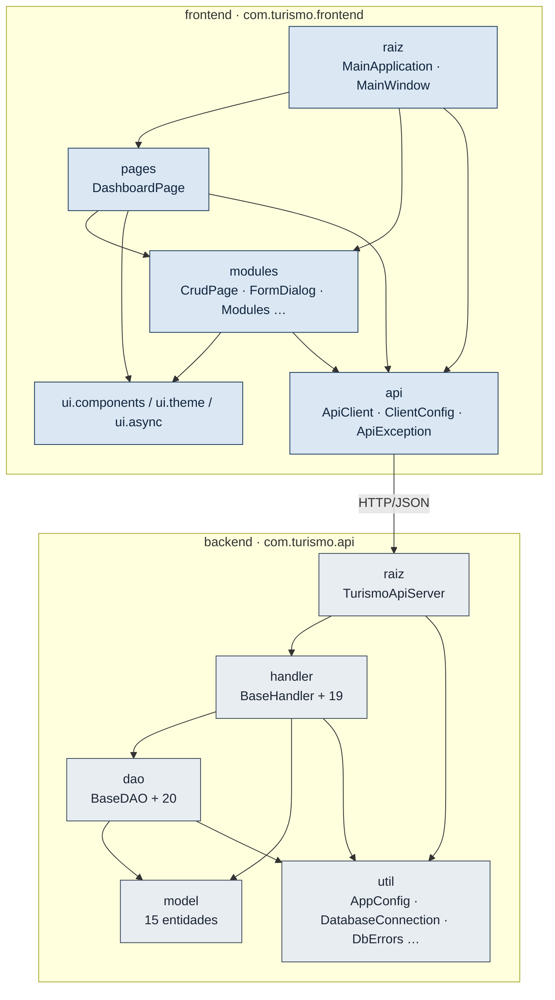

As setas indicam "usa" (dependência de compilação). Os dois módulos **não partilham código Java**: o frontend conhece o backend apenas pelo contrato JSON (nomes dos campos dos *models*, formato das respostas e dos erros).

### 8.2 Pacotes do backend (com.turismo.api)

| Pacote | Classes | Responsabilidade | Depende de |
|---|---|---|---|
| `com.turismo.api` | `TurismoApiServer` | Ponto de entrada da API: cria o `HttpServer`, regista as rotas, mostra o estado da BD no arranque | `handler`, `dao.SchemaDAO`, `util` |
| `…api.handler` | `BaseHandler`, `EstadoHandler`, `DominioHandler`, `DashboardHandler`, `RelatorioHandler` + 15 handlers de entidade | Camada HTTP: rotas, métodos, validação, códigos de resposta | `dao`, `model`, `util`, `com.sun.net.httpserver` |
| `…api.dao` | `BaseDAO`, `IdGenerator`, `PlSqlOutput`, `SchemaDAO`, `RelatorioDAO`, `DashboardDAO` + 15 DAOs de entidade | Acesso a dados: SQL, PL/SQL, transações, conversão para *models* | `model`, `util`, `java.sql` |
| `…api.model` | 15 classes | Representação Java das linhas das tabelas (POJO) | `java.math`, `java.time` |
| `…api.util` | `AppConfig`, `DatabaseConnection`, `ConnectionProvider`, `ApiException`, `DbErrors`, `ConstraintCatalog`, `Validator`, `Json` | Configuração, *pool* de ligações, erros, validação, JSON | HikariCP, Gson |

### 8.3 Pacotes do frontend (com.turismo.frontend)

| Pacote | Classes | Responsabilidade |
|---|---|---|
| `com.turismo.frontend` | `MainApplication`, `MainWindow` | Arranque e janela principal |
| `…frontend.api` | `ApiClient`, `ApiException`, `ClientConfig` | Comunicação HTTP com o backend |
| `…frontend.modules` | `ModuleSpec`, `ColumnSpec`, `FieldSpec`, `ActionSpec`, `ReportSpec`, `Page`, `Modules`, `CrudPage`, `FormDialog`, `ReportPanel`, `RowsTableModel`, `CellRenderer`, `BadgePainter`, `Lookups`, `Format` | Ecrã genérico de CRUD orientado por especificações declarativas |
| `…frontend.pages` | `DashboardPage` | Painel inicial |
| `…frontend.ui.async` | `Task` | Execução de pedidos fora da EDT |
| `…frontend.ui.theme` | `Palette`, `Theme`, `Icons` | Cores, fontes, ícones, tema claro/escuro |
| `…frontend.ui.components` | `Badge`, `BarChart`, `Card`, `Scroll`, `SearchField`, `Sidebar`, `Spinner`, `StateView`, `StatusBar`, `Surface`, `Toast`, `UI`, `WrapText` | Componentes visuais reutilizáveis (pequeno *design system*) |

### 8.4 Padrões de desenho efetivamente usados

| Padrão | Onde | Para quê |
|---|---|---|
| **Template Method** | `BaseHandler.handle` chama o método abstrato `route`; `BaseDAO` fornece `query`/`update`/`inTransaction` às subclasses | Centralizar o tratamento de erros HTTP e o JDBC repetitivo |
| **DAO** | Pacote `dao` | Isolar o SQL |
| **Singleton preguiçoso** (*lazy*, com *double-checked locking*) | `AppConfig.get()`, `DatabaseConnection.pool()` | Ler a configuração e criar o *pool* uma só vez, no primeiro uso |
| **Interface funcional / injeção de dependências manual** | `ConnectionProvider`, construtores dos DAOs e handlers | Permitir aos testes substituir a origem das ligações (ex.: `RollbackConnection`) ou o DAO (ex.: `FakeDAO`) |
| **Builder fluente** | `ModuleSpec`, `FieldSpec`, `Validator` | Descrever módulos e validações de forma legível |
| **Especificação declarativa + componente genérico** | `Modules` + `CrudPage` + `FormDialog` | Um único ecrã serve 15 tabelas |
| **Fábrica estática** | `ApiException.notFound/badRequest/…`, `FieldSpec.text/integer/…`, `UI.primary/…` | Criar objetos padronizados |


---

# Parte III — O código, classe a classe

### Índice de classes

**Backend** (`backend/src/main/java/com/turismo/api/…`)

| Pacote | Classes |
|---|---|
| raiz | [TurismoApiServer](#TurismoApiServer) |
| `util` | [AppConfig](#AppConfig) · [DatabaseConnection](#DatabaseConnection) · [ConnectionProvider](#ConnectionProvider) · [ApiException do backend](#ApiException%20do%20backend) · [DbErrors](#DbErrors) · [ConstraintCatalog](#ConstraintCatalog) · [Validator](#Validator) · [Json](#Json) |
| `dao` (infraestrutura) | [BaseDAO](#BaseDAO) · [IdGenerator](#IdGenerator) · [PlSqlOutput](#PlSqlOutput) · [SchemaDAO](#SchemaDAO) · [RelatorioDAO](#RelatorioDAO) · [DashboardDAO](#DashboardDAO) |
| `dao` (entidades) | [DestinoDAO](#DestinoDAO) · [AtracaoDAO](#AtracaoDAO) · [AlojamentoDAO](#AlojamentoDAO) · [TipoAlojamentoDAO](#TipoAlojamentoDAO) · [TransporteDAO](#TransporteDAO) · [TuristaDAO](#TuristaDAO) · [TuristaPreferenciaDAO](#TuristaPreferenciaDAO) · [OperadorDAO](#OperadorDAO) · [ReservaDAO](#ReservaDAO) · [PagamentoDAO](#PagamentoDAO) · [TuristaDestinoDAO](#TuristaDestinoDAO) · [ReservaAlojamentoDAO](#ReservaAlojamentoDAO) · [OperadorTuristaDAO](#OperadorTuristaDAO) · [OperadorTransporteDAO](#OperadorTransporteDAO) · [OperadorAlojamentoDAO](#OperadorAlojamentoDAO) |
| `handler` (infraestrutura) | [BaseHandler](#BaseHandler) · [EstadoHandler](#EstadoHandler) · [DominioHandler](#DominioHandler) · [DashboardHandler](#DashboardHandler) · [RelatorioHandler](#RelatorioHandler) |
| `handler` (entidades) | [Handlers de entidade](#9.6%20Handlers%20de%20entidade) (15 classes) |
| `model` | [Models](#9.7%20Models) (15 classes) |

**Frontend** (`frontend/src/main/java/com/turismo/frontend/…`)

| Pacote | Classes |
|---|---|
| raiz | [MainApplication](#MainApplication) · [MainWindow](#MainWindow) |
| `api` | [ApiClient](#ApiClient) · [ApiException do frontend](#ApiException%20do%20frontend) · [ClientConfig](#ClientConfig) |
| `modules` | [Page](#Page) · [ModuleSpec](#ModuleSpec) · [ColumnSpec](#ColumnSpec) · [FieldSpec](#FieldSpec) · [ActionSpec](#ActionSpec) · [ReportSpec](#ReportSpec) · [Modules](#Modules) · [CrudPage](#CrudPage) · [FormDialog](#FormDialog) · [ReportPanel](#ReportPanel) · [RowsTableModel](#RowsTableModel) · [CellRenderer](#CellRenderer) · [BadgePainter](#BadgePainter) · [Lookups](#Lookups) · [Format](#Format) |
| `pages` | [DashboardPage](#DashboardPage) |
| `ui.async` | [Task](#Task) |
| `ui.theme` | [Palette](#Palette) · [Theme](#Theme) · [Icons](#Icons) |
| `ui.components` | [Componentes visuais](#10.7%20Componentes%20visuais) (13 classes) |

**Testes e código auxiliar:** ver o [capítulo 11](#11.%20Classes%20de%20teste%20e%20código%20auxiliar).

## 9. Classes do backend

Todas as classes do backend estão em `backend/src/main/java/com/turismo/api/`. Os caminhos abaixo são relativos a essa pasta, salvo indicação em contrário.

### 9.1 Ponto de entrada

#### TurismoApiServer

| | |
|---|---|
| **Localização** | `backend/src/main/java/com/turismo/api/TurismoApiServer.java` |
| **Pacote** | `com.turismo.api` |
| **Tipo** | Classe concreta com método `main` |
| **Objetivo** | Arrancar a API REST: testar a base de dados, criar o servidor HTTP e associar cada rota ao seu *handler*. |
| **Responsabilidade** | Ponto de entrada do `turismo-api.jar` (definido no `maven-shade-plugin`). |

**Atributos**

| Atributo | Tipo | Finalidade |
|---|---|---|
| `ENDPOINTS` | `static final String[]` | Lista das 19 rotas base, usada **apenas** para as escrever na consola no arranque. |
| `server` | `HttpServer` | Servidor HTTP do JDK (`com.sun.net.httpserver`). |
| `executor` | `ExecutorService` | *Pool* fixo de 8 *threads daemon* chamadas `api-worker`, que atendem pedidos em paralelo. |
| `port` | `int` | Porta efetiva (útil quando se pede a porta 0, que escolhe uma livre). |

**Construtores**

- `TurismoApiServer()` — lê `api.port` (por omissão 8083) e `api.bindAddress` (por omissão `127.0.0.1`) de `AppConfig` e delega no construtor seguinte.
- `TurismoApiServer(int port, String bindAddress)` — cria o `HttpServer`, regista 19 contextos com `createContext(caminho, handler)` (um objeto *handler* por contexto), cria o *pool* de 8 *threads* e escreve "Turismo API Server initialized on …". Uma `IOException` (por exemplo, porta ocupada) é relançada como `RuntimeException`.

**Métodos**

| Assinatura | O que faz |
|---|---|
| `void start()` | Arranca o servidor e escreve a lista de rotas. |
| `void stop()` | Para o servidor (`stop(0)`), encerra o *executor* e espera até 2 s. |
| `int getPort()` | Devolve a porta efetiva. |
| `static void printDatabaseStatus()` | Escreve a pasta de configuração e a descrição da ligação (sem palavra-passe), chama `SchemaDAO.status()` e lista os objetos INVALID e as *views* em falta. Uma `SQLException` é traduzida por `DbErrors` e escrita em `System.err`; **não impede** o arranque. |
| `static void main(String[] args)` | (1) `printDatabaseStatus()`; (2) cria e arranca o servidor; (3) regista um *shutdown hook* que para o servidor e fecha o *pool* (`DatabaseConnection.shutdown()`). |

**Dependências:** todos os handlers, `SchemaDAO`, `AppConfig`, `DbErrors`, `DatabaseConnection`.
**Relações:** é usado apenas pela JVM (ponto de entrada). Nenhuma classe o instancia, exceto os testes HTTP, que criam o seu próprio `HttpServer`.

**Exemplo de utilização**

```bash
# a partir da raiz do projeto, com a palavra-passe definida
java -jar backend/target/turismo-api.jar
# ou, para outra porta
java -Dapi.port=9090 -jar backend/target/turismo-api.jar
```

**Estado:** implementado; o arranque está documentado em `backend/server.log`.
**Limitações e observações:**
- A lista `ENDPOINTS` duplica os caminhos registados com `createContext`; quem acrescentar uma rota tem de atualizar os dois sítios.
- As mensagens de arranque estão parte em inglês e parte em português.
- Pedidos a caminhos sem contexto registado (ex.: `/api/inexistente`) recebem a resposta 404 por omissão do `HttpServer`, que não é JSON.

---

### 9.2 Pacote util

#### AppConfig

| | |
|---|---|
| **Localização** | `util/AppConfig.java` |
| **Pacote** | `com.turismo.api.util` |
| **Tipo** | Classe `final`, *singleton* preguiçoso |
| **Objetivo** | Ler a configuração externa uma única vez e oferecer valores tipados. |
| **Responsabilidade** | Fonte única de configuração do backend: ligação Oracle, porta da API, *timeouts*, palavra-passe. |

**Funcionamento interno**

1. `get()` usa *double-checked locking* sobre o campo `volatile instance`: a primeira chamada executa `load()`; as seguintes devolvem o mesmo objeto.
2. `load()` procura a pasta de configuração (`findConfigDir()`), carrega `turismo.properties` e depois `turismo.local.properties` (que sobrepõe o primeiro) e, por fim, copia as propriedades de sistema começadas por `db.` ou `api.` (`-Dchave=valor`), que têm prioridade máxima.
3. `findConfigDir()` procura, por ordem: `-Dturismo.config.dir`, variável `TURISMO_CONFIG_DIR`, `./config`, `../config` (estas duas só se contiverem `turismo.properties`).
4. Os ficheiros são lidos em UTF-8 (`readInto`).

**Atributos:** `PASSWORD_ENV = "TURISMO_DB_PASSWORD"`; `instance` (`volatile`); `props` (`Properties`); `configDir` (`Path`, pode ser `null`).

**Construtor:** `AppConfig(Properties, Path)` — visível no pacote, usado por `load()` e pelos testes (`AppConfigTest`).

**Métodos**

| Assinatura | Devolve | Notas |
|---|---|---|
| `static AppConfig get()` | instância única | — |
| `String get(String key, String defaultValue)` | valor sem espaços nas pontas, ou o valor por omissão se faltar ou estiver vazio | — |
| `int getInt(String key, int defaultValue)` | inteiro | Valor não numérico → `IllegalStateException("Valor inválido para …")` |
| `String dbPassword()` | palavra-passe | Variável de ambiente primeiro, depois `db.password` |
| `String dbHost()` / `int dbPort()` / `String dbUser()` | — | Omissões: `localhost`, `1521`, `null` |
| `String jdbcUrl()` | URL JDBC | Com `db.service`: `jdbc:oracle:thin:@//host:porta/serviço`; com `db.sid`: `jdbc:oracle:thin:@host:porta:sid`; sem nenhum → `IllegalStateException` |
| `String describeDatabase()` | `utilizador@host:porta/serviço` | Nunca inclui a palavra-passe (testado) |
| `Path configDir()` | pasta usada | Mostrada no arranque |

**Dependências:** apenas JDK. **Relações:** usada por `DatabaseConnection`, `TurismoApiServer`, `BaseDAO.queryTimeout()`.

**Exemplo** (do teste `AppConfigTest`):

```java
AppConfig c = config("db.host", "10.0.0.5", "db.port", "1522", "db.service", "XE");
c.jdbcUrl();   // "jdbc:oracle:thin:@//10.0.0.5:1522/XE"
```

**Estado:** implementado e testado (5 testes).
**Observações:** a configuração é lida uma vez; alterar `turismo.properties` exige reiniciar a API.

#### DatabaseConnection

| | |
|---|---|
| **Localização** | `util/DatabaseConnection.java` |
| **Pacote** | `com.turismo.api.util` |
| **Tipo** | Classe concreta com membros estáticos |
| **Objetivo** | Fornecer ligações JDBC ao Oracle através de um *pool* HikariCP. |
| **Responsabilidade** | Única classe que cria ligações à base de dados. |

**Funcionamento interno**

1. **Bloco estático** (executa quando a classe é carregada): define o *locale* da JVM como `pt_PT` (o Oracle não reconhece `pt_MZ` e responderia `ORA-12705`) e várias propriedades do driver Oracle, entre elas `oracle.jdbc.timezoneAsRegion=false` (sem isto o Oracle 10g responde `ORA-01882`).
2. `getConnection()` devolve `pool().getConnection()`. **Fechar** a ligação devolve-a ao *pool*; não a fecha fisicamente.
3. `pool()` cria o *pool* na primeira chamada (*double-checked locking*).
4. `createPool(AppConfig)`:
   1. Sem palavra-passe → `SQLException` com estado `08001` e código interno `DbErrors.NO_PASSWORD` (99001).
   2. Sem `db.user` → mesma exceção.
   3. Configura o HikariCP: nome `turismo-oracle`, driver `oracle.jdbc.OracleDriver`, URL de `AppConfig.jdbcUrl()`, `CONNECT_TIMEOUT` = `db.connectTimeoutSeconds` (8 s), `ReadTimeout` = `db.queryTimeoutSeconds` + 5 s, máximo `db.poolSize` (4) ligações, mínimo inativo 0, ligações inativas fechadas ao fim de 120 s e renovadas ao fim de 10 min, `autoCommit=true`.
   4. `initializationFailTimeout = -1`: a API **arranca mesmo que a máquina virtual esteja desligada**; a ligação é tentada no primeiro pedido.

**Métodos:** `static Connection getConnection() throws SQLException` · `static void shutdown()` (fecha o *pool*; chamado no *shutdown hook*) · `static void closeConnection(Connection)` (fecha e regista o erro; **não é usado** no código atual, mantido por compatibilidade).

**Dependências:** HikariCP, driver Oracle, `AppConfig`, `DbErrors`. **Relações:** é a implementação de `ConnectionProvider.DEFAULT`; usada indiretamente por todos os DAOs e diretamente por `ConstraintCatalog.describe` e pelos testes de integração.

**Exemplo** (do utilitário antigo `TestDB.java`):

```java
try (Connection conn = DatabaseConnection.getConnection()) {
    DatabaseMetaData meta = conn.getMetaData();   // a ligação volta ao pool no fim do try
}
```

**Estado:** implementado e testado contra o Oracle real.
**Observações:** o *pool* pequeno (4) é intencional: o Oracle 10g XE tem poucos processos e uma ligação por pedido esgotava o *listener* (`ORA-12516`, registado em `RELATORIO_TESTES.md`). O bloco estático altera o *locale* e a propriedade `user.timezone` da JVM inteira.

#### ConnectionProvider

| | |
|---|---|
| **Localização** | `util/ConnectionProvider.java` |
| **Tipo** | Interface funcional (`@FunctionalInterface`) |
| **Objetivo** | Abstrair "de onde vem uma ligação", para que os testes possam injetar outra fonte. |

**Membros:** `Connection get() throws SQLException`; constante `DEFAULT = DatabaseConnection::getConnection`.
**Relações:** recebida pelos construtores de todos os DAOs (`BaseDAO`) e handlers (`BaseHandler`). Os testes de integração passam `RollbackConnection.provider()`, que devolve sempre a mesma ligação transacional; o `TuristaHandlerHttpTest` passa uma *lambda* que lança exceção.
**Estado:** implementado.

#### ApiException do backend

| | |
|---|---|
| **Localização** | `util/ApiException.java` |
| **Tipo** | Classe concreta, estende `RuntimeException` (exceção não verificada) |
| **Objetivo** | Representar um erro já pronto para ser devolvido ao cliente: estado HTTP, código e mensagem em português. |

**Atributos:** `status` (`int`, código HTTP), `code` (`String`, ex.: `NAO_ENCONTRADO`), `fields` (`Map<String,String>` imutável, erros por campo).
**Construtores:** `(status, code, message)`, `(status, code, message, cause)`, `(status, code, message, fields, cause)`.
**Fábricas estáticas:** `notFound` → 404 `NAO_ENCONTRADO`; `badRequest` → 400 `PEDIDO_INVALIDO`; `conflict` → 409 `CONFLITO`; `rule` → 422 `REGRA_NEGOCIO`.
**Relações:** criada por `DbErrors`, `Validator`, `Json`, DAOs e handlers; apanhada por `BaseHandler.handle`, que a converte em JSON.
**Estado:** implementado.

#### DbErrors

| | |
|---|---|
| **Localização** | `util/DbErrors.java` |
| **Tipo** | Classe utilitária `final` (só métodos estáticos) |
| **Objetivo** | Traduzir erros Oracle (`SQLException`, `ORA-xxxxx`) em `ApiException` com mensagens em português e o estado HTTP adequado, sem expor credenciais nem detalhes da ligação. |

**Método principal — `static ApiException translate(SQLException e)`**

1. Obtém o código de erro (`getErrorCode()`); se for 0, extrai-o do texto com a expressão `ORA-(\d{5})`.
2. Decide pela ordem seguinte:

| Condição | HTTP | Código | Mensagem (resumo) |
|---|---|---|---|
| código 99001 (sem palavra-passe) | 503 | `BD_SEM_CREDENCIAIS` | mensagem original |
| problema de ligação (ver abaixo) | 503 | `BD_INDISPONIVEL` | "Sem ligação à base de dados Oracle…" |
| `SQLTimeoutException` ou ORA-01013 | 504 | `BD_TEMPO_ESGOTADO` | "A base de dados demorou demasiado…" |
| ORA-20000 a ORA-20999 (erros de aplicação dos *triggers*/PL/SQL) | 422 | `REGRA_BD` | o texto que o PL/SQL escreveu |
| ORA-00001 | 409 | `CHAVE_DUPLICADA` | "Já existe um registo com esta chave." |
| ORA-01017 | 503 | `BD_CREDENCIAIS_INVALIDAS` | — |
| ORA-01400 | 422 | `CAMPO_OBRIGATORIO` | — |
| ORA-01438 | 422 | `NUMERO_DEMASIADO_GRANDE` | — |
| ORA-02290 (CHECK) | 422 | `REGRA_VIOLADA` | inclui o texto da restrição, lido por `ConstraintCatalog.describe` |
| ORA-02291 | 422 | `REFERENCIA_INEXISTENTE` | — |
| ORA-02292 | 409 | `TEM_DEPENDENTES` | — |
| ORA-04091 | 500 | `TABELA_MUTANTE` | inclui o nome do *trigger* |
| ORA-04098 | 503 | `TRIGGER_INVALIDO` | inclui o nome do *trigger* e manda aplicar `correcoes.sql` |
| ORA-00942 | 503 | `OBJETO_INEXISTENTE` | tabela ou *view* em falta |
| ORA-06550 / ORA-06575 | 503 | `PLSQL_INVALIDO` | função ou procedure inválida |
| ORA-08004 | 500 | `SEQUENCIA_ESGOTADA` | sequência no máximo (999) |
| ORA-12899 | 422 | `TEXTO_DEMASIADO_LONGO` | — |
| ORA-01841/1843/1847/1861 | 422 | `DATA_INVALIDA` | — |
| outro | 500 | `ERRO_BD` | "Erro na base de dados (ORA-xxxxx)." |

**Problema de ligação** (`isConnectionProblem`): `SQLRecoverableException`, `SQLTransientConnectionException`, estado SQL começado por `08`, ou um dos códigos 17002, 17410, 12170, 12541, 12514, 12505, 12516, 12519, 12520, 12528, 12537, 3113, 3114.

**Outros métodos:** `fromMessage(String)` (converte um texto devolvido por PL/SQL: se tiver `ORA-`, traduz; senão, 422 `REGRA_NEGOCIO`), `oraCode`, `applicationMessage`, `objectName`, `constraintName` (auxiliares com expressões regulares).

**Exemplo** (do teste `DbErrorsTest`): uma `SQLException` com "ORA-04098: trigger 'ESQUEMA.DELETERESERVA' is invalid…" torna-se 503 `TRIGGER_INVALIDO` com a mensagem "O trigger DELETERESERVA está inválido na base de dados e bloqueia esta operação. Aplique o script database/correcoes.sql."

**Estado:** implementado e testado (11 testes).

#### ConstraintCatalog

| | |
|---|---|
| **Localização** | `util/ConstraintCatalog.java` |
| **Tipo** | Classe utilitária `final` com *cache* estática |
| **Objetivo** | Ler as restrições `CHECK` do dicionário de dados do Oracle para obter as listas de valores permitidos (regiões, estados, métodos…), evitando duplicá-las em Java. |

**Funcionamento interno**

1. `domains(ConnectionProvider)`: na primeira chamada executa `SELECT table_name, search_condition FROM user_constraints WHERE constraint_type = 'C'`. Para cada condição da forma `coluna in ('A', 'B', …)` (expressão `IN_LIST`), extrai os valores entre plicas (`QUOTED`) e guarda-os com a chave `"TABELA.COLUNA"`. O resultado fica em *cache* (`volatile`) **para toda a vida do processo**.
2. `domain(provider, tabela, coluna)` devolve a lista dessa coluna, ou uma lista vazia.
3. `describe(nomeDaRestrição)` lê o texto de uma restrição (para mensagens de ORA-02290). A coluna `search_condition` é do tipo `LONG` e só pode ser lida uma vez por linha (a correção do erro `ORA-17027` está registada no relatório de testes). Os textos ficam em *cache* (`ConcurrentHashMap`); uma falha é só registada em `System.err` e devolve o nome da restrição.

**Exemplo de resultado** (`/api/dominios`, com valores reais de `tabelas.sql`):

```json
{
  "DESTINO.REGIAO": ["Maputo", "Gaza", "Inhambane", "Sofala", "Tete", "Manica", "Zambezia", "Nampula", "Niassa", "Cabo Delgado"],
  "TRANSPORTE.DISPONIBILIDADE": ["Sim", "Nao"]
}
```

**Relações:** usada por `BaseHandler.domain()` (validação), `DominioHandler` e `DbErrors`.
**Estado:** implementado e testado (2 testes unitários + integração).
**Observações:** `describe` usa diretamente `DatabaseConnection` em vez do `ConnectionProvider` recebido pelos outros métodos; a *cache* não é invalidada se o esquema mudar.

#### Validator

| | |
|---|---|
| **Localização** | `util/Validator.java` |
| **Tipo** | Classe `final` com interface fluente |
| **Objetivo** | Validar os dados recebidos segundo as regras de `tabelas.sql` e **juntar todos os erros** para a interface os mostrar campo a campo. |

**Atributos:** `HORA` (expressão `^([01][0-9]|2[0-3]):[0-5][0-9]$`); `errors` (`LinkedHashMap` campo → mensagem; só guarda o **primeiro** erro de cada campo, `putIfAbsent`).

**Métodos** (todos devolvem `this`, exceto os três últimos)

| Método | Regra |
|---|---|
| `text(campo, valor, máx, obrigatório)` | Obrigatório se pedido; comprimento máximo |
| `required(campo, valor)` | Não nulo e, se texto, não vazio |
| `oneOf(campo, valor, permitidos)` | Valor dentro da lista (ignorado se a lista estiver vazia) |
| `positive(campo, Integer, máxDígitos)` | > 0 e com no máximo N dígitos |
| `rating(campo, BigDecimal)` | Entre 0,0 e 5,0, uma casa decimal (`NUMBER(2,1)`) |
| `money(campo, BigDecimal)` | > 0, duas casas, ≤ 99 999 999,99 (`NUMBER(10,2)`) |
| `hour(campo, valor)` | Formato `HH:MM` |
| `after(campo, posterior, anterior, mensagem)` | Para `String` (horas) ou `LocalDate` (datas): o posterior tem de ser estritamente maior |
| `check(condição, campo, mensagem)` | Regra livre |
| `isValid()` / `errors()` | Consulta |
| `throwIfInvalid()` | Se houver erros, lança `ApiException(422, "VALIDACAO", "Existem campos com valores inválidos.", errors)` |

**Exemplo** (de `DestinoHandler.read`):

```java
new Validator()
        .text("nomeDestino", d.getNomeDestino(), 80, true)
        .required("regiao", d.getRegiao())
        .oneOf("regiao", d.getRegiao(), domain("DESTINO", "REGIAO"))
        .required("capacidadeVisitantes", d.getCapacidadeVisitantes())
        .positive("capacidadeVisitantes", d.getCapacidadeVisitantes(), 10)
        .throwIfInvalid();
```

**Estado:** implementado e testado (9 testes).

#### Json

| | |
|---|---|
| **Localização** | `util/Json.java` |
| **Tipo** | Classe utilitária `final` |
| **Objetivo** | Serialização JSON partilhada, independente do *locale* (números sempre com ponto decimal). |

**Membros:** `GSON` (Gson com adaptador de `LocalDate`, `serializeNulls()` e sem *escape* HTML); `toJson(Object)`; `fromJson(String, Class)` — corpo vazio ou `null` → 400 "O pedido não tem dados."; JSON inválido → 400 "Dados inválidos no pedido: …"; classe interna `LocalDateAdapter` — escreve `AAAA-MM-DD`, aceita texto vazio como `null` e corta valores com mais de 10 caracteres (ex.: `2026-10-20T00:00` → `2026-10-20`).
**Contexto histórico:** antes, o JSON era montado à mão com `String.format("%f")`, que com o *locale* português gerava `25000,000000` (JSON inválido), segundo `IMPLEMENTATION_PLAN.md`.
**Estado:** implementado e testado (4 testes).

---

### 9.3 Pacote dao — infraestrutura

#### BaseDAO

| | |
|---|---|
| **Localização** | `dao/BaseDAO.java` |
| **Pacote** | `com.turismo.api.dao` |
| **Tipo** | Classe **abstrata** |
| **Objetivo** | Reunir o código JDBC comum a todos os DAOs. |
| **Responsabilidade** | Executar consultas e atualizações com `PreparedStatement`, gerir transações, chamar funções PL/SQL e converter tipos. **Propagar sempre os erros**, nunca os converter em listas vazias. |

**Tipos internos:** `RowMapper<T>` (converte a linha atual de um `ResultSet` num objeto) e `TxWork<T>` (trabalho a executar numa transação, recebe a `Connection`).

**Atributo:** `protected final ConnectionProvider connections`.
**Construtores:** `BaseDAO()` (usa `ConnectionProvider.DEFAULT`) e `BaseDAO(ConnectionProvider)` (usado nos testes).

**Métodos**

| Assinatura | Finalidade |
|---|---|
| `<T> List<T> query(String sql, RowMapper<T> mapper, Object... params)` | Obtém uma ligação, executa e devolve a lista mapeada; a ligação é fechada (`try-with-resources`). |
| `<T> List<T> query(Connection c, …)` | Igual, numa ligação já existente (para transações e para o painel). |
| `<T> T queryOne(…)` | Primeiro resultado ou `null`. |
| `int update(String sql, Object... params)` / `update(Connection c, …)` | `executeUpdate`; devolve o número de linhas afetadas. |
| `<T> T inTransaction(TxWork<T> work)` | Transação "tudo ou nada" (ver abaixo). |
| `String callStringFunction(Connection c, String função, Object... params)` | Monta `{? = call função(?, ?, …)}`, regista a saída `VARCHAR` e devolve o texto. |
| `static String requireSuccess(String resultado, String prefixoDeSucesso)` | As funções do projeto devolvem uma mensagem em vez de lançar exceções; se a mensagem não começar pelo prefixo esperado, converte-a num erro (`functionError`). |
| `static ApiException functionError(String)` | `null` → 500 `SEM_RESPOSTA_PLSQL`; contém `ora-` → `DbErrors.fromMessage`; contém "inexistente" → 404; contém "ja existe", "ja tem", "nao e possivel" ou "ja nao esta" → 409; outro → 422. |
| `PreparedStatement prepare(Connection, String)` | Cria o `PreparedStatement` com `setQueryTimeout(db.queryTimeoutSeconds)`. |
| `static void bind(…)` / `setParam(…)` | Liga os parâmetros: `null` → `setNull(VARCHAR)`; `LocalDate` → `java.sql.Date`; `BigDecimal`; `Integer`; restante → `setString(toString())`. |
| `static LocalDate getDate(ResultSet, coluna)` | Lê `DATE` como `Timestamp` e converte para `LocalDate` (preserva `null`). |
| `static Integer getInteger(…)` | Lê inteiro preservando `null` (`wasNull()`). |
| `static String getTrimmed(…)` | Lê texto sem espaços nas pontas (útil para colunas `CHAR`, como as horas). |

**`inTransaction`, passo a passo**

1. Obtém uma ligação e guarda o valor atual de `autoCommit`.
2. Desliga o `autoCommit`.
3. Executa `work.run(c)`.
4. Sucesso → `commit()` e devolve o resultado.
5. `SQLException` ou `RuntimeException` → `rollback()` (um erro no próprio *rollback* é anexado como *suppressed*) e relança a exceção original.
6. Em qualquer caso, repõe o `autoCommit` e fecha a ligação (devolvendo-a ao *pool*).

**Exemplo** (de `DestinoDAO.addDestino`):

```java
return inTransaction(c -> IdGenerator.insertWithNewId(c, IdGenerator.Sequence.DESTINO, id ->
        update(c, "INSERT INTO DESTINO (ID_DESTINO, NOME_DESTINO, REGIAO, CAPACIDADE_VISITANTES) VALUES (?, ?, ?, ?)",
                id, destino.getNomeDestino(), destino.getRegiao(), destino.getCapacidadeVisitantes())));
```

**Relações:** superclasse de todos os 20 DAOs. Usa `ConnectionProvider`, `AppConfig`, `DbErrors`, `ApiException`.
**Estado:** implementado e testado (indiretamente pelos testes de integração; `requireSuccess`/`functionError` por `PlSqlOutputTest`).

#### IdGenerator

| | |
|---|---|
| **Localização** | `dao/IdGenerator.java` |
| **Tipo** | Classe utilitária `final` com `enum` interno |
| **Objetivo** | Gerar códigos no formato usado em `Inserts.sql`: prefixo + número da sequência com 3 dígitos (ex.: `DT-007`). |

**Enum `Sequence`:** `DESTINO("ID_destino","DT-")`, `ATRACAO("ID_atracao","AT-")`, `TURISTA("ID_turista","TR-")`, `RESERVA("ID_reserva","RS-")`, `OPERADOR("ID_operador","OP-")`, `ALOJAMENTO("ID_alojamento","AL-")`, `TRANSPORTE("ID_transporte","TP-")`, `PAGAMENTO("ID_pagamento","PG-")`.

**Métodos**

- `static String sql(Sequence)` → `SELECT 'DT-' || LPAD(ID_destino.NEXTVAL, 3, '0') FROM dual`.
- `static String next(Connection, Sequence)` → executa esse SQL e devolve o código.
- `static String insertWithNewId(Connection, Sequence, Insert)`:
  1. Repete até `MAX_ATTEMPTS` (20) vezes:
  2. pede um novo código à sequência;
  3. executa o `INSERT` recebido;
  4. sucesso → devolve o código;
  5. erro ORA-00001 (código já ocupado, por exemplo por dados inseridos à mão) → tenta o número seguinte; outro erro → relança;
  6. ao fim de 20 tentativas, relança o último ORA-00001.

**Relações:** usado pelos `add*` de `DestinoDAO`, `AtracaoDAO`, `AlojamentoDAO`, `TransporteDAO`, `OperadorDAO`, `ReservaDAO`, `PagamentoDAO`. O `TuristaDAO` não o usa: o código do turista é gerado pela função `Insere_Turista`.
**Estado:** implementado e testado (formato verificado em `PlSqlOutputTest`).
**Observações:** as sequências têm `MAXVALUE 999` e os IDs são `VARCHAR2(6)`; ao fim de 999 registos por tabela a criação falha com `SEQUENCIA_ESGOTADA`. Como o Oracle não recua sequências com `ROLLBACK`, os testes de integração deixaram "saltos" na numeração.

#### PlSqlOutput

| | |
|---|---|
| **Localização** | `dao/PlSqlOutput.java` |
| **Tipo** | Classe utilitária `final` |
| **Objetivo** | Chamar as procedures do projeto, que **não lançam exceções**: apanham o erro, fazem `ROLLBACK` e escrevem-no com `DBMS_OUTPUT`. Esta classe lê essa saída para não confundir uma falha com um sucesso. |

**`static String callProcedure(Connection c, String procedure, Object... params)`** — chama `execute` e depois `interpret`.

**`execute`, passo a passo**

1. `{call DBMS_OUTPUT.ENABLE(1000000)}` — ativa o *buffer* de saída na sessão.
2. Monta e executa `{call procedure(?, ?, …)}` com os parâmetros (via `BaseDAO.setParam`) e o *timeout* de consulta.
3. Repete `{call DBMS_OUTPUT.GET_LINE(?, ?)}` até o estado devolvido ser diferente de 0, juntando as linhas não vazias.
4. `{call DBMS_OUTPUT.DISABLE}`.

**`interpret(procedure, linhas)`**

1. Sem linhas → 500 `SEM_RESPOSTA_PLSQL` ("A procedure … não indicou o resultado da operação."). Ou seja, o silêncio **não** é tratado como sucesso.
2. Texto começado por "erro" → `DbErrors.fromMessage` (ex.: um ORA-00001 dentro do texto torna-se 409 `CHAVE_DUPLICADA`).
3. Texto com "nao foi encontrad" → 404.
4. Outro texto → é a mensagem de sucesso, devolvida ao cliente.

**Exemplo** (de `OperadorTuristaDAO`):

```java
try (Connection c = connections.get()) {
    return PlSqlOutput.callProcedure(c, "associar_operador_turista", ot.getIdOperador(), ot.getIdTurista());
}
```

**Relações:** usado por `TipoAlojamentoDAO`, `TuristaPreferenciaDAO`, `ReservaDAO.cancelarReserva`, `ReservaAlojamentoDAO`, `OperadorTuristaDAO`, `OperadorTransporteDAO`, `OperadorAlojamentoDAO`.
**Estado:** implementado e testado (`PlSqlOutputTest` e `OracleIntegrationTest.procedureComErroEngolidoEhDetetadaPeloDbmsOutput`).
**Observações:** as procedures fazem `COMMIT` internamente, por isso estas operações não podem participar numa transação maior.

#### SchemaDAO

| | |
|---|---|
| **Localização** | `dao/SchemaDAO.java` |
| **Tipo** | Classe concreta, estende `BaseDAO` |
| **Objetivo** | Diagnosticar o estado do esquema para a interface explicar porque é que uma operação não está disponível. |

**`Map<String,Object> status()`** — numa só ligação:
1. `database`: primeira linha de `getDatabaseProductVersion()`.
2. `objetosInvalidos`: `SELECT object_type, object_name FROM user_objects WHERE status <> 'VALID'` → lista de `{tipo, nome}`.
3. `viewsEmFalta`: compara `SELECT LOWER(view_name) FROM user_views` com as 24 chaves de `RelatorioDAO.VIEWS`.
4. `viewsEsperadas`: 24.

**Relações:** usado por `TurismoApiServer.printDatabaseStatus`, `EstadoHandler` e `OracleIntegrationTest`. **Estado:** implementado.

#### RelatorioDAO

| | |
|---|---|
| **Localização** | `dao/RelatorioDAO.java` |
| **Tipo** | Classe concreta, estende `BaseDAO` |
| **Objetivo** | Ler qualquer uma das 24 *views* de `views.sql` de forma genérica (colunas + linhas). |

**Atributos:** `VIEWS` (`Map` imutável nome → cláusula `ORDER BY`, com as 24 *views*); `MAX_ROWS = 1000`.

**`read(Connection c, String viewName)`, passo a passo**

1. Converte o nome para minúsculas e procura-o em `VIEWS`. Nome desconhecido → 404 "Relatório desconhecido". **Só nomes da lista são aceites**, o que impede injeção de SQL apesar de o nome entrar no texto da consulta.
2. Executa `SELECT * FROM (SELECT * FROM <view> ORDER BY <ordem>) WHERE ROWNUM <= 1001`.
3. Lê os metadados das colunas: nome em minúsculas e tipo simplificado (`number`, `date`, `text`) por `typeOf`.
4. Converte cada valor (`value`): números como `BigDecimal` sem zeros à direita; datas como texto `AAAA-MM-DD`; texto sem espaços nas pontas.
5. Se vierem 1001 linhas, corta para 1000 e marca `truncated = true`.
6. Devolve `{view, columns: [{name, type}], rows: [[…]], truncated}`.

**Exemplo de resposta** (forma):

```json
{"view": "v_receita_mensal",
 "columns": [{"name": "mes", "type": "text"}, {"name": "receita", "type": "number"}],
 "rows": [["2026-09", 15000]],
 "truncated": false}
```

> [!note] Colunas do exemplo
> Os nomes de colunas do exemplo foram retirados do código que as lê (`DashboardPage` usa `mes` e `receita`). Como as *views* não existem na BD atual, nenhuma resposta real com linhas foi observada.

**Relações:** usado por `RelatorioHandler`, `DashboardDAO` e `SchemaDAO`. **Estado:** implementado; na BD atual todas as leituras falham com `ORA-00942` (503 `OBJETO_INEXISTENTE`).
**Observação:** o campo `truncated` é enviado mas **não é usado** pelo frontend.

#### DashboardDAO

| | |
|---|---|
| **Localização** | `dao/DashboardDAO.java` |
| **Tipo** | Classe concreta, estende `BaseDAO`; compõe um `RelatorioDAO` |
| **Objetivo** | Obter todos os dados do painel inicial numa só ligação, com secções que falham de forma independente. |

**Atributos:** `COUNTS` (uma consulta `UNION ALL` com `COUNT(*)` das 15 tabelas); `DASHBOARD_VIEWS` (`v_receita_mensal`, `v_receita_nacionalidade`, `v_reservas_ativas`, `v_total_atracoes_destino`, `v_total_alojamentos_destino`, `v_avaliacao_operador`); `AUDIT_VIEWS` (`v_aud_pagamento_data_futura`, `v_aud_recibo_sem_concluido`, `v_reservas_sem_alojamento`, `v_reservas_sem_pagamento`); `relatorios`.

**`Map<String,Object> load()`**
1. `totais`: mapa nome → contagem (ex.: `"destinos": 2`).
2. `views`: para cada *view* do painel, `section(c, view)`.
3. `verificacoes`: o mesmo para as 4 *views* de verificação.

**`section(c, view)`** devolve `{ok: true, data: …}` ou, se falhar, `{ok: false, code, error}`; para ORA-00942 a mensagem é "A view … não existe na base de dados. Aplique database/correcoes.sql." Assim, **uma *view* em falta não derruba o painel inteiro**.

**Estado:** implementado e testado.
**Observação:** lê `v_total_alojamentos_destino` e `v_avaliacao_operador`, mas o `DashboardPage` não as apresenta.

---

### 9.4 Pacote dao — DAOs de entidade

#### Anatomia comum dos DAOs

Os 15 DAOs de entidade seguem o mesmo modelo. Perceber um é perceber todos:

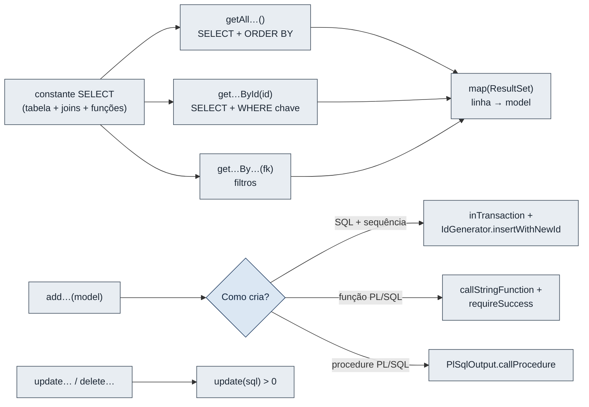

- **Estrutura:** dois construtores (`()` e `(ConnectionProvider)`), uma constante `SELECT` e um método privado `static map(ResultSet)`.
- **Leitura:** `getAll…`, `get…ById` (devolve `null` se não existir) e, nalguns casos, filtros por chave estrangeira.
- **Campos calculados:** o `SELECT` acrescenta nomes (por *join*), contagens (subconsultas `COUNT(*)`) ou resultados de funções PL/SQL. Estes campos são **só de leitura** e são ignorados nas escritas.
- **Escrita:** `update…` e `delete…` devolvem `true` se afetaram alguma linha (o handler converte `false` em 404). Os `add…` devolvem o código criado ou a mensagem do PL/SQL.
- **Erros:** todas as operações declaram `throws SQLException`. Nenhuma engole erros.
- **Recursos:** todas as ligações, instruções e `ResultSet` usam `try-with-resources`.

Nas secções seguintes, para cada DAO indicam-se apenas as particularidades. Todos estão em `backend/src/main/java/com/turismo/api/dao/`, pacote `com.turismo.api.dao`, e são classes concretas que estendem `BaseDAO`.

#### DestinoDAO

| | |
|---|---|
| **Tabela** | `DESTINO` |
| **SELECT** | Colunas de `DESTINO` + `TOTAL_ATRACOES` e `TOTAL_ALOJAMENTOS` (subconsultas `COUNT(*)`) |
| **Métodos** | `getAllDestinos()`, `getDestinoById(id)`, `addDestino(d)` → código `DT-xxx`, `updateDestino(d)`, `deleteDestino(id)`, `getDependencias(id)` → `{atracoes, alojamentos, visitas}`, `getInfo(id)` → `{info, atracoes}` |
| **Criação** | SQL + sequência `ID_destino` (transação) |
| **PL/SQL usado** | Funções `Retorna_Info_Destino` e `Lista_Atracoes_Destino` (em `getInfo`) |
| **Efeitos na BD** | Eliminar dispara o *trigger* `deleteDestino`, que apaga atrações, alojamentos e visitas do destino (e, em cadeia, `deleteAlojamento` apaga as associações desses alojamentos). `getDependencias` conta o que vai ser apagado, para a interface avisar antes. |
| **Estado** | Leitura, criação, edição e eliminação testadas com `ROLLBACK` contra o Oracle real. |

#### AtracaoDAO

| | |
|---|---|
| **Tabela** | `ATRACAO` (+ *join* com `DESTINO` para `NOME_DESTINO`) |
| **Métodos** | `getAllAtracoes()`, `getAtracaoById(id)`, `getAtracoesByDestino(idDestino)`, `addAtracao(a)` → `AT-xxx`, `updateAtracao(a)`, `deleteAtracao(id)` |
| **Criação** | SQL + sequência `ID_atracao`. Não usa a procedure `registrar_atracao`, que está INVALID e recebe horas como `DATE`, quando as colunas são `CHAR(5)` "HH:MM". |
| **Conversões** | Horas lidas com `getTrimmed` (colunas `CHAR`). |
| **Estado** | Leitura implementada e testada. Criação e edição implementadas, mas **bloqueadas na BD** pelos *triggers* inválidos `validarhorabertura`, `validarhorafecho`, `validarhoraberturaesp`, `validarhorafechoesp` (o erro `TRIGGER_INVALIDO` foi testado). |

#### AlojamentoDAO

| | |
|---|---|
| **Tabela** | `ALOJAMENTO` (+ `DESTINO` e `TIPO_ALOJAMENTO`) |
| **Campos calculados** | `NOME_DESTINO`, `CAP_ALOJAMENTO` (do tipo), `MEDIA_AVALIACOES` = função `Media_Avaliacao_Alojamento(ID_ALOJAMENTO)` |
| **Métodos** | `getAllAlojamentos()`, `getAlojamentoById(id)`, `getAlojamentosByDestino(idDestino)`, `addAlojamento(a)` → `AL-xxx`, `updateAlojamento(a)`, `deleteAlojamento(id)` |
| **Criação** | SQL + sequência `ID_alojamento` |
| **Efeitos na BD** | Eliminar dispara `deleteAlojamento` (apaga associações a reservas e operadores). |
| **Estado** | Leitura testada. Criação e edição **bloqueadas** pelo *trigger* inválido `validarcapalojamento`. |

#### TipoAlojamentoDAO

| | |
|---|---|
| **Tabela** | `TIPO_ALOJAMENTO` (chave natural: o próprio nome do tipo) |
| **Campo calculado** | `TOTAL_ALOJAMENTOS` |
| **Métodos** | `getAllTipoAlojamentos()`, `getTipoAlojamentoById(tipo)`, `addTipoAlojamento(t)` → mensagem da procedure, `updateTipoAlojamento(t)` (só a capacidade), `deleteTipoAlojamento(tipo)` |
| **Criação** | Procedure `definir_tipo_alojamento` via `PlSqlOutput` (faz `COMMIT`) |
| **Notas** | A chave não pode mudar porque é referenciada pelos alojamentos; um tipo em uso não pode ser apagado (ORA-02292 → 409). |
| **Estado** | Leitura e edição testadas (edição com `ROLLBACK`). Criação **não executada nos testes** (gravaria dados permanentemente). |

#### TransporteDAO

| | |
|---|---|
| **Tabela** | `TRANSPORTE` |
| **Campo calculado** | `TOTAL_OPERADORES` |
| **Métodos** | `getAllTransportes()`, `getTransporteById(id)`, `addTransporte(t)` → `TP-xxx`, `updateTransporte(t)`, `deleteTransporte(id)` |
| **Criação** | SQL + sequência `ID_transporte` |
| **Efeitos na BD** | `deleteTransporte` apaga associações a operadores. |
| **Estado** | Criação e eliminação testadas com `ROLLBACK`; edição implementada mas não testada contra a BD. |

#### TuristaDAO

| | |
|---|---|
| **Tabela** | `TURISTA` |
| **Campo calculado** | `TOTAL_RESERVAS` |
| **Atributo extra** | `CODIGO` — expressão `([A-Z]{2}-\d{3})` para extrair o código da mensagem da função |
| **Métodos** | `getAllTuristas()`, `getTuristaById(id)`, `addTurista(t)` → código, `updateTurista(t)`, `deleteTurista(id)` → mensagem |
| **Criação** | Função `Insere_Turista(nome, nacionalidade)`: gera o código e devolve uma frase começada por "Turista inserido"; o DAO extrai o código com `CODIGO` (se não o encontrar → 500 `SEM_CODIGO`). |
| **Eliminação** | Função `Elimina_Turista(id)`: recusa se o turista tiver reservas ("Nao e possivel eliminar…" → 409); apaga preferências, associações a operadores e visitas e depois o turista. |
| **Estado** | Leitura e edição testadas. Criação não executada nos testes (faz `COMMIT`). Eliminação **bloqueada na BD**: o `DELETE` em `Turista` dispara `deleteTurista`, que faz `DELETE` em `Reserva` e dispara o *trigger* inválido `deleteReserva`. |

#### TuristaPreferenciaDAO

| | |
|---|---|
| **Tabela** | `TURISTA_PREFERENCIA` (chave composta `ID_TURISTA` + `PREFERENCIA`) |
| **Métodos** | `getAllTuristaPreferencias()`, `getTuristaPreferenciasByTurista(idTurista)`, `getTuristaPreferencia(idTurista, pref)`, `addTuristaPreferencia(tp)`, `updateTuristaPreferencia(idTurista, atual, nova)`, `deleteTuristaPreferencia(idTurista, pref)` |
| **Criação** | Procedure `inserir_preferencia` |
| **Edição** | Troca atómica numa transação: `DELETE` da preferência atual + `INSERT` da nova. Não usa `atualizar_pref_turista`, porque essa procedure altera **todas** as preferências do turista (`WHERE` só por `ID_turista`), o que viola a chave composta quando há mais do que uma. |
| **Estado** | Troca testada com `ROLLBACK`; caminho de erro da procedure testado (turista inexistente). |

#### OperadorDAO

| | |
|---|---|
| **Tabela** | `OPERADOR` |
| **Campos calculados** | `TOTAL_TURISTAS`, `MEDIA_AVALIACAO` = função `Media_Avaliacao_Operador` |
| **Métodos** | `getAllOperadores()`, `getOperadorById(id)`, `addOperador(o)` → `OP-xxx`, `updateOperador(o)`, `deleteOperador(id)` |
| **Efeitos na BD** | `deleteOperador` apaga associações a turistas, transportes e alojamentos. |
| **Estado** | Criação e eliminação testadas com `ROLLBACK`; edição não testada contra a BD. |

#### ReservaDAO

| | |
|---|---|
| **Tabela** | `RESERVA` (+ `TURISTA`) |
| **Campos calculados** | `NOME_TURISTA`, `NOITES` (`DATA_PARTIDA - DATA_CHEGADA`), `TOTAL_PAGO` = `Total_Pago_Reserva`, `ESTADO_COMPLETUDE` = `Reserva_Completa` |
| **Métodos** | `getAllReservas()`, `getReservaById(id)`, `getReservasByTurista(idTurista)`, `addReserva(r, idsAlojamento)` → `RS-xxx`, `updateReserva(r)`, `cancelarReserva(id)` → mensagem, `deleteReserva(id)` |
| **Criação** | Uma só transação: `INSERT` da reserva (com `IdGenerator`) e um `INSERT` em `RESERVA_ALOJAMENTO` por alojamento escolhido (avaliação `NULL`). Se algum falhar, nada fica gravado. Não usa `registrar_reserva` (INVALID) nem `associar_alojamento_reserva` (faz `COMMIT` sozinha, o que impediria a atomicidade). |
| **Edição** | Uma só instrução `UPDATE`, para as datas e o estado mudarem juntos (os *triggers* de datas veem os dois valores novos). |
| **Cancelamento** | Procedure `cancelar_reserva`. |
| **Estado** | Leitura testada. Criação, edição, cancelamento e eliminação **bloqueados na BD** (`validardatachegada`, `validardatapartida`, `deleteReserva` inválidos); os caminhos de erro foram testados. |

#### PagamentoDAO

| | |
|---|---|
| **Tabela** | `PAGAMENTO` (+ `RESERVA` + `TURISTA` para o nome) |
| **Métodos** | `getAllPagamentos()`, `getPagamentoById(id)`, `getPagamentosByReserva(idReserva)`, `addPagamento(p)` → `PG-xxx`, `updatePagamento(p)`, `concluirPagamento(id)` → mensagem, `valorEmDolar(id, cotacao)` → `BigDecimal`, `deletePagamento(id)` |
| **Regras** | A aplicação **nunca** escreve `ID_RECIBO`: o recibo é gerado pela função `Concluir_Pagamento` (sequência `ID_recibo`). `updatePagamento` tem `AND STATUS_PAGAMENTO <> 'CONCLUIDO'` no `WHERE`, para não alterar um pagamento concluído mesmo em concorrência. |
| **Conversão** | `valorEmDolar` executa `SELECT Valor_Em_Dolar(VALOR, ?) …`; devolve `null` se o pagamento não existir. |
| **Estado** | Leitura testada. Criação e edição **bloqueadas** pelo *trigger* inválido `validarpagamento`. `Concluir_Pagamento` testado só no caminho de erro (código inexistente). |

#### TuristaDestinoDAO

| | |
|---|---|
| **Tabela** | `TURISTA_DESTINO` (chave de 3 colunas: destino, turista, data da visita) |
| **Métodos** | `getAllTuristaDestinos()`, `getTuristaDestinosByTurista(id)`, `getTuristaDestinosByDestino(id)`, `getTuristaDestino(idDestino, idTurista, data)`, `addTuristaDestino(td)` → mensagem, `deleteTuristaDestino(…)` |
| **Criação** | Função `Regista_Visita(destino, turista, data)`, que recusa a visita se o destino já tiver atingido a capacidade nessa data; sucesso esperado: texto começado por "Visita registada". |
| **Sem edição** | Todas as colunas fazem parte da chave. |
| **Estado** | Leitura testada; criação testada no caminho de erro. |

#### ReservaAlojamentoDAO

| | |
|---|---|
| **Tabela** | `RESERVA_ALOJAMENTO` (chave reserva + alojamento) |
| **Métodos** | `getAll…`, `…ByReserva`, `…ByAlojamento`, `getReservaAlojamento(idReserva, idAlojamento)`, `addReservaAlojamento(ra)`, `avaliar(idReserva, idAlojamento, avaliacao)`, `deleteReservaAlojamento(…)` |
| **PL/SQL** | `associar_alojamento_reserva` (criação, avaliação vazia) e `avaliar_alojamento` (avaliação; `null` retira-a) |
| **Estado** | Leitura testada. Criação e avaliação **bloqueadas** pelo *trigger* inválido `validaravalojamento`. |

#### OperadorTuristaDAO

| | |
|---|---|
| **Tabela** | `OPERADOR_TURISTA` |
| **Métodos** | `getAll…`, `…ByOperador`, `…ByTurista`, `getOperadorTurista(…)`, `addOperadorTurista(ot)`, `avaliar(…)`, `deleteOperadorTurista(…)` |
| **PL/SQL** | `associar_operador_turista`, `avaliar_operador` |
| **Estado** | Leitura testada. Criação e avaliação **bloqueadas** pelo *trigger* inválido `validaravaoperador`. |

#### OperadorTransporteDAO

| | |
|---|---|
| **Tabela** | `OPERADOR_TRANSPORTE` (só chaves) |
| **Métodos** | `getAll…`, `…ByOperador`, `…ByTransporte`, `getOperadorTransporte(…)`, `addOperadorTransporte(ot)`, `deleteOperadorTransporte(…)` |
| **PL/SQL** | `associar_operador_transporte` |
| **Estado** | Leitura testada; criação não executada nos testes (faz `COMMIT`). |

#### OperadorAlojamentoDAO

| | |
|---|---|
| **Tabela** | `OPERADOR_ALOJAMENTO` (só chaves) |
| **Métodos** | `getAll…`, `…ByOperador`, `…ByAlojamento`, `getOperadorAlojamento(…)`, `addOperadorAlojamento(oa)`, `deleteOperadorAlojamento(…)` |
| **PL/SQL** | `associar_operador_alojamento` |
| **Estado** | Leitura testada; criação não testada (não há alojamentos na BD, segundo `PROGRESS_CHECKLIST.md`). |


---

### 9.5 Pacote handler — infraestrutura

#### BaseHandler

| | |
|---|---|
| **Localização** | `handler/BaseHandler.java` |
| **Pacote** | `com.turismo.api.handler` |
| **Tipo** | Classe **abstrata**, implementa `com.sun.net.httpserver.HttpHandler` |
| **Objetivo** | Concentrar tudo o que é comum aos *handlers*: decompor o pedido, converter exceções em respostas JSON e oferecer ajudas de leitura e resposta. |
| **Responsabilidade** | Garantir que **qualquer** erro chega ao cliente como `{"error", "code", "fields"}` com o código HTTP correto. |

**Atributos:** `MAX_BODY_BYTES = 64 * 1024`; `basePath` (ex.: `/api/destinos`); `protected final ConnectionProvider connections`.
**Construtores:** `BaseHandler(String basePath)` e `BaseHandler(String basePath, ConnectionProvider)`.
**Método abstrato:** `protected abstract void route(Request request) throws IOException, SQLException` — cada subclasse decide aqui o que fazer.

**`handle(HttpExchange)`, passo a passo** (método *template*)

1. Cria um `Request` com os segmentos do caminho **depois** do `basePath`. Exemplo: `/api/reservas/RS-001/cancelar` → `["RS-001", "cancelar"]`. Um caminho que não comece pelo `basePath` gera 404.
2. Chama `route(request)`.
3. Trata as exceções:
   - `ApiException` → se o estado for ≥ 500, regista em `System.err`; envia o erro.
   - `SQLException` → traduz com `DbErrors.translate`, regista "[MÉTODO caminho] SQL código: primeira linha" e envia o erro traduzido.
   - `RuntimeException` → imprime a *stack trace* e envia 500 `ERRO_INTERNO` "Erro interno no servidor." (não expõe detalhes ao cliente).
4. `finally`: fecha sempre o `HttpExchange`.

**Classe interna `Request`** (`protected final class`)

| Membro | Finalidade |
|---|---|
| `method`, `segments`, `query` | Método em maiúsculas, segmentos imutáveis, parâmetros da *query string* já descodificados (`parseQuery`, UTF-8) |
| `is(String)`, `size()`, `segment(int)`, `param(String)` | Consultas rápidas (`param` aplica `clean`: vazio → `null`) |
| `body()` | Lê o corpo até 64 KB; maior → 413 `PEDIDO_GRANDE` |
| `body(Class<T>)` | Lê e converte com `Json.fromJson` |
| `send(status, valor)`, `ok(valor)`, `created(valor)` | Serializa com Gson e responde 200/201 |

**Ajudas protegidas:** `methodNotAllowed()` (405 `METODO_NAO_PERMITIDO`), `notFound(o quê)` (404 "… inexistente."), `domain(tabela, coluna)` (lista da restrição `CHECK`), `clean(String)` (sem espaços; vazio → `null`), `parseDate`, `parseDecimal` (aceita vírgula), `message(texto)` e `message(texto, dados)` (corpo `{"message", "data"}`), `sendJsonResponse` (cabeçalho `application/json; charset=UTF-8`).

**Exemplo de resposta de erro** (validação):

```json
{"error": "Existem campos com valores inválidos.",
 "code": "VALIDACAO",
 "fields": {"nomeTurista": "Campo obrigatório.", "nacionalidade": "Máximo de 50 caracteres."}}
```

**Relações:** superclasse dos 19 *handlers*.
**Estado:** implementado e testado (`TuristaHandlerHttpTest`, 8 testes de encaminhamento e códigos).
**Observações:** `sendErrorResponse(exchange, mensagem, estado)` existe mas **não é usado** por nenhum *handler* atual (resto da versão anterior).

#### EstadoHandler

| | |
|---|---|
| **Localização** | `handler/EstadoHandler.java` · rota base `/api/estado` |
| **Tipo** | Classe concreta, estende `BaseHandler`; usa `SchemaDAO` |
| **Objetivo** | Indicar se a API está viva e qual o estado da BD. |

**Comportamento:** só `GET` (outro → 405). Responde **sempre 200** quando a API funciona: `{"api": "OK", "bd": "OK", "database", "objetosInvalidos", "viewsEsperadas", "viewsEmFalta"}` ou, se a BD falhar, `{"api": "OK", "bd": "ERRO", "bdErro", "bdCodigo"}`. Assim o cliente distingue "API em baixo" (sem resposta) de "BD em baixo" (`bd = ERRO`).
**Relações:** usado pelo `MainWindow.checkHealth()` (a cada 60 s), pelo `DashboardPage`, pelos scripts de arranque (como teste de "a API está a correr?") e pelo `LiveApplicationE2ETest`.
**Estado:** implementado.

#### DominioHandler

`handler/DominioHandler.java` · `GET /api/dominios` · estende `BaseHandler`. Devolve o mapa completo de `ConstraintCatalog.domains()` (chave `"TABELA.COLUNA"` → lista de valores). Outro método → 405; segmentos extra → 404. Usado pelo `Lookups` do frontend para preencher as listas dos formulários. **Estado:** implementado.

#### DashboardHandler

`handler/DashboardHandler.java` · `GET /api/dashboard` · estende `BaseHandler`, usa `DashboardDAO`. Devolve `{totais, views, verificacoes}` (ver [DashboardDAO](#DashboardDAO)). **Estado:** implementado.

#### RelatorioHandler

`handler/RelatorioHandler.java` · estende `BaseHandler`, usa `RelatorioDAO`. `GET /api/relatorios` devolve os nomes das 24 *views*; `GET /api/relatorios/{view}` devolve colunas e linhas. Outro método → 405. **Estado:** implementado; as leituras falham com 503 `OBJETO_INEXISTENTE` enquanto as *views* não existirem.

---

### 9.6 Handlers de entidade

#### Anatomia comum dos handlers

Os 15 *handlers* de entidade estão em `backend/src/main/java/com/turismo/api/handler/`, no pacote `com.turismo.api.handler`. Todos são classes concretas que estendem `BaseHandler` e seguem o mesmo esquema:

- **Atributo:** o DAO da entidade (`private final XxxDAO xxxDAO`).
- **Construtores:** `XxxHandler()` (cria o DAO real) e `XxxHandler(XxxDAO, ConnectionProvider)` (para testes, como o `FakeDAO` de `TuristaHandlerHttpTest`).
- **`route(Request)`:** um encadeamento de `if` sobre o número de segmentos e o método HTTP.
- **Método privado `read(Request)`** (ou `validate`): lê o corpo para o *model*, limpa os textos com `clean`, valida com `Validator` (incluindo listas de `domain(...)`) e lança 422 se houver erros.
- **Respostas:** listas e registos são devolvidos diretamente. As escritas devolvem `{"message": "…", "data": <registo relido da BD>}`, com 201 na criação e 200 nas restantes.
- **No `PUT`, a chave vem sempre do caminho**, nunca do corpo (testado em `atualizacaoUsaOIdDoCaminho`).

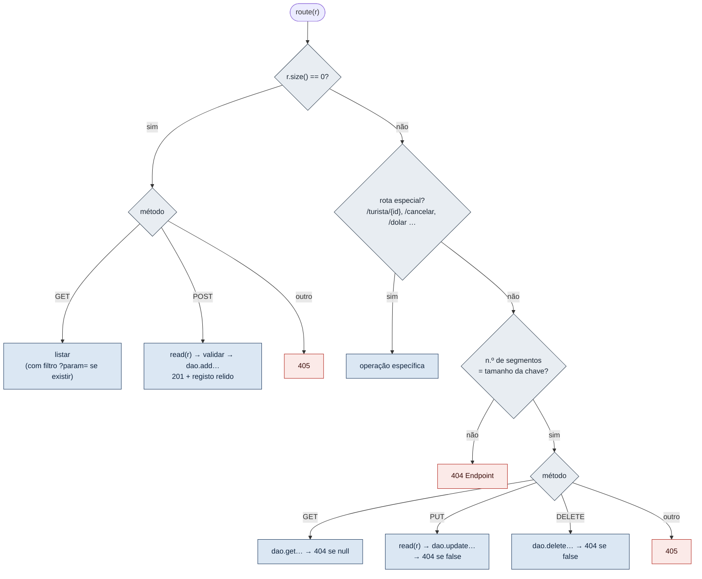

#### Validações por handler

| Handler | Rota base | Validação no servidor (`read`/`validate`) | Rotas especiais |
|---|---|---|---|
| `DestinoHandler` | `/api/destinos` | `nomeDestino` obrigatório ≤ 80; `regiao` obrigatória e da lista `DESTINO.REGIAO`; `capacidadeVisitantes` obrigatória, > 0, ≤ 10 dígitos | `GET /{id}/dependencias`, `GET /{id}/info` |
| `AtracaoHandler` | `/api/atracoes` | `tipoAtracao` obrigatório e da lista; `descricao` ≤ 200; horas obrigatórias, formato `HH:MM`, fecho depois da abertura; `idDestino` obrigatório; **se qualquer campo do horário especial for preenchido, os três são obrigatórios** (espelha a restrição `CHECK`) | `?idDestino=`, `GET /destino/{id}` |
| `AlojamentoHandler` | `/api/alojamentos` | `nomeAlojamento` obrigatório ≤ 50; `tipoAlojamento` e `idDestino` obrigatórios; `classAlojamento` opcional, 0,0–5,0 | `?idDestino=` |
| `TipoAlojamentoHandler` | `/api/tipoAlojamentos` | Na criação, `tipoAlojamento` obrigatório ≤ 11; `capAlojamento` obrigatória, > 0, ≤ 2 dígitos | — |
| `TransporteHandler` | `/api/transportes` | `tipoTransporte` obrigatório ≤ 15; `capTransporte` > 0, ≤ 9 dígitos; `disponibilidade` da lista (`Sim`/`Nao`) | — |
| `TuristaHandler` | `/api/turistas` | `nomeTurista` obrigatório ≤ 80; `nacionalidade` obrigatória ≤ 50 | — (o `DELETE` devolve a mensagem de `Elimina_Turista`) |
| `TuristaPreferenciaHandler` | `/api/turistaPreferencias` | `idTurista` obrigatório (POST); `preferencia` obrigatória e da lista | `?idTurista=`, `GET /turista/{id}`; chave `/{idTurista}/{preferencia}`; `PUT` recebe `{"preferencia": nova}` |
| `OperadorHandler` | `/api/operadores` | `nomeOperador` obrigatório ≤ 25; `especialidade` obrigatória ≤ 15; `classOperador` 0,0–5,0 | — |
| `ReservaHandler` | `/api/reservas` | `idTurista`, datas e estado obrigatórios; estado da lista (por omissão `PENDENTE` no POST); partida **depois** da chegada; chegada não anterior a hoje (ao criar, ou ao editar se a data mudou) | `?idTurista=`, `GET /turista/{id}`, `POST /{id}/cancelar`; POST aceita `"alojamentos": [...]` (duplicados e vazios removidos) |
| `PagamentoHandler` | `/api/pagamentos` | `valor` > 0, 2 casas, ≤ 99 999 999,99; `dataPagamento` obrigatória, não futura e com no máximo 12 meses; `metodoPagamento` da lista; `statusPagamento` só `PENDENTE` ou `FALHADO` (omissão `PENDENTE`); `detalhesTransacao` ≤ 200; `idReserva` obrigatório. `PUT` de pagamento `CONCLUIDO` → 409. | `?idReserva=`, `GET /reserva/{id}`, `POST /{id}/concluir`, `GET /{id}/dolar?cotacao=` (cotação > 0) |
| `TuristaDestinoHandler` | `/api/turistaDestinos` | `idDestino`, `idTurista`, `dataVisita` obrigatórios | `?idTurista=`, `?idDestino=`, `GET /turista/{id}`, `GET /destino/{id}`; chave `/{idDestino}/{idTurista}/{AAAA-MM-DD}`; sem `PUT` |
| `ReservaAlojamentoHandler` | `/api/reservaAlojamentos` | POST: as duas chaves obrigatórias; PUT: `avaliacaoAlojamento` 0,0–5,0 (pode ser `null`) e a associação tem de existir | `?idReserva=`, `?idAlojamento=`, `/reserva/{id}`, `/alojamento/{id}` |
| `OperadorTuristaHandler` | `/api/operadorTuristas` | POST: as duas chaves obrigatórias; PUT: `avaliacaoOperador` 0,0–5,0 e a associação tem de existir | `?idOperador=`, `?idTurista=`, `/operador/{id}`, `/turista/{id}` |
| `OperadorTransporteHandler` | `/api/operadorTransportes` | POST: as duas chaves obrigatórias | `?idOperador=`, `?idTransporte=`, `/operador/{id}`, `/transporte/{id}`; sem `PUT` |
| `OperadorAlojamentoHandler` | `/api/operadorAlojamentos` | POST: as duas chaves obrigatórias | `?idOperador=`, `?idAlojamento=`, `/operador/{id}`, `/alojamento/{id}`; sem `PUT` |

> [!note] Validação mais estrita do que a base de dados
> A tabela `Reserva` aceita `data_partida >= data_chegada`, mas o `ReservaHandler` (e o formulário) exigem partida **estritamente** depois da chegada, alinhando com o *trigger* `validardatapartida` segundo o comentário do código. É uma regra de negócio intencional, não um erro.

#### Ficha resumida de cada handler

Para todos: **Localização** `backend/src/main/java/com/turismo/api/handler/<Nome>.java` · **Pacote** `com.turismo.api.handler` · **Tipo** classe concreta, estende `BaseHandler` · **Dependências** o DAO e o *model* indicados, `Validator`, `ConnectionProvider` · **Relações** registado no `TurismoApiServer`; chamado pelo `HttpServer` · **Estado** implementado (o estado de cada escrita na BD está no [§20](#20.%20Estado%20das%20funcionalidades)).

| Classe | DAO / model | Objetivo |
|---|---|---|
| `DestinoHandler` | `DestinoDAO` / `Destino` | CRUD de destinos + dependências em cascata + ficha PL/SQL |
| `AtracaoHandler` | `AtracaoDAO` / `Atracao` | CRUD de atrações, filtro por destino |
| `AlojamentoHandler` | `AlojamentoDAO` / `Alojamento` | CRUD de alojamentos, filtro por destino |
| `TipoAlojamentoHandler` | `TipoAlojamentoDAO` / `TipoAlojamento` | CRUD de tipos (a chave não muda) |
| `TransporteHandler` | `TransporteDAO` / `Transporte` | CRUD de transportes |
| `TuristaHandler` | `TuristaDAO` / `Turista` | CRUD de turistas via funções PL/SQL |
| `TuristaPreferenciaHandler` | `TuristaPreferenciaDAO` / `TuristaPreferencia` | Preferências com chave composta |
| `OperadorHandler` | `OperadorDAO` / `Operador` | CRUD de operadores |
| `ReservaHandler` | `ReservaDAO` / `Reserva` (+ classe interna `NovaReserva extends Reserva` com `List<String> alojamentos`) | Reservas, criação atómica com alojamentos, cancelamento |
| `PagamentoHandler` | `PagamentoDAO` / `Pagamento` (+ constante `ESTADOS_EDITAVEIS = [PENDENTE, FALHADO]`) | Pagamentos, conclusão com recibo, conversão em dólares |
| `TuristaDestinoHandler` | `TuristaDestinoDAO` / `TuristaDestino` | Visitas (chave de 3 colunas com data) |
| `ReservaAlojamentoHandler` | `ReservaAlojamentoDAO` / `ReservaAlojamento` | Alojamentos de reservas e a sua avaliação |
| `OperadorTuristaHandler` | `OperadorTuristaDAO` / `OperadorTurista` | Operadores que acompanham turistas e a sua avaliação |
| `OperadorTransporteHandler` | `OperadorTransporteDAO` / `OperadorTransporte` | Associação operador–transporte |
| `OperadorAlojamentoHandler` | `OperadorAlojamentoDAO` / `OperadorAlojamento` | Associação operador–alojamento |

**Exemplo de utilização real** (corpo enviado pelo frontend para criar uma reserva com dois alojamentos):

```json
POST /api/reservas
{"idTurista": "TR-001", "dataChegada": "2026-11-02", "dataPartida": "2026-11-05",
 "statusReserva": "PENDENTE", "alojamentos": ["AL-001", "AL-002"]}
```

---

### 9.7 Models

#### Anatomia comum dos models

Os 15 *models* estão em `backend/src/main/java/com/turismo/api/model/`, pacote `com.turismo.api.model`. São **POJO** (*Plain Old Java Objects*: classes simples, sem lógica):

- Campos `private` que correspondem às colunas da tabela (nomes em *camelCase*: `ID_DESTINO` → `idDestino`).
- Campos **"apenas leitura"**: valores calculados pela BD (*joins*, contagens, funções). São preenchidos pelos DAOs e ignorados nas escritas.
- Construtor vazio (necessário ao Gson) e construtor com os campos da tabela.
- *Getters* e *setters* para todos os campos.
- `equals`/`hashCode` baseados **só na chave primária** (simples ou composta).
- `toString` com os campos da tabela.

Os nomes dos campos são o **contrato JSON** entre backend e frontend: o frontend usa exatamente estes nomes (`Modules`, `FieldSpec`).

**Tipos usados:** `String` para textos e códigos; `Integer` para inteiros (aceita `null`); `BigDecimal` para valores monetários e classificações (exatos, sem erros de arredondamento); `LocalDate` para datas; horas como `String` `"HH:MM"` (colunas `CHAR(5)`).

**Exemplo de JSON produzido** (um `Destino`):

```json
{"idDestino": "DT-001", "nomeDestino": "Arquipelago de Bazaruto", "regiao": "Inhambane",
 "capacidadeVisitantes": 500, "totalAtracoes": 1, "totalAlojamentos": 2}
```

> [!note] Valores do exemplo
> O registo `DT-001` vem de `database/Inserts.sql`. As contagens são ilustrativas.

#### Campos de cada model

| Model | Tabela | Chave | Campos da tabela | Campos só de leitura |
|---|---|---|---|---|
| `Destino` | `Destino` | `idDestino` | `nomeDestino`, `regiao`, `capacidadeVisitantes` (`Integer`) | `totalAtracoes`, `totalAlojamentos` |
| `Atracao` | `Atracao` | `idAtracao` | `tipoAtracao`, `descricao`, `horaAbertura`, `horaFecho`, `horaAberturaEspecial`, `horaFechoEspecial`, `detalhesHorarioEspecial`, `idDestino` | `nomeDestino` |
| `Alojamento` | `Alojamento` | `idAlojamento` | `nomeAlojamento`, `classAlojamento` (`BigDecimal`), `tipoAlojamento`, `idDestino` | `nomeDestino`, `capAlojamento`, `mediaAvaliacoes` |
| `TipoAlojamento` | `Tipo_Alojamento` | `tipoAlojamento` | `capAlojamento` | `totalAlojamentos` |
| `Transporte` | `Transporte` | `idTransporte` | `tipoTransporte`, `capTransporte`, `disponibilidade` (`Sim`/`Nao`) | `totalOperadores` |
| `Turista` | `Turista` | `idTurista` | `nomeTurista`, `nacionalidade` | `totalReservas` |
| `TuristaPreferencia` | `Turista_Preferencia` | `idTurista` + `preferencia` | — | `nomeTurista` |
| `Operador` | `Operador` | `idOperador` | `nomeOperador`, `especialidade`, `classOperador` | `totalTuristas`, `mediaAvaliacao` |
| `Reserva` | `Reserva` | `idReserva` | `dataChegada`, `dataPartida` (`LocalDate`), `statusReserva`, `idTurista` | `nomeTurista`, `noites`, `totalPago`, `estadoCompletude` |
| `Pagamento` | `Pagamento` | `idPagamento` | `valor`, `dataPagamento`, `metodoPagamento`, `statusPagamento`, `idRecibo` (único), `detalhesTransacao`, `idReserva` | `nomeTurista` |
| `TuristaDestino` | `Turista_Destino` | `idDestino` + `idTurista` + `dataVisita` | — | `nomeDestino`, `nomeTurista` |
| `ReservaAlojamento` | `Reserva_Alojamento` | `idReserva` + `idAlojamento` | `avaliacaoAlojamento` | `nomeAlojamento`, `nomeTurista` |
| `OperadorTurista` | `Operador_Turista` | `idOperador` + `idTurista` | `avaliacaoOperador` | `nomeOperador`, `nomeTurista` |
| `OperadorTransporte` | `Operador_Transporte` | `idOperador` + `idTransporte` | — | `nomeOperador`, `tipoTransporte` |
| `OperadorAlojamento` | `Operador_Alojamento` | `idOperador` + `idAlojamento` | — | `nomeOperador`, `nomeAlojamento` |

**Dependências:** apenas `java.math.BigDecimal`, `java.time.LocalDate`, `java.util.Objects`. **Relações:** criados pelos DAOs (`map`) e pelo Gson (`Request.body`); usados pelos *handlers*. **Estado:** implementados. Segundo `IMPLEMENTATION_PLAN.md`, os tipos foram corrigidos numa fase anterior (antes, avaliações eram `String`, datas `java.util.Date` e valores `Double`).


---

## 10. Classes do frontend

Todas as classes estão em `frontend/src/main/java/com/turismo/frontend/`. Os caminhos abaixo são relativos a essa pasta.

> [!important] Regra de concorrência do frontend
> No Swing, só a **EDT** pode mexer em componentes, e a EDT nunca pode esperar pela rede. No projeto, **todos** os pedidos à API passam por `Task.run(trabalho, sucesso, erro[, fim])`: o trabalho corre numa *thread* de fundo e o resultado volta à EDT. O `ApiClient` documenta que os seus métodos bloqueiam e não devem ser chamados na EDT.

### 10.1 Arranque e janela

#### MainApplication

| | |
|---|---|
| **Localização** | `MainApplication.java` |
| **Pacote** | `com.turismo.frontend` |
| **Tipo** | Classe concreta com `main` (ponto de entrada de `turismo-desktop.jar`) |
| **Objetivo** | Preparar o ambiente e abrir a janela principal. |

**`main`, passo a passo:**
1. Define o *locale* `pt_PT` (`Format.PT`).
2. Define o nome da aplicação no macOS (`apple.awt.application.name`) e permite reduzir a escala do FlatLaf.
3. `ClientConfig.load()` lê `api.baseUrl` e `api.timeoutSeconds`.
4. Cria o `ApiClient`.
5. Na EDT (`SwingUtilities.invokeLater`): `Theme.install()` e `new MainWindow(api).setVisible(true)`.

**Estado:** implementado. **Observação:** a aplicação abre mesmo sem a API; nesse caso mostra o estado "Sem ligação".

#### MainWindow

| | |
|---|---|
| **Localização** | `MainWindow.java` |
| **Tipo** | Classe concreta, estende `JFrame` |
| **Objetivo** | Janela principal: barra lateral, área de conteúdo com os ecrãs e barra de estado. |
| **Responsabilidade** | Navegação, atalhos globais e verificação periódica da ligação. |

**Atributos**

| Atributo | Tipo | Finalidade |
|---|---|---|
| `DASHBOARD` | `static final String` | Identificador do painel (`"dashboard"`) |
| `HEALTH_INTERVAL_MS` | `int` | 60 000 ms entre verificações de `/estado` |
| `api`, `lookups` | `ApiClient`, `Lookups` | Partilhados por todos os ecrãs |
| `specs` | `Map<String, ModuleSpec>` | Os 15 módulos, por identificador |
| `pages` | `Map<String, JComponent>` | Ecrãs já criados (criação preguiçosa) |
| `cards`, `content` | `CardLayout`, `JPanel` | Área central que mostra um ecrã de cada vez |
| `sidebar`, `status` | `Sidebar`, `StatusBar` | Navegação e barra inferior |
| `healthTimer` | `javax.swing.Timer` | Temporizador da verificação de saúde |
| `current` | `String` | Ecrã visível |

**Construtor `MainWindow(ApiClient)`**
1. Título "Gestão de Turismo", tamanho mínimo 1100×700, inicial 1360×860, centrado; fechar a janela termina a aplicação.
2. Carrega `Modules.all()` para `specs`.
3. Constrói a barra lateral com 5 grupos: **Visão geral** (Painel), **Turismo** (destinos, atrações, alojamentos, tipos de alojamento, transportes), **Pessoas** (turistas, preferências, operadores), **Reservas e pagamentos** (reservas, pagamentos), **Relações e atividade** (visitas, alojamentos das reservas, operadores e turistas, operadores e transportes, operadores e alojamentos). O rodapé tem o botão "Tema escuro/claro".
4. Liga as mensagens dos *toasts* à barra de estado (`Toast.setStatusListener`).
5. Regista os atalhos (`bindShortcuts`).
6. Quando a janela abre: põe o foco no ecrã, chama `checkHealth()` e arranca o temporizador.
7. Abre o painel (`navigate(DASHBOARD)`).

**Métodos**

| Assinatura | Finalidade |
|---|---|
| `void navigate(String id)` | Cria o ecrã na primeira visita (`DashboardPage` ou `new CrudPage(spec, lookups)`), marca-o na barra lateral, mostra-o e chama `onShow()` (que recarrega os dados). |
| `void checkHealth()` | `Task` com `GET /estado`. API inalcançável → "API indisponível em …"; BD em erro → "Base de dados sem ligação: …"; BD OK → "Ligado a Oracle 10g …" e, se houver objetos inválidos ou *views* em falta, um aviso clicável que leva ao painel. |
| `bindShortcuts()` | ⌘/Ctrl+N novo, ⌘/Ctrl+F pesquisar, F5 e ⌘/Ctrl+R atualizar, encaminhados para o `Page` visível. |
| `currentPage()`, `page(id)`, `sidebar()`, `statusBar()` | Acesso para os testes de interface. |

**Estado:** implementado e testado (`MainWindowUiTest`, `LiveApplicationE2ETest`).

### 10.2 Pacote api

#### ApiClient

| | |
|---|---|
| **Localização** | `api/ApiClient.java` |
| **Pacote** | `com.turismo.frontend.api` |
| **Tipo** | Classe concreta |
| **Objetivo** | Único ponto de contacto com o backend: enviar pedidos HTTP e converter respostas e erros. |

**Atributos:** `config` (`ClientConfig`); `http` (`java.net.http.HttpClient` com *timeout* de ligação de 5 s).

**Métodos públicos**

| Assinatura | Finalidade |
|---|---|
| `String baseUrl()` | Endereço configurado |
| `JsonArray getArray(String caminho)` | `GET` que tem de devolver uma lista |
| `JsonObject getObject(String caminho)` | `GET` que tem de devolver um objeto |
| `JsonObject post(caminho, JsonObject)` | `POST` (corpo vazio `{}` se `null`) |
| `JsonObject put(caminho, JsonObject)` | `PUT` |
| `JsonObject delete(caminho)` | `DELETE` |
| `static String segment(String)` | Codifica um valor para segmento de URL (espaço → `%20`), necessário nas chaves compostas |

**`send(método, caminho, corpo)`, passo a passo**
1. Monta o pedido para `baseUrl + caminho`, com *timeout* `api.timeoutSeconds` e `Accept: application/json`; com corpo, envia JSON UTF-8.
2. Converte as falhas de rede em `ApiException`: ligação recusada ou *timeout* de ligação → estado `0` (`UNREACHABLE`), código `API_INDISPONIVEL` ("Verifique se o backend está em execução."); *timeout* de resposta → 504 `API_TEMPO_ESGOTADO`; outra `IOException` → `UNREACHABLE`; interrupção → `CANCELADO`.
3. Interpreta o corpo como JSON (texto inválido → `null`).
4. Estado ≥ 400 → `ApiException` com a mensagem `error`, o `code` e os `fields` do JSON do backend (ou uma mensagem genérica, se o corpo não for JSON).
5. Sucesso sem JSON válido, ou com o tipo errado (lista em vez de objeto) → 502 `RESPOSTA_INVALIDA`.

**Exemplo** (de `Modules`, ação "Cancelar reserva"):

```java
page.request(() -> page.lookups().api().post("/reservas/" + Format.str(row, "idReserva") + "/cancelar", null),
        "Reserva cancelada.", row);
```

**Estado:** implementado e testado (`ApiClientTest`, 7 testes com servidor falso).

#### ApiException do frontend

| | |
|---|---|
| **Localização** | `api/ApiException.java` |
| **Tipo** | Classe concreta, estende `Exception` (exceção **verificada**, ao contrário da do backend) |
| **Objetivo** | Transportar o erro da API, ou a falha de rede, até à interface. |

**Membros:** `UNREACHABLE = 0`; `status`, `code` (por omissão `"ERRO"`), `fields`; `isUnreachable()` (estado 0); `isRetryable()` (0, 503 ou 504: "tentar de novo pode resolver").
**Relações:** criada pelo `ApiClient` e `Lookups`; lida por `CrudPage`, `FormDialog`, `ReportPanel`, `DashboardPage`, `MainWindow`. **Estado:** implementado.

#### ClientConfig

| | |
|---|---|
| **Localização** | `api/ClientConfig.java` |
| **Tipo** | Classe `final` imutável |
| **Objetivo** | Configuração do cliente: endereço da API e *timeout*. |

**`load()`:** procura a pasta `config` (`-Dturismo.config.dir`, `TURISMO_CONFIG_DIR`, `./config`, `../config`), lê `turismo.properties` e `turismo.local.properties` e devolve `api.baseUrl` (omissão `http://localhost:8083/api`) e `api.timeoutSeconds` (omissão 40). As propriedades de sistema `-Dapi.baseUrl` e `-Dapi.timeoutSeconds` têm prioridade. O construtor retira a `/` final do URL.
**Estado:** implementado.
**Observações:** a lógica de procura da pasta é parecida com a do `AppConfig` do backend, mas está duplicada porque os módulos não partilham código. Um erro de leitura de ficheiro só é registado em `System.err`. Um `api.timeoutSeconds` não numérico lança `NumberFormatException` no arranque.

### 10.3 Pacote modules — especificações

O frontend não tem uma classe de ecrã por tabela. Em vez disso, cada módulo é **descrito** por um `ModuleSpec` e um único ecrã genérico (`CrudPage`) interpreta essa descrição. Analogia: o `ModuleSpec` é a planta e o `CrudPage` é o construtor que constrói qualquer casa a partir da planta.

#### Page

`modules/Page.java` · **interface**. Contrato de um ecrã da janela: `onShow()` (obrigatório, chamado sempre que o ecrã fica visível) e os métodos com implementação por omissão vazia `onNew()`, `onSearch()`, `onRefresh()`, `focusDefault()`, para onde o `MainWindow` encaminha os atalhos. **Implementada por** `CrudPage` e `DashboardPage`.

#### ModuleSpec

| | |
|---|---|
| **Localização** | `modules/ModuleSpec.java` |
| **Tipo** | Classe `final` com interface fluente (*builder*) |
| **Objetivo** | Descrição declarativa de um módulo: endpoint, chave, colunas, campos do formulário, ações, relatórios e regras de edição/eliminação. |

**Atributos principais:** `id`, `title`, `singular`, `feminine` (para "Novo"/"Nova"), `icon`, `endpoint`, `description`, `keyFields`, `columns`, `fields`, `actions`, `reports`, `titleOf` (título do registo no detalhe), `editable` + `notEditableReason`, `canCreate`/`canDelete` (sempre `true`), `deleteLabel`/`editLabel`, `deleteWarning`, `crossValidation`, `emptyMessage`.

**Interface interna `DeleteWarning`:** `String build(ApiClient, JsonObject)` — texto do aviso antes de eliminar; **pode consultar a API** (corre fora da EDT).

**Métodos fluentes:** `description`, `key`, `column` (2 variantes), `status` (coluna com etiqueta colorida), `derived` (coluna calculada), `detail` (só no painel de detalhe), `field`, `action`, `report`, `titleOf`, `editableWhen`, `deleteWarning`, `deleteLabel`, `editLabel`, `crossValidation`, `emptyMessage`.

**Métodos utilitários:**
- `newLabel()` → "Novo destino" / "Nova atração".
- `hasEditFields()` → existe pelo menos um campo editável (se não, não há botão Editar).
- `pathOf(linha)` → caminho REST do registo, com os segmentos codificados: `/destinos/DT-001`, `/operadorTuristas/OP-001/TR-002`, `/turistaDestinos/DT-001/TR-001/2026-10-20`.
- `keyText(linha)` → chave legível (datas ISO mostradas como `dd/MM/aaaa`).
- `sameKey(a, b)` → compara duas linhas pela chave (usado para manter a seleção depois de recarregar).

**Estado:** implementado.
**Observações:** `canCreate` e `canDelete` não têm método para os alterar e ficam sempre `true`; `emptyMessage(...)` nunca é chamado em `Modules`.

#### ColumnSpec

`modules/ColumnSpec.java` · classe `final`. Coluna da tabela: `key` (campo JSON), `header`, `type` (`enum Type { TEXT, INTEGER, DECIMAL, MONEY, RATING, DATE, STATUS }`), `width` (0 = flexível), `tone` (função valor → tom da etiqueta, para `STATUS`), `derived` (valor calculado a partir da linha, ex.: "Carlos Silva (TR-002)") e `detailOnly`. **Observação:** o tipo `DECIMAL` é suportado pelo renderizador mas não é usado em nenhum módulo.

#### FieldSpec

| | |
|---|---|
| **Localização** | `modules/FieldSpec.java` |
| **Tipo** | Classe `final` com fábricas estáticas e métodos fluentes |
| **Objetivo** | Campo de formulário: tipo de controlo, regras e origem das opções. |

**Tipos (`enum Type`):** `TEXT`, `TEXTAREA`, `INTEGER`, `MONEY`, `RATING`, `DATE`, `TIME`, `DOMAIN` (lista vinda de `/api/dominios`), `FK` (lista vinda de outro endpoint), `MULTI_FK` (seleção múltipla).
**Fábricas:** `text`, `textArea`, `integer`, `money`, `rating`, `date`, `time`, `domain`, `fk`, `multiFk`.
**Modificadores:** `required()`, `help(texto)`, `exclude(valores…)` (retira opções, ex.: `CONCLUIDO`), `createOnly()`, `editOnly()`, `defaultValue(v)`.
**Exemplo** (do módulo Pagamentos):

```java
FieldSpec.domain("statusPagamento", "Estado", "PAGAMENTO.STATUS_PAGAMENTO").required()
        .exclude("CONCLUIDO").defaultValue("PENDENTE")
        .help("Para concluir use a ação \"Concluir e emitir recibo\", que gera o recibo.")
```

#### ActionSpec

`modules/ActionSpec.java` · classe `final`. Ação específica mostrada no detalhe do registo: `label`, `icon`, `tooltip`, `enabled` (`Predicate<JsonObject>`, decide se o botão fica ativo para a linha) e `handler` (interface `Handler.run(CrudPage, JsonObject)`). Exemplos: "Cancelar reserva" (ativa só se o estado for `PENDENTE` ou `CONFIRMADA`) e "Concluir e emitir recibo" (ativa só se `PENDENTE`).

#### ReportSpec

`modules/ReportSpec.java` · classe `final`. Uma *view* mostrada no separador "Relatórios": `view`, `title`, `description`.

#### Modules

| | |
|---|---|
| **Localização** | `modules/Modules.java` |
| **Tipo** | Classe utilitária `final` |
| **Objetivo** | Definir os 15 módulos da aplicação, um por tabela. |

**Funcionamento:** um método estático por módulo devolve o `ModuleSpec` completo; `all()` devolve os 15, pela ordem da navegação. Os nomes dos campos são os do JSON da API e as regras seguem `tabelas.sql`.

| Módulo (`id`) | Endpoint | Chave | Ações especiais | Relatórios (*views*) |
|---|---|---|---|---|
| `destinos` | `/destinos` | `idDestino` | Ver ficha do destino | `v_total_atracoes_destino`, `v_total_alojamentos_destino` |
| `atracoes` | `/atracoes` | `idAtracao` | — (validação cruzada de horários) | `v_atracoes_destino` |
| `alojamentos` | `/alojamentos` | `idAlojamento` | — | `v_alojamentos_detalhe`, `v_media_avaliacao_alojamento`, `v_alojamentos_acima_media` |
| `tiposAlojamento` | `/tipoAlojamentos` | `tipoAlojamento` | — | — |
| `transportes` | `/transportes` | `idTransporte` | — | `v_transportes_disponiveis` |
| `turistas` | `/turistas` | `idTurista` | — | `v_turistas_sem_reserva`, `v_receita_nacionalidade` |
| `preferencias` | `/turistaPreferencias` | `idTurista`, `preferencia` | — | `v_turista_preferencias` |
| `operadores` | `/operadores` | `idOperador` | — | `v_avaliacao_operador` |
| `reservas` | `/reservas` | `idReserva` | Cancelar reserva | `v_reservas_detalhe`, `v_reservas_ativas`, `v_total_pago_reserva`, `v_reservas_sem_alojamento`, `v_reservas_sem_pagamento` |
| `pagamentos` | `/pagamentos` | `idPagamento` | Concluir e emitir recibo; Converter para dólares | `v_recibos`, `v_receita_mensal`, `v_aud_pagamento_data_futura`, `v_aud_recibo_sem_concluido` |
| `visitas` | `/turistaDestinos` | `idDestino`, `idTurista`, `dataVisita` | — | `v_turista_destinos` |
| `reservaAlojamentos` | `/reservaAlojamentos` | `idReserva`, `idAlojamento` | Editar = "Avaliar" | `v_reservas_alojamento` |
| `operadorTuristas` | `/operadorTuristas` | `idOperador`, `idTurista` | Editar = "Avaliar" | `v_avaliacao_operador` |
| `operadorTransportes` | `/operadorTransportes` | `idOperador`, `idTransporte` | — | `v_operadores_transportes` |
| `operadorAlojamentos` | `/operadorAlojamentos` | `idOperador`, `idAlojamento` | — | `v_operadores_alojamentos` |

**Métodos auxiliares:** textos das opções de chave estrangeira (`turista`, `destino`, `alojamento`, `operador`, `transporte`, `reserva`, `tipoAlojamento`), tons das etiquetas (`reservaTone`, `pagamentoTone`), `validateAtracao` (validação cruzada dos horários), `confirm` (diálogo de confirmação), `showText` (mostra o texto devolvido por funções PL/SQL) e `convertToUsd` (pede a cotação, valida-a e chama `/pagamentos/{id}/dolar`).

**Avisos antes de eliminar** (`deleteWarning`): destinos consultam `/destinos/{id}/dependencias` e indicam quantas atrações, alojamentos e visitas o *trigger* `deleteDestino` vai apagar; alojamentos, transportes, operadores e reservas explicam o que os respetivos *triggers* apagam; turistas explicam a regra de `Elimina_Turista`; pagamentos concluídos avisam que o recibo deixa de existir.

**Estado:** implementado e testado (`ModulesTest`: 15 módulos, as 24 *views* ligadas a módulos, chaves compostas, regras de edição, validações cruzadas e formatação).
**Observação:** o aviso de eliminação de destinos diz que os alojamentos são apagados "com as respetivas reservas e parcerias". Pelo código dos *triggers*, o que é apagado são as **associações** desses alojamentos a reservas (`Reserva_Alojamento`) e a operadores, não as reservas em si.

### 10.4 Pacote modules — ecrãs e modelos de tabela

#### CrudPage

| | |
|---|---|
| **Localização** | `modules/CrudPage.java` |
| **Tipo** | Classe concreta, estende `Surface` (`JPanel`), implementa `Page` |
| **Objetivo** | Ecrã genérico de um módulo: tabela pesquisável e ordenável, painel de detalhe com ações, formulários e separador de relatórios. |

**Estrutura visual (construtor):**
1. **Cabeçalho**: título, descrição e botão "Novo …".
2. **Barra de ferramentas**: `SearchField`, botão Atualizar, indicador de atualização e contagem de registos.
3. **Área de estados** (`CardLayout`): *a carregar*, *erro*, *vazio*, *sem resultados* e *tabela*. "Vazio" (a consulta correu bem e não há registos) e "erro" (a consulta falhou) têm sempre aparência e texto diferentes.
4. **Painel dividido** (`JSplitPane`): tabela à esquerda e `DetailPanel` à direita.
5. Se o módulo tiver relatórios, um `JTabbedPane` com "Registos" e "Relatórios" (`ReportPanel`).

**Interações da tabela:** duplo clique ou Enter → editar; Delete ou Backspace → eliminar; seleção → atualiza o detalhe.

**Métodos principais**

| Método | Finalidade |
|---|---|
| `onShow()` | Recarrega os dados (e o relatório, se esse separador estiver visível). |
| `onNew()` | Abre um `FormDialog` de criação; no fim mostra o *toast* e recarrega, selecionando o novo registo. |
| `onSearch()`, `onRefresh()`, `focusDefault()` | Atalhos. |
| `reload()` / `reloadSelecting(linha)` | Se não estiver já a carregar: `Task` com `lookups.rows(endpoint)`. Sucesso → preenche o modelo, atualiza a contagem e o estado e volta a selecionar a linha anterior pela chave. Erro → limpa a tabela e mostra "Sem ligação" (API inalcançável) ou "Não foi possível carregar …" com "Tentar novamente". |
| `applyFilter(texto)` | Filtra as linhas cujo texto **apresentado** (já formatado) contém o termo, ignorando acentos e maiúsculas (`Format.fold`). Ex.: "atracao" encontra "Atração". |
| `onEdit(linha)` | Se o módulo tiver campos editáveis e a linha for editável, abre o `FormDialog` de edição; senão mostra o motivo (ex.: "Um pagamento concluído já tem recibo…"). |
| `onDelete(linha)` | Se houver `deleteWarning`, calcula o aviso numa `Task` (bloqueia os botões entretanto) e pede confirmação; envia `DELETE pathOf(linha)`. |
| `request(trabalho, mensagemPorOmissão, manterSeleção)` | Executa uma ação de escrita (usado pelas `ActionSpec`): bloqueia os botões, mostra o resultado num *toast* e recarrega. |
| `selectedRow()`, `table()`, `spec()`, `lookups()`, `isLoading()`, `hasLoaded()`, `visibleState()` | Acesso (vários usados pelos testes). |
| `static escape(String)` | Escapa HTML nas mensagens dos diálogos. |

**Classes internas:** `HeaderRenderer` (alinha os cabeçalhos numéricos à direita) e `DetailPanel` (mostra todos os campos do registo, incluindo os "só de detalhe", e os botões Editar/ações/Eliminar; `setBusy` desativa-os durante uma operação).
**Estado:** implementado e testado (interface real com API falsa e com API real).
**Observação:** a mensagem de sucesso por omissão de `onNew` (`newLabel() + " criado."`) não concorda em género para módulos femininos ("Nova atração criado."), mas só aparece se a API não devolver `message`, o que não acontece no backend atual.

#### FormDialog

| | |
|---|---|
| **Localização** | `modules/FormDialog.java` |
| **Tipo** | Classe concreta, estende `JDialog` (modal) |
| **Objetivo** | Formulário genérico de criação ou edição construído a partir dos `FieldSpec`. |

**Construtor `FormDialog(janela, spec, lookups, existente, aoGravar)`**
1. `existente == null` → criação; senão → edição (subtítulo "Campos da chave não podem ser alterados.").
2. Para cada campo visível nesse modo (`onCreate`/`onEdit`), cria o controlo adequado, o rótulo (com `*` se obrigatório), a linha de erro e a ajuda.
3. Botões "Cancelar" e "Criar …"/"Guardar alterações"; Enter grava, Esc fecha.
4. Ajusta a altura ao conteúdo (até 85 % do ecrã) e chama `loadOptions()`.

**`loadOptions()`:** numa `Task`, carrega as listas dos campos `DOMAIN` (`lookups.domain`, sem os valores excluídos) e `FK`/`MULTI_FK` (`lookups.rows`). No fim preenche os controlos (`fill`: valores do registo ou valores por omissão). Erro → desativa "Gravar" e mostra uma faixa vermelha com o motivo.

**`submit()`, passo a passo**
1. Ignora se as opções ainda não carregaram ou se já está a gravar (evita submissões duplicadas).
2. Lê cada controlo; um valor impossível de interpretar (ex.: "abc" num inteiro) gera um erro do campo.
3. `validate(campo, valor, problemas)`: obrigatório; texto ≤ máximo; inteiro > 0 e ≤ N dígitos; dinheiro > 0, 2 casas, ≤ 99 999 999,99; classificação 0–5 com 1 casa; hora `HH:MM`.
4. Se não houver erros de campo, aplica `spec.crossValidation` (ex.: partida depois da chegada).
5. Se houver erros: mostra-os junto aos campos (contorno vermelho, ícone, descrição acessível) e põe o foco no primeiro. **Não envia o pedido.**
6. Converte os valores para JSON (`toJson`: números, datas ISO, listas).
7. `Task`: `POST endpoint` (criação) ou `PUT pathOf(existente)` (edição).
8. Sucesso → fecha e chama `aoGravar(resposta)`. Erro → mostra os erros por campo devolvidos pela API (`fields`) e a mensagem geral numa faixa.

**Controlos (classes internas):** `TextInput` (texto, inteiro, dinheiro, classificação, hora; aceita vírgula decimal), `AreaInput` (texto longo; Tab muda de campo), `DateInput` (`JSpinner` `dd/MM/yyyy`), `ComboInput` (listas; mantém um valor que já não exista nas opções, como `CONCLUIDO`), `MultiInput` (lista com caixas de seleção; clique ou Espaço alternam). `Option` guarda o par valor/texto.
**Métodos para testes:** `inputFor(chave)`, `saveButton()`, `errorFor(chave)`, `isReady()`.
**Estado:** implementado e testado (validação no cliente sem pedido; erros de campo da API).
**Observações:** um campo de data nunca fica vazio (o `JSpinner` tem sempre uma data, por omissão hoje), por isso a verificação "obrigatório" nunca falha para datas; ao editar um registo com data nula, o campo mostraria a data de hoje.

#### ReportPanel

| | |
|---|---|
| **Localização** | `modules/ReportPanel.java` |
| **Tipo** | Classe concreta, estende `JPanel` |
| **Objetivo** | Separador "Relatórios": lista das *views* do módulo à esquerda e o conteúdo da *view* selecionada à direita. |

**Funcionamento:** na primeira vez que o separador é aberto, seleciona o primeiro relatório. `reload()` cancela um pedido anterior ainda em curso, mostra "A ler a view …" e chama `GET /relatorios/{view}`. Resultados: tabela; "Sem linhas"; "A view … não existe na base de dados" (código `OBJETO_INEXISTENTE`, com indicação para aplicar `correcoes.sql`); "Sem ligação"; ou erro genérico com "Tentar novamente".
**Classes internas:** `ViewTableModel` (colunas e tipos vindos da própria *view*) e `ViewRenderer` (colunas com "valor", "receita" ou "pago" aparecem em meticais; "media", "avaliacao" ou começadas por "class" como classificação; datas `dd/MM/aaaa`).
**Estado:** implementado; com a BD atual mostra sempre "view não existe".

#### RowsTableModel

`modules/RowsTableModel.java` · estende `AbstractTableModel`. Modelo de tabela sobre as linhas JSON. Ignora as colunas `detailOnly`. Devolve valores **tipados** (`Integer`, `BigDecimal`, `LocalDate`, `String`) para a ordenação por coluna ser correta (ex.: datas ordenadas cronologicamente, não alfabeticamente). Métodos estáticos `value(coluna, linha)` (valor tipado ou derivado) e `display(coluna, valor)` (texto formatado, usado também pela pesquisa e pelo detalhe; `null` → "—").

#### CellRenderer

`modules/CellRenderer.java` · estende `DefaultTableCellRenderer`. Formata cada célula pelo tipo da coluna: números à direita, valores vazios em cor discreta e colunas `STATUS` como etiqueta (classe interna `StatusCell`, que desenha com `BadgePainter`).

#### BadgePainter

`modules/BadgePainter.java` · classe `final` de pacote. Reutiliza um único componente `Badge` para pintar etiquetas de estado dentro das células da tabela (evita criar um componente por célula).

#### Lookups

| | |
|---|---|
| **Localização** | `modules/Lookups.java` |
| **Tipo** | Classe concreta |
| **Objetivo** | Fonte das opções dos formulários e das listas dos módulos. |

**Métodos:** `api()`; `domain(chave)` — na primeira chamada lê `/dominios` e guarda-o em memória (`volatile`) para toda a sessão; uma chave sem valores → `ApiException` 500 `DOMINIO_EM_FALTA`; `rows(endpoint)` — lê sempre de novo (os dados mudam) e devolve `List<JsonObject>`.
**Estado:** implementado.

#### Format

| | |
|---|---|
| **Localização** | `modules/Format.java` |
| **Tipo** | Classe utilitária `final` |
| **Objetivo** | Formatação portuguesa e leitura segura de JSON. |

**Constantes:** `PT` (`pt_PT`), `EMPTY = "—"`.
**Métodos:** `date` (`dd/MM/yyyy`), `parseIsoDate`, `money` (`#,##0.00 MT`), `number`, `rating` (`0.0` com vírgula), `compact` (eixos de gráficos: "2,5 mil", "1 M"), `plural`, `str`/`dec`/`integer` (leitura de campos JSON tolerante a `null`), `fold` (remove acentos e passa a minúsculas, para a pesquisa), `humanize` (`nome_destino` → "Nome destino"; `id_…` → "Código …").
**Estado:** implementado e testado (`ModulesTest.formatacaoPortuguesa`).

### 10.5 Pacote pages

#### DashboardPage

| | |
|---|---|
| **Localização** | `pages/DashboardPage.java` |
| **Tipo** | Classe concreta, estende `Surface`, implementa `Page` |
| **Objetivo** | Painel inicial: situação da agência lida diretamente da base de dados. |

**Secções**

| Secção | Fonte | Apresentação |
|---|---|---|
| Totais | `totais` de `/dashboard` | 7 indicadores: Destinos, Turistas, Reservas, Alojamentos, Operadores, Pagamentos (clicáveis, abrem o módulo) e Receita total (soma de `v_receita_mensal`) |
| Receita por mês | `v_receita_mensal` | Gráfico de colunas (`BarChart`) |
| Receita por nacionalidade | `v_receita_nacionalidade` | Gráfico de barras |
| Atrações por destino | `v_total_atracoes_destino` | Gráfico de barras |
| Reservas ativas | `v_reservas_ativas` | Lista |
| Integridade dos dados | `/estado` + as 4 *views* de verificação | Objetos inválidos, *views* em falta (com botão "Ver detalhes e correção") e o resultado de cada verificação |

**`load()`:** lança **duas** `Task` em paralelo (`/dashboard` e `/estado`) e só reativa o botão Atualizar quando as duas terminam (contador `pending`). Cada secção mostra o seu próprio estado: se uma *view* faltar, aparece "View em falta — Aplique database/correcoes.sql…" só nessa secção.
**Classes internas:** `Section` (cartão com título, fonte dos dados e estado próprio), `ChartSection` (gráfico com alternativa em tabela para acessibilidade), `IntegritySection`.
**Estado:** implementado; ver a captura `frontend/target/screenshots/00-painel.png`.

### 10.6 Pacotes ui.async e ui.theme

#### Task

| | |
|---|---|
| **Localização** | `ui/async/Task.java` |
| **Tipo** | Classe `final` genérica, estende `SwingWorker<T, Void>` |
| **Objetivo** | Executar trabalho bloqueante fora da EDT e entregar o resultado ou o erro na EDT. |

**Membros:** interface `Work<T> { T call() throws Exception; }`; fábricas `run(work, onSuccess, onError)` e `run(…, onFinally)`, que criam e executam a tarefa.
**Funcionamento:** `doInBackground` recusa correr na EDT (`IllegalStateException`) e executa `work.call()`. `done` (já na EDT): se foi cancelada, não faz nada; se falhou, chama `onError` com a causa real; senão chama `onSuccess`; e chama **sempre** `onFinally`.
**Estado:** implementado e testado: num pedido de 2,5 s, a EDT respondeu sempre em menos de 250 ms (`MainWindowUiTest.interfaceContinuaResponsivaDuranteUmPedidoLento`).

#### Palette

`ui/theme/Palette.java` · classe `final` imutável. Tokens de cor (fundo da página, cartão, texto, primário, perigo, aviso, sucesso, informação, barra lateral, gráfico, etc.). Duas instâncias: `LIGHT` (verde-escuro `#1F6B54` como cor primária e barra lateral `#12352D`) e `DARK` (valores próprios, não uma inversão automática).

#### Theme

`ui/theme/Theme.java` · classe utilitária `final`. `install()` carrega as fontes IBM Plex Sans do `.jar` e aplica o tema guardado nas preferências do utilizador (`java.util.prefs`, chave `temaEscuro`); `setDark(boolean)` aplica o FlatLaf claro/escuro, guarda a preferência e atualiza todas as janelas; `p()` devolve a paleta ativa; fontes por papel tipográfico: `body`, `small`, `label`, `strong`, `title`, `section`, `figure`. **Observação:** `addListener` existe, mas nenhum componente o usa.

#### Icons

`ui/theme/Icons.java` · classe utilitária `final`. Cria ícones Material Design (Ikonli) desenhados como fonte; a cor é lida no momento de pintar, por isso acompanha a mudança de tema. `of(ícone, tamanho, cor)` e `text(ícone, tamanho)`.

### 10.7 Componentes visuais

Todos em `ui/components/`, pacote `com.turismo.frontend.ui.components`. Formam um pequeno *design system* (conjunto de peças visuais coerentes).

| Classe | Tipo | Finalidade | Notas |
|---|---|---|---|
| `UI` | utilitária `final` | Fábricas de rótulos por papel (`title`, `section`, `body`, `secondary`, `muted`, `fieldLabel`), botões (`primary`, `secondary`, `danger`, `iconButton`), espaçamentos (`S1`=4 … `S6`=32), `enum Tone` (NEUTRAL, INFO, SUCCESS, WARNING, DANGER) | Base de todos os ecrãs |
| `Surface` | `JPanel` | Painel opaco cuja cor acompanha o tema | Superclasse de `CrudPage` e `DashboardPage` |
| `Card` | `JPanel` | Cartão com contorno de 1 px e cantos arredondados, sem sombra | — |
| `Scroll` | `JScrollPane` | *Scroll* transparente sem contorno (reaplicado em `updateUI`); `WidthTrackingPanel` interno | — |
| `WrapText` | `JTextArea` | Texto de várias linhas que quebra à largura disponível, selecionável | `widthHint(...)` não é chamado fora da classe |
| `Badge` | `JComponent` | Etiqueta de estado (ponto + texto sobre fundo suave): a informação nunca depende só da cor | Nome acessível |
| `BarChart` | `JComponent` | Gráfico de barras/colunas em Java2D, com dicas e valores | `enum Orientation`, classe `Point` |
| `SearchField` | `JTextField` | Pesquisa com ícone, texto de ajuda e limpar; aplica o filtro 150 ms depois de parar de escrever | — |
| `Sidebar` | `JPanel` | Navegação lateral agrupada, com traço ativo animado (150 ms) e navegação por teclado | Classe interna `Item` |
| `Spinner` | `JComponent` | Indicador de carregamento cujo temporizador só corre quando está visível | Testado |
| `StateView` | `JPanel` | Estados *a carregar*, *vazio*, *erro*, *indisponível*, *sem ligação* | — |
| `StatusBar` | `JPanel` | Barra inferior: estado da ligação, aviso do esquema (clicável) e última mensagem | — |
| `Toast` | `JComponent` | Notificação no canto superior direito (3,5 s; erros 7 s), também enviada para a barra de estado | — |

**Estado:** implementados; verificados visualmente pelas capturas dos testes.


---

## 11. Classes de teste e código auxiliar

### 11.1 Testes do backend (backend/src/test/java/com/turismo/api/)

| Classe | Tipo | Testes | O que prova |
|---|---|---|---|
| `util/DbErrorsTest` | Unitário | 11 | Tradução dos códigos Oracle; nome do *trigger* inválido; mensagens dos erros de aplicação; falhas de rede = BD indisponível; código extraído do texto; nenhum detalhe da ligação exposto |
| `util/ValidatorTest` | Unitário | 9 | Obrigatório e tamanho; listas; inteiros; classificações; dinheiro; horas; ordem de horas e datas; erros por campo |
| `util/JsonTest` | Unitário | 4 | Números com ponto mesmo com *locale* português; leitura de datas e decimais |
| `util/AppConfigTest` | Unitário | 5 | URL com *service name* e com SID; erro sem nenhum; descrição sem palavra-passe; **o `turismo.properties` do projeto não tem palavra-passe** |
| `util/ConstraintCatalogTest` | Unitário | 2 | Interpretação de `coluna in (...)` com quebras de linha; outras condições ignoradas |
| `dao/PlSqlOutputTest` | Unitário | 6 | Interpretação da saída das procedures e das mensagens das funções; formato dos códigos gerados |
| `handler/TuristaHandlerHttpTest` | HTTP com DAO falso | 8 | Lista vazia = `[]` com 200; falha da BD = 503 (nunca lista vazia); caracteres especiais; 404; erros por campo (422); o `PUT` usa o código do caminho; JSON inválido = 400; método não suportado = 405 |
| `integration/OracleIntegrationTest` | **Integração com o Oracle real** (`@Tag("integracao")`) | 18 | Ver abaixo |
| `integration/RollbackConnection` | Auxiliar | — | *Proxy* de `Connection` que ignora `commit()`, `close()` e `setAutoCommit()` e faz `ROLLBACK` no fim. Os DAOs "pensam" que gravam, mas nada fica na BD. **Só serve para SQL direto**: funções/procedures que fazem `COMMIT` internamente gravariam de facto. |

**`OracleIntegrationTest` em detalhe:** em `@BeforeAll` tenta ligar e ler `SchemaDAO.status()`; se não conseguir, todos os testes ficam *skipped* (`assumeTrue`). Os testes leem as 15 tabelas; procuram cada registo pela chave (incluindo chaves com data); comparam os totais do painel com as listas; verificam que cada *view* ou é lida ou falha com `ORA-00942`; leem os domínios das restrições `CHECK`; chamam `Retorna_Info_Destino`; criam, alteram e eliminam com `ROLLBACK` (destino, transporte, operador, preferência, turista, tipo de alojamento); confirmam que a restrição `CHECK` rejeita uma região inválida; e confirmam que as escritas bloqueadas por *triggers* inválidos devolvem `TRIGGER_INVALIDO` com o nome do *trigger*. Os testes **adaptam-se** ao estado do esquema (`invalid(nomeDoObjeto)`, `missingViews()`), por isso continuarão válidos depois de aplicar `correcoes.sql`.

### 11.2 Testes do frontend (frontend/src/test/java/com/turismo/frontend/)

| Classe | Tipo | Testes | O que prova |
|---|---|---|---|
| `api/ApiClientTest` | HTTP com servidor falso | 7 | Lista vazia válida; erros com mensagem, código e campos; resposta não JSON rejeitada; tipo inesperado = erro; corpo em UTF-8; segmentos codificados; servidor desligado = indisponível |
| `modules/ModulesTest` | Unitário | 8 | 15 módulos (um por tabela); as 24 *views* ligadas a módulos; chaves compostas; pagamento concluído não editável; validações cruzadas; validação dos campos; formatação portuguesa |
| `MainWindowUiTest` | Interface real + API falsa | 9 | Navegação pelos 16 ecrãs; tabela e detalhe; erro 503 não é lista vazia e "Tentar novamente" recupera; API desligada = "Sem ligação"; pesquisa sem acentos; validação no cliente sem pedido; erros de campo da API; **a EDT responde em < 250 ms durante um pedido de 2,5 s**; troca de tema |
| `LiveApplicationE2ETest` | **Ponta a ponta** (interface + API real + Oracle), `@Tag("integracao")` | 4 | Totais do painel iguais aos da API; os 15 módulos carregam com o mesmo número de linhas que a API; relatórios mostram o conteúdo ou o erro real; tema escuro. **Só leitura.** Fica *skipped* se a API não estiver a correr. |
| `StubApi` | Auxiliar | — | API falsa que responde com JSON fixo por caminho (classe interna `Reply`) |
| `SwingTestSupport` | Auxiliar | — | Executa código na EDT (`edt`), espera por condições (`waitFor`), procura componentes por nome (`find`), procura texto (`containsText`) e grava capturas PNG em `target/screenshots/` (`screenshot`) |

### 11.3 Código auxiliar e restos antigos

| Ficheiro | Pacote / tipo | Situação |
|---|---|---|
| `TestDB.java` (raiz) | pacote por omissão, `main` | Diagnóstico manual: liga à BD e lista as colunas de `TURISTA`. Fora do Maven. Compatível com o código atual. |
| `TestTuristaDAO.java` (raiz) | pacote por omissão, `main` | Diagnóstico manual: lista turistas via `TuristaDAO`. Fora do Maven. |
| `src/Main.java` | pacote por omissão | "Hello, World" do modelo de projeto. Sem relação com a aplicação. |
| `backend/src/main.java` | pacote por omissão | `public class main {}` vazia, em minúsculas, fora de `src/main/java`. Não é compilada pelo Maven. |
| `demo/src/main/java/com/example/Main.java` | `com.example` | "Hello world!" de um projeto Maven independente. |
| `turista_diagnosis_workflow.js` | JavaScript | Script de um fluxo automático de diagnóstico, com 5 fases (ligação, tabela, dados, DAO, endpoint). **Contém credenciais.** |

---

## 12. Relações e dependências entre classes

### 12.1 Backend

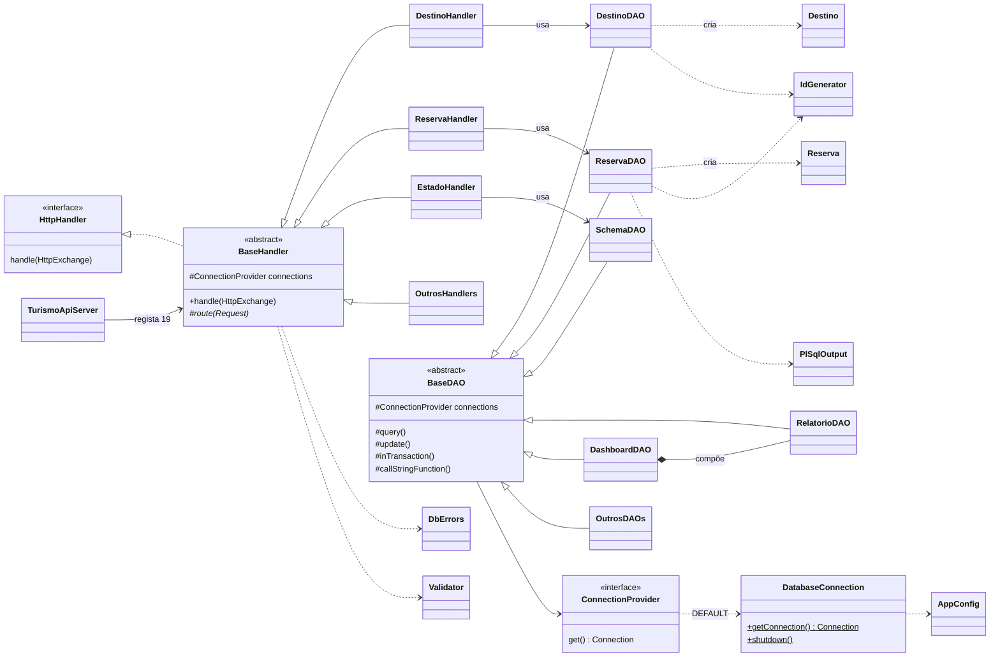

**Como ler:** `<|--` é **herança** (é um); `<|..` é **implementação de interface**; `*--` é **composição** (o `DashboardDAO` cria e possui o seu `RelatorioDAO`); `-->` é **associação** (guarda uma referência num atributo); `..>` é **dependência** (usa temporariamente, sem guardar). O diagrama mostra classes representativas (`OutrosHandlers` e `OutrosDAOs` representam as restantes subclasses); todos os *handlers* e DAOs de entidade seguem o mesmo padrão de `DestinoHandler`/`DestinoDAO`.

### 12.2 Frontend

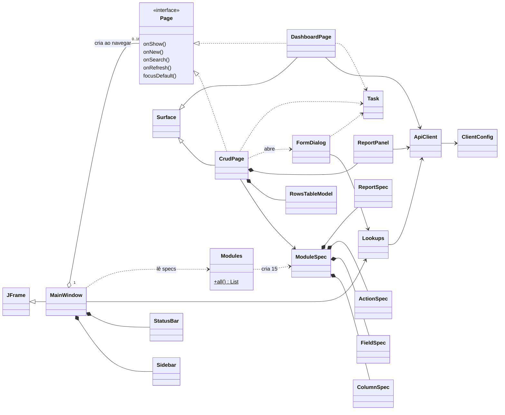

### 12.3 Quem usa quem — resumo

| Classe | É usada por | Usa |
|---|---|---|
| `BaseHandler` | 19 handlers (herança) | `DbErrors`, `Json`, `ConstraintCatalog`, `ApiException` |
| `BaseDAO` | 20 DAOs (herança) | `ConnectionProvider`, `AppConfig`, `DbErrors` |
| `DatabaseConnection` | `ConnectionProvider.DEFAULT`, `ConstraintCatalog`, testes | `AppConfig`, HikariCP |
| `DbErrors` | `BaseHandler`, `PlSqlOutput`, `BaseDAO`, `DashboardDAO`, `EstadoHandler`, `TurismoApiServer` | `ConstraintCatalog` |
| `ApiClient` | `Lookups`, `MainWindow`, `DashboardPage`, `ReportPanel`, `ModuleSpec.DeleteWarning`, `Modules` | `ClientConfig`, Gson |
| `ModuleSpec` | `CrudPage`, `FormDialog`, `MainWindow`, `Modules` | `ColumnSpec`, `FieldSpec`, `ActionSpec`, `ReportSpec`, `Format`, `ApiClient` |
| `Task` | todos os ecrãs e o `MainWindow` | `SwingWorker` |

---

# Parte IV — Funcionamento

## 13. Funcionamento interno dos principais processos

### 13.1 Arranque do sistema com executar.sh

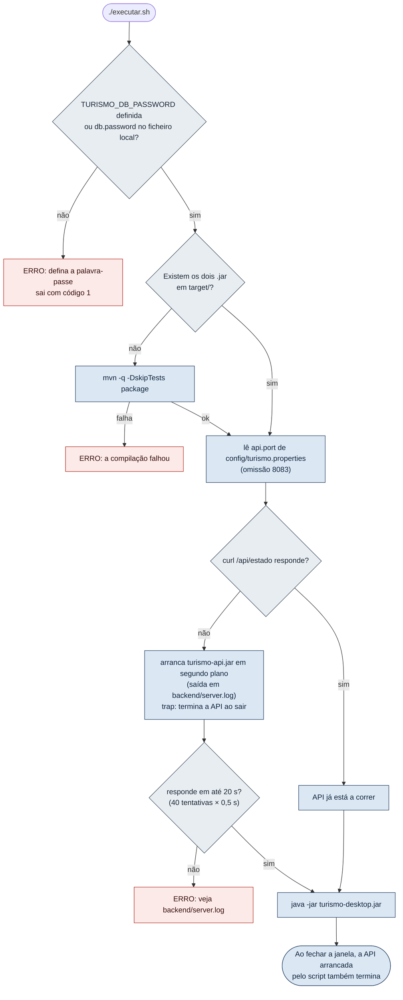

> [!note] Recompilação
> O `executar.sh` só compila quando falta um dos `.jar`. Depois de alterar código, é preciso compilar manualmente (`mvn package` ou `backend/compile.sh`); caso contrário, o script continua a usar os `.jar` antigos.

### 13.2 Arranque da API

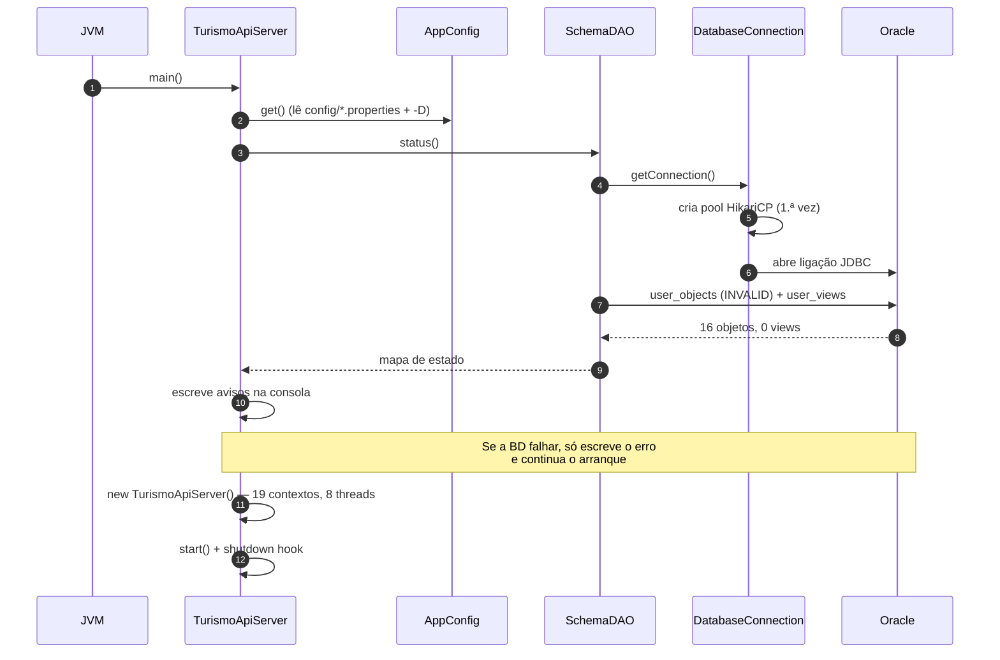

### 13.3 Arranque da aplicação desktop

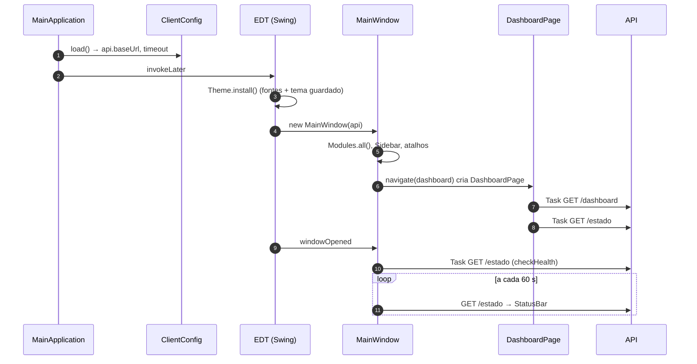

### 13.4 Operação completa — listar um módulo

Exemplo real: o utilizador clica em **Destinos** na barra lateral.

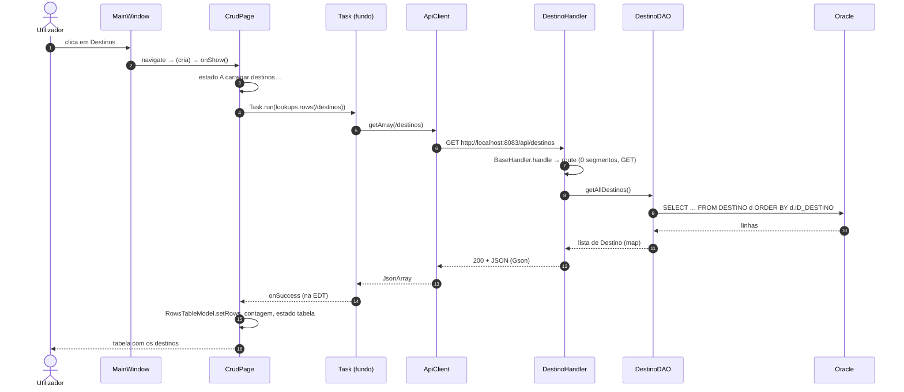

**Em caso de erro:** se o Oracle estiver desligado, o DAO lança `SQLRecoverableException`; o `BaseHandler` traduz para 503 `BD_INDISPONIVEL`; o `ApiClient` lança `ApiException(503)`; o `CrudPage` mostra "Não foi possível carregar destinos" com o motivo e "Tentar novamente". Se a API estiver desligada, o `ApiClient` lança `ApiException(0)` e o ecrã mostra "Sem ligação".

### 13.5 Operação completa — criar um registo com validação em três níveis

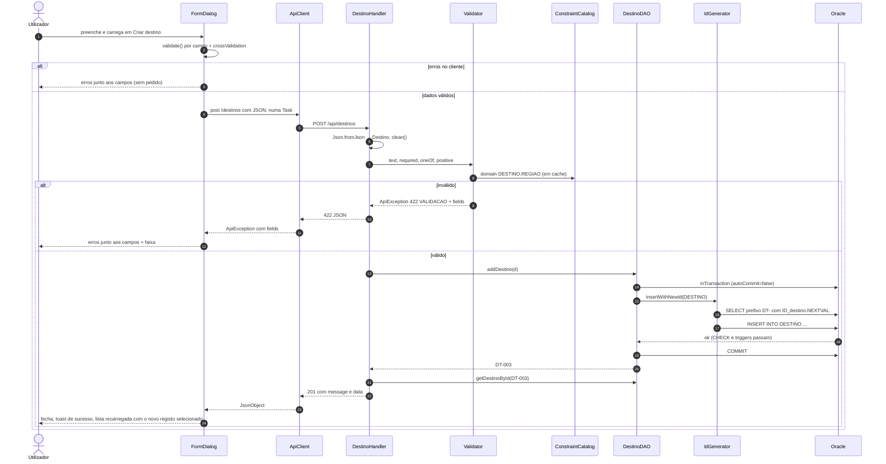

O código `DT-003` é ilustrativo: por causa dos números consumidos pelos testes, o próximo código real pode ser outro.

### 13.6 Criar uma reserva com alojamentos numa transação

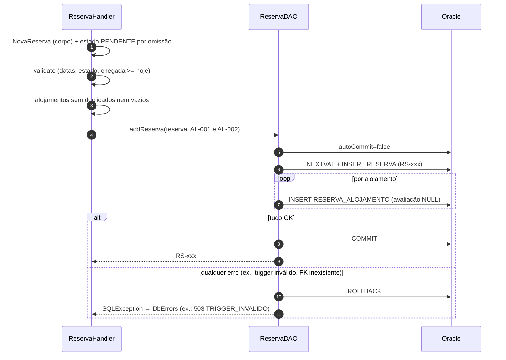

Hoje o primeiro `INSERT` falha com `ORA-04098` (*triggers* `VALIDARDATACHEGADA`/`VALIDARDATAPARTIDA` inválidos), por isso a reserva não é criada e o utilizador vê a mensagem do *trigger* inválido.

### 13.7 Chamada de uma procedure e leitura do DBMS_OUTPUT

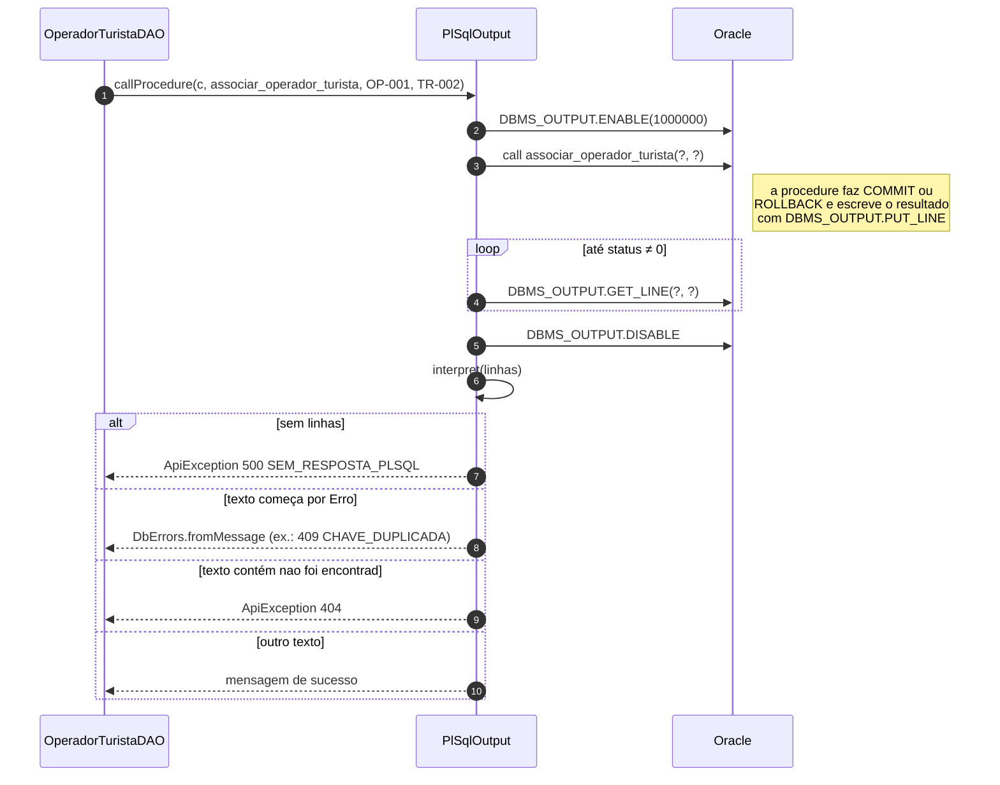

### 13.8 Tradução de erros da base de dados

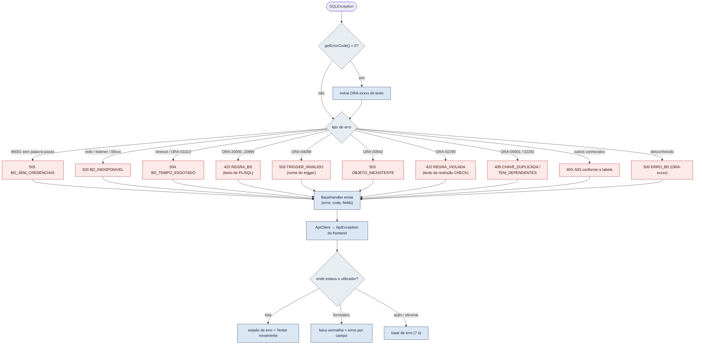

### 13.9 Eliminar um registo com aviso de cascata

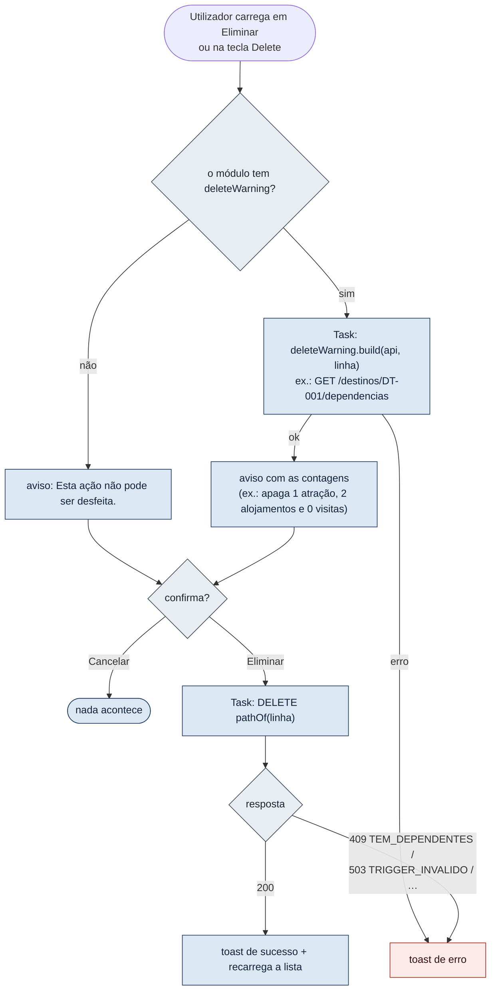

### 13.10 Carregamento do painel inicial

O `DashboardPage.load()` faz dois pedidos em paralelo:

1. `GET /api/dashboard` → `DashboardDAO.load()` numa só ligação: contagens das 15 tabelas e 10 *views* (6 do painel + 4 de verificação), cada uma em `try/catch` próprio.
2. `GET /api/estado` → `SchemaDAO.status()`: objetos inválidos e *views* em falta.

Cada secção do painel é preenchida de forma independente. Com a BD atual, os totais aparecem (as tabelas existem), mas todas as secções baseadas em *views* mostram "View em falta", e a secção "Integridade dos dados" mostra "16 inválidos" e "24 em falta".


---

## 14. Base de dados e acesso a dados

### 14.1 Papel da base de dados

A base de dados Oracle não é só um "armazém" de dados. Neste projeto ela também:

- **guarda as regras** de integridade (chaves, `NOT NULL`, `CHECK` com listas de valores e intervalos);
- **executa lógica de negócio** em PL/SQL (gerar recibos, verificar a capacidade de um destino, impedir apagar turistas com reservas, calcular médias e totais);
- **apaga em cascata** através de *triggers* `delete*` (as chaves estrangeiras **não** têm `ON DELETE CASCADE`);
- **valida** escritas através de *triggers* `validar*`;
- **fornece relatórios** através de 24 *views*.

A aplicação Java respeita esta divisão: reutiliza as funções e procedures válidas e lê as listas de valores das próprias restrições `CHECK`.

### 14.2 Mecanismo de ligação

| Aspeto | Implementação |
|---|---|
| Tecnologia | JDBC com o driver *thin* da Oracle (`com.oracle.database.jdbc:ojdbc11:23.26.3.0.0`) |
| Classe responsável | [DatabaseConnection](#DatabaseConnection) (única que cria ligações) |
| URL | Construído por `AppConfig.jdbcUrl()`: `jdbc:oracle:thin:@//<db.host>:<db.port>/<db.service>` ou `jdbc:oracle:thin:@<db.host>:<db.port>:<db.sid>` |
| Valores atuais | `db.host=192.168.64.4`, `db.port=1521`, `db.service=XE` (máquina virtual CentOS em UTM, segundo o README original) |
| Credenciais | `db.user` no ficheiro de configuração; palavra-passe em `TURISMO_DB_PASSWORD` ou `config/turismo.local.properties` (nunca nos logs) |
| *Pool* | HikariCP `turismo-oracle`, máximo `db.poolSize` (4) ligações, sem ligações mínimas, `autoCommit=true` |
| *Timeouts* | Ligação: `db.connectTimeoutSeconds` (8 s). Consulta: `db.queryTimeoutSeconds` (30 s) em cada instrução, e *timeout* de leitura de rede = consulta + 5 s |
| Particularidades do Oracle 10g | `oracle.jdbc.timezoneAsRegion=false` (evita `ORA-01882`); *locale* `pt_PT` (evita `ORA-12705`) |

### 14.3 Execução de SQL e PL/SQL

| Tipo de operação | Como é executada | Onde |
|---|---|---|
| Consultas | `PreparedStatement` com parâmetros `?` e *timeout* | `BaseDAO.query` / `queryOne` |
| `INSERT`/`UPDATE`/`DELETE` | `PreparedStatement.executeUpdate` | `BaseDAO.update` |
| Escritas compostas | Transação manual (`autoCommit=false` → `commit`/`rollback`) | `BaseDAO.inTransaction` |
| Funções PL/SQL que devolvem texto | `CallableStatement` `{? = call f(?, …)}` | `BaseDAO.callStringFunction` |
| Funções PL/SQL dentro de consultas | No próprio `SELECT` (ex.: `Media_Avaliacao_Operador(o.ID_OPERADOR)`) | DAOs |
| Procedures PL/SQL | `CallableStatement` `{call p(?, …)}` + leitura do `DBMS_OUTPUT` | `PlSqlOutput` |
| *Views* | `SELECT *` com nome validado contra uma lista fixa | `RelatorioDAO` |
| Dicionário de dados | `user_objects`, `user_views`, `user_constraints` | `SchemaDAO`, `ConstraintCatalog` |

> [!tip] Instruções preparadas e segurança
> Todos os valores vindos do utilizador entram como parâmetros `?`, nunca concatenados no SQL. As duas exceções em que texto entra no SQL são seguras: o nome da *view* (só aceita as 24 da lista `RelatorioDAO.VIEWS`) e o nome da sequência/função/procedure (constantes do código).

### 14.4 Conversão de resultados, erros e recursos

- **Conversão:** cada DAO tem um método `map(ResultSet)` que cria o *model*. As ajudas `getDate` (DATE → `LocalDate`), `getInteger` (preserva `null`) e `getTrimmed` (colunas `CHAR`) evitam erros comuns.
- **Parâmetros:** `BaseDAO.setParam` converte `LocalDate` → `java.sql.Date`, `BigDecimal`, `Integer` e `null` (`setNull(VARCHAR)`).
- **Exceções:** os DAOs **propagam** a `SQLException`. A tradução é feita num só sítio (`BaseHandler` → `DbErrors.translate`). As funções e procedures que devolvem mensagens em vez de lançar exceções são interpretadas por `requireSuccess`/`functionError` e `PlSqlOutput.interpret`.
- **Encerramento de recursos:** todas as `Connection`, `PreparedStatement`, `CallableStatement` e `ResultSet` são abertas em `try-with-resources`. Fechar a `Connection` devolve-a ao *pool*. O *pool* é fechado no *shutdown hook* da API.

### 14.5 Tabelas e relações

Fonte: `database/tabelas.sql` (confirmado, segundo `IMPLEMENTATION_PLAN.md`, por consulta ao dicionário de dados da BD real).

| Tabela | Chave primária | Chaves estrangeiras | Restrições relevantes | Model / DAO |
|---|---|---|---|---|
| `Tipo_Alojamento` | `tipo_alojamento` `VARCHAR2(11)` | — | `cap_alojamento NUMBER(2) > 0` | `TipoAlojamento` |
| `Destino` | `ID_destino` | — | `regiao` ∈ {Maputo, Gaza, Inhambane, Sofala, Tete, Manica, Zambezia, Nampula, Niassa, Cabo Delgado}; `capacidade_visitantes NUMBER(10) > 0` | `Destino` |
| `Atracao` | `ID_atracao` | `ID_destino` → `Destino` | `tipo_atracao` ∈ 8 valores; horas `CHAR(5)`; horário especial: os 3 campos todos nulos ou todos preenchidos com fecho > abertura | `Atracao` |
| `Turista` | `ID_turista` | — | `nome_turista VARCHAR2(80)`, `nacionalidade VARCHAR2(50)` | `Turista` |
| `Turista_Preferencia` | (`ID_turista`, `preferencia`) | `ID_turista` → `Turista` | `preferencia` ∈ {Praias, Aventura, Natureza, Cultura, Gastronomia} | `TuristaPreferencia` |
| `Reserva` | `ID_reserva` | `ID_turista` → `Turista` | `status_reserva` ∈ {PENDENTE, CONFIRMADA, CANCELADA, CONCLUIDA}, omissão PENDENTE; `data_partida >= data_chegada` | `Reserva` |
| `Operador` | `ID_operador` | — | `class_operador NUMBER(2,1)` entre 0,0 e 5,0 | `Operador` |
| `Alojamento` | `ID_alojamento` | `tipo_alojamento` → `Tipo_Alojamento`; `ID_destino` → `Destino` | `class_alojamento` 0,0–5,0 | `Alojamento` |
| `Transporte` | `ID_transporte` | — | `cap_transporte NUMBER(9) > 0`; `disponibilidade CHAR(3)` ∈ {Sim, Nao} | `Transporte` |
| `Pagamento` | `ID_pagamento` | `ID_reserva` → `Reserva` | `valor NUMBER(10,2) > 0`; `metodo_pagamento` ∈ {DINHEIRO, CARTAO, TRANSFERENCIA}; `status_pagamento` ∈ {PENDENTE, CONCLUIDO, FALHADO}; `ID_recibo` único | `Pagamento` |
| `Reserva_Alojamento` | (`ID_reserva`, `ID_alojamento`) | ambas | `avaliacao_alojamento` 0,0–5,0 | `ReservaAlojamento` |
| `Operador_Transporte` | (`ID_operador`, `ID_transporte`) | ambas | — | `OperadorTransporte` |
| `Operador_Alojamento` | (`ID_operador`, `ID_alojamento`) | ambas | — | `OperadorAlojamento` |
| `Operador_Turista` | (`ID_operador`, `ID_turista`) | ambas | `avaliacao_operador` 0,0–5,0 | `OperadorTurista` |
| `Turista_Destino` | (`ID_destino`, `ID_turista`, `data_visita`) | `ID_destino`, `ID_turista` | — | `TuristaDestino` |

Todos os identificadores `ID_*` são `VARCHAR2(6)` (ex.: `DT-001`).

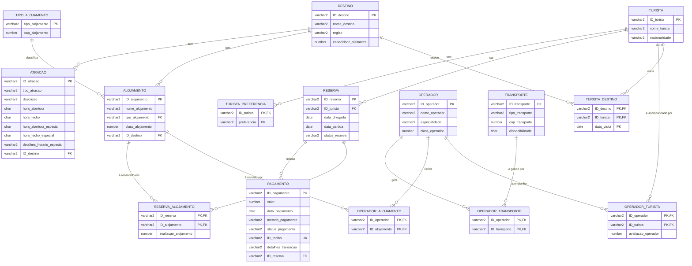

**Leitura do modelo:** o **destino** é o centro geográfico (tem atrações e alojamentos e recebe visitas). O **turista** faz reservas, tem preferências e visita destinos. A **reserva** liga o turista aos alojamentos (`Reserva_Alojamento`, onde fica a avaliação) e recebe pagamentos. O **operador** é ligado a transportes, alojamentos e turistas por três tabelas associativas; a avaliação do operador fica em `Operador_Turista`.

### 14.6 Sequências e formato dos códigos

| Sequência | Prefixo | Gerada por |
|---|---|---|
| `ID_destino` | `DT-` | `IdGenerator` (`DestinoDAO`) |
| `ID_atracao` | `AT-` | `IdGenerator` (`AtracaoDAO`) |
| `ID_turista` | `TR-` | função `Insere_Turista` |
| `ID_reserva` | `RS-` | `IdGenerator` (`ReservaDAO`) |
| `ID_operador` | `OP-` | `IdGenerator` (`OperadorDAO`) |
| `ID_alojamento` | `AL-` | `IdGenerator` (`AlojamentoDAO`) |
| `ID_transporte` | `TP-` | `IdGenerator` (`TransporteDAO`) |
| `ID_pagamento` | `PG-` | `IdGenerator` (`PagamentoDAO`) |
| `ID_recibo` | (definido na função) | função `Concluir_Pagamento` |

Todas as sequências têm `MAXVALUE 999`.

### 14.7 Funções e procedures usadas pelo Java

| Objeto PL/SQL | Tipo | Usado por | Para quê |
|---|---|---|---|
| `Total_Pago_Reserva` | Função | `ReservaDAO` (no `SELECT`) | Total pago da reserva |
| `Reserva_Completa` | Função | `ReservaDAO` (no `SELECT`) | Texto de completude ("Completa"…) |
| `Media_Avaliacao_Alojamento` | Função | `AlojamentoDAO` | Média das avaliações |
| `Media_Avaliacao_Operador` | Função | `OperadorDAO` | Média das avaliações |
| `Valor_Em_Dolar` | Função | `PagamentoDAO.valorEmDolar` | Conversão com cotação |
| `Retorna_Info_Destino`, `Lista_Atracoes_Destino` | Funções | `DestinoDAO.getInfo` | Ficha do destino |
| `Insere_Turista` | Função | `TuristaDAO.addTurista` | Criar turista e gerar código |
| `Elimina_Turista` | Função | `TuristaDAO.deleteTurista` | Eliminar turista sem reservas |
| `Regista_Visita` | Função | `TuristaDestinoDAO.addTuristaDestino` | Registar visita respeitando a capacidade |
| `Concluir_Pagamento` | Função | `PagamentoDAO.concluirPagamento` | Concluir e gerar recibo |
| `definir_tipo_alojamento` | Procedure | `TipoAlojamentoDAO` | Criar tipo |
| `inserir_preferencia` | Procedure | `TuristaPreferenciaDAO` | Criar preferência |
| `associar_alojamento_reserva` | Procedure | `ReservaAlojamentoDAO` | Associar alojamento a reserva |
| `avaliar_alojamento` | Procedure | `ReservaAlojamentoDAO.avaliar` | Avaliar alojamento |
| `associar_operador_turista` | Procedure | `OperadorTuristaDAO` | Associar operador a turista |
| `avaliar_operador` | Procedure | `OperadorTuristaDAO.avaliar` | Avaliar operador |
| `associar_operador_transporte` | Procedure | `OperadorTransporteDAO` | Associar operador a transporte |
| `associar_operador_alojamento` | Procedure | `OperadorAlojamentoDAO` | Associar operador a alojamento |
| `cancelar_reserva` | Procedure | `ReservaDAO.cancelarReserva` | Cancelar reserva |

**Não usados pelo Java:** funções `Capacidade_Alojamento` e `Actualiza_Status_Reserva`; procedures `registrar_reserva`, `registrar_pagamento`, `registrar_visita`, `registrar_atracao` (INVALID), `alterar_horario_atracao` (INVALID), `alterar_datas_reserva` e `atualizar_pref_turista` (com o problema descrito no [TuristaPreferenciaDAO](#TuristaPreferenciaDAO)).

### 14.8 Estado real da base de dados

> [!warning] Evidência
> O estado abaixo vem do último arranque da API registado em `backend/server.log` e da auditoria de 20-10-2026 documentada em `IMPLEMENTATION_PLAN.md`. Esta análise **não** consultou a base de dados (para não alterar nada). O estado pode ter mudado desde então.

**Objetos INVALID (16):**

| Tipo | Nome | Tabela / evento | Efeito |
|---|---|---|---|
| Procedure | `ALTERAR_HORARIO_ATRACAO`, `REGISTRAR_ATRACAO`, `REGISTRAR_PAGAMENTO`, `REGISTRAR_RESERVA`, `REGISTRAR_VISITA` | — | Não são usadas pelo Java; sem efeito na aplicação |
| Trigger | `VALIDARHORABERTURA`, `VALIDARHORAFECHO`, `VALIDARHORABERTURAESP`, `VALIDARHORAFECHOESP` | `Atracao`, antes de INSERT/UPDATE | Bloqueiam criar e editar atrações |
| Trigger | `VALIDARCAPALOJAMENTO` | `Alojamento`, antes de INSERT/UPDATE | Bloqueia criar e editar alojamentos |
| Trigger | `VALIDARDATACHEGADA`, `VALIDARDATAPARTIDA` | `Reserva`, antes de INSERT/UPDATE | Bloqueiam criar, editar e cancelar reservas |
| Trigger | `DELETERESERVA` | `Reserva`, depois de DELETE | Bloqueia eliminar reservas **e** turistas (o `deleteTurista` apaga reservas) |
| Trigger | `VALIDARPAGAMENTO` | `Pagamento`, antes de INSERT/UPDATE | Bloqueia criar, editar e concluir pagamentos |
| Trigger | `VALIDARAVAOPERADOR` | `Operador_Turista`, antes de INSERT/UPDATE | Bloqueia associar e avaliar operadores |
| Trigger | `VALIDARAVALOJAMENTO` | `Reserva_Alojamento`, antes de INSERT/UPDATE | Bloqueia associar e avaliar alojamentos de reservas |

**Views:** 0 de 24 existem (`user_views` vazia).
**Auditoria:** as 15 tabelas `auditoria_*` e os 15 *triggers* de auditoria não existem na BD, segundo `IMPLEMENTATION_PLAN.md`. O script `Triggers.sql` tem `UPTADE` em vez de `UPDATE` e um *trigger* com o nome `Transporte` (igual ao nome da tabela).
**Dados** (à data da auditoria): 2 destinos, 5 turistas, 2 tipos de alojamento, 2 transportes, 2 operadores, 2 preferências, 2 visitas e 2 associações operador–transporte; as restantes tabelas estavam vazias. A captura `00-painel.png` confirma 2 destinos, 5 turistas, 0 reservas, 0 alojamentos, 2 operadores e 0 pagamentos.

> [!note] Discrepância na documentação existente
> `README.md`, `IMPLEMENTATION_PLAN.md` e o cabeçalho de `correcoes.sql` falam em **12 *triggers*** e `PROGRESS_CHECKLIST.md` em **17 objetos** inválidos. O `server.log` lista **11 *triggers* + 5 procedures = 16** objetos, e o `correcoes.sql` recria exatamente esses 16. O valor correto, segundo as evidências mais diretas, é **16**.

**O que `correcoes.sql` faz:** recria `deleteReserva` sem a instrução que apagava turistas por `ID_reserva`; recria os 10 *triggers* de validação corrigidos (`REGEXP_LIKE` em vez de `REGEXP`, `END IF` em falta, colunas certas); **move** `validarcapalojamento` da tabela `Alojamento` para `Tipo_Alojamento`, que é onde está a capacidade; recria as 5 procedures (variáveis declaradas, colunas e tipos corretos); e cria as 24 *views*. Cada decisão está comentada com `NOTA`.

### 14.9 Scripts SQL e ordem de execução

> [!caution] Não verificado
> Não existe documentação no projeto sobre a ordem completa de execução dos scripts. A ordem abaixo é **deduzida das dependências** entre objetos e serve de orientação, não de procedimento validado. `tabelas.sql` começa com `DROP TABLE … CASCADE CONSTRAINTS`, por isso **apaga todos os dados** existentes.

1. `tabelas.sql` (tabelas e restrições)
2. `Sequences.sql`
3. `Index.sql`
4. `Tabelas_de_Historico.sql` (necessárias aos *triggers* de auditoria)
5. `functions.sql` e `procedures.sql`
6. `Triggers.sql`
7. `views.sql`
8. `Inserts.sql`
9. `correcoes.sql` (corrige os objetos inválidos e cria as *views*)

O único procedimento documentado é o de `correcoes.sql`, a partir da pasta `database/`: `sqlplus <utilizador>@//192.168.64.4:1521/XE @correcoes.sql`.

---

## 15. API REST e rotas

### 15.1 Convenções

| Aspeto | Regra (confirmada no código) |
|---|---|
| Endereço base | `http://localhost:8083/api` (`api.port`, `api.bindAddress=127.0.0.1` por omissão) |
| Formato | JSON em UTF-8 (`Content-Type: application/json; charset=UTF-8`) |
| Nomes dos campos | Os dos *models* (`idDestino`, `nomeDestino`, …) |
| Datas | `AAAA-MM-DD` |
| Números | Ponto decimal; o servidor aceita vírgula em `?cotacao=` |
| Escritas com sucesso | `{"message": "…", "data": {registo relido}}` (201 na criação, 200 nas restantes) |
| Erros | `{"error": "mensagem em português", "code": "CODIGO", "fields": {"campo": "mensagem"}}` (`fields` só na validação) |
| Tamanho máximo do corpo | 64 KB (acima → 413) |
| Autenticação | Nenhuma |
| Concorrência | 8 *threads* no servidor, 4 ligações à BD |

| Estado HTTP | Quando |
|---|---|
| 200 / 201 | Sucesso / registo criado |
| 400 | JSON inválido, corpo vazio, data ou número mal formatado no caminho ou na *query* |
| 404 | Registo, relatório ou rota inexistente |
| 405 | Método não suportado na rota |
| 409 | Chave duplicada, registos dependentes, pagamento já concluído, mensagens de conflito das funções PL/SQL |
| 413 | Corpo maior que 64 KB |
| 422 | Validação (`fields`), restrição `CHECK`, chave estrangeira inexistente, regra de um *trigger* ou de uma função |
| 500 | Erro interno, sequência esgotada, *trigger* com tabela mutante, PL/SQL sem resposta |
| 502 | (só no cliente) resposta inesperada da API |
| 503 | BD indisponível, sem credenciais, *trigger* ou PL/SQL inválido, *view* em falta |
| 504 | Consulta demasiado lenta (no cliente: API demasiado lenta) |

### 15.2 Tabela completa de rotas

Legenda do **Estado**: **Funcional** = implementada e testada contra a BD real · **Funcional (ROLLBACK)** = escrita testada numa transação desfeita · **Implementada** = código presente, mas não testada com sucesso contra a BD real · **Bloqueada** = implementada, mas a BD atual rejeita-a (*trigger* inválido ou *view* em falta).

| Método HTTP | Rota | Finalidade | Parâmetros | Resposta | Estado |
|---|---|---|---|---|---|
| GET | `/api/estado` | Estado da API e da BD | — | `{api, bd, database, objetosInvalidos, viewsEsperadas, viewsEmFalta}` | Funcional |
| GET | `/api/dominios` | Listas das restrições `CHECK` | — | `{"TABELA.COLUNA": [...]}` | Funcional |
| GET | `/api/dashboard` | Dados do painel | — | `{totais, views, verificacoes}` | Funcional (secções de *views*: Bloqueada) |
| GET | `/api/relatorios` | Nomes das 24 *views* | — | `["v_…", …]` | Funcional |
| GET | `/api/relatorios/{view}` | Conteúdo de uma *view* (máx. 1000 linhas) | `view` | `{view, columns, rows, truncated}` | Bloqueada (503) |
| GET | `/api/destinos` | Listar destinos | — | `[Destino]` | Funcional |
| POST | `/api/destinos` | Criar destino | corpo `Destino` | 201 + destino | Funcional (ROLLBACK) |
| GET | `/api/destinos/{id}` | Obter destino | `id` | `Destino` | Funcional |
| PUT | `/api/destinos/{id}` | Alterar destino | `id`, corpo | 200 + destino | Funcional (ROLLBACK) |
| DELETE | `/api/destinos/{id}` | Eliminar (cascata por *trigger*) | `id` | `{message}` | Funcional (ROLLBACK) |
| GET | `/api/destinos/{id}/dependencias` | O que a eliminação apagaria | `id` | `{atracoes, alojamentos, visitas}` | Funcional |
| GET | `/api/destinos/{id}/info` | Ficha PL/SQL do destino | `id` | `{info, atracoes}` | Funcional |
| GET | `/api/atracoes` | Listar (opcional por destino) | `?idDestino=` | `[Atracao]` | Funcional |
| GET | `/api/atracoes/destino/{idDestino}` | Atrações de um destino | `idDestino` | `[Atracao]` | Funcional |
| POST | `/api/atracoes` | Criar atração | corpo | 201 + atração | Bloqueada |
| GET | `/api/atracoes/{id}` | Obter atração | `id` | `Atracao` | Funcional |
| PUT | `/api/atracoes/{id}` | Alterar atração | `id`, corpo | 200 | Bloqueada |
| DELETE | `/api/atracoes/{id}` | Eliminar atração | `id` | `{message}` | Implementada |
| GET | `/api/alojamentos` | Listar (opcional por destino) | `?idDestino=` | `[Alojamento]` | Funcional |
| POST | `/api/alojamentos` | Criar alojamento | corpo | 201 | Bloqueada |
| GET / PUT / DELETE | `/api/alojamentos/{id}` | Obter / alterar / eliminar | `id` | — | GET Funcional · PUT Bloqueada · DELETE Implementada |
| GET / POST | `/api/tipoAlojamentos` | Listar / criar (procedure) | corpo no POST | — | GET Funcional · POST Implementada |
| GET / PUT / DELETE | `/api/tipoAlojamentos/{tipo}` | Obter / alterar capacidade / eliminar | `tipo` | — | GET Funcional · PUT Funcional (ROLLBACK) · DELETE Implementada |
| GET / POST | `/api/transportes` | Listar / criar | — | — | Funcional · Funcional (ROLLBACK) |
| GET / PUT / DELETE | `/api/transportes/{id}` | Obter / alterar / eliminar | `id` | — | Funcional · Implementada · Funcional (ROLLBACK) |
| GET / POST | `/api/turistas` | Listar / criar (`Insere_Turista`) | — | — | Funcional · Implementada |
| GET / PUT / DELETE | `/api/turistas/{id}` | Obter / alterar / eliminar (`Elimina_Turista`) | `id` | DELETE: `{message}` | Funcional · Funcional (ROLLBACK) · Bloqueada |
| GET / POST | `/api/turistaPreferencias` | Listar / criar (procedure) | `?idTurista=` | — | Funcional · Implementada (erro testado) |
| GET | `/api/turistaPreferencias/turista/{idTurista}` | Preferências de um turista | `idTurista` | `[TuristaPreferencia]` | Funcional |
| GET / PUT / DELETE | `/api/turistaPreferencias/{idTurista}/{preferencia}` | Obter / trocar / remover | chave composta; PUT `{"preferencia": nova}` | — | Funcional · Funcional (ROLLBACK) · Implementada |
| GET / POST | `/api/operadores` | Listar / criar | — | — | Funcional · Funcional (ROLLBACK) |
| GET / PUT / DELETE | `/api/operadores/{id}` | Obter / alterar / eliminar (cascata) | `id` | — | Funcional · Implementada · Funcional (ROLLBACK) |
| GET | `/api/reservas` | Listar (opcional por turista) | `?idTurista=` | `[Reserva]` | Funcional |
| GET | `/api/reservas/turista/{idTurista}` | Reservas de um turista | `idTurista` | `[Reserva]` | Funcional |
| POST | `/api/reservas` | Criar reserva + alojamentos (transação) | corpo com `alojamentos` opcional | 201 | Bloqueada |
| GET / PUT / DELETE | `/api/reservas/{id}` | Obter / alterar / eliminar | `id` | — | Funcional · Bloqueada · Bloqueada |
| POST | `/api/reservas/{id}/cancelar` | Cancelar (`cancelar_reserva`) | `id` | 200 + reserva | Bloqueada (erro testado) |
| GET | `/api/pagamentos` | Listar (opcional por reserva) | `?idReserva=` | `[Pagamento]` | Funcional |
| GET | `/api/pagamentos/reserva/{idReserva}` | Pagamentos de uma reserva | `idReserva` | `[Pagamento]` | Funcional |
| POST | `/api/pagamentos` | Registar pagamento | corpo | 201 | Bloqueada |
| GET / PUT / DELETE | `/api/pagamentos/{id}` | Obter / alterar (não se `CONCLUIDO`) / eliminar | `id` | — | Funcional · Bloqueada · Implementada |
| POST | `/api/pagamentos/{id}/concluir` | Concluir e gerar recibo (`Concluir_Pagamento`) | `id` | 200 + pagamento | Implementada (erro testado) |
| GET | `/api/pagamentos/{id}/dolar` | Valor em dólares (`Valor_Em_Dolar`) | `id`, `?cotacao=` (> 0) | `{idPagamento, cotacao, valorUsd}` | Implementada |
| GET / POST | `/api/turistaDestinos` | Listar / registar visita (`Regista_Visita`) | `?idTurista=` ou `?idDestino=` | — | Funcional · Implementada (erro testado) |
| GET | `/api/turistaDestinos/turista/{id}` · `/destino/{id}` | Filtros | `id` | lista | Funcional |
| GET / DELETE | `/api/turistaDestinos/{idDestino}/{idTurista}/{data}` | Obter / remover visita | chave de 3 partes | — | Funcional · Implementada |
| GET / POST | `/api/reservaAlojamentos` | Listar / associar | `?idReserva=` ou `?idAlojamento=` | — | Funcional · Bloqueada |
| GET | `/api/reservaAlojamentos/reserva/{id}` · `/alojamento/{id}` | Filtros | `id` | lista | Funcional |
| GET / PUT / DELETE | `/api/reservaAlojamentos/{idReserva}/{idAlojamento}` | Obter / avaliar / remover | chave; PUT `{"avaliacaoAlojamento": x}` | — | Funcional · Bloqueada · Implementada |
| GET / POST | `/api/operadorTuristas` | Listar / associar | `?idOperador=` ou `?idTurista=` | — | Funcional · Bloqueada |
| GET | `/api/operadorTuristas/operador/{id}` · `/turista/{id}` | Filtros | `id` | lista | Funcional |
| GET / PUT / DELETE | `/api/operadorTuristas/{idOperador}/{idTurista}` | Obter / avaliar / remover | chave; PUT `{"avaliacaoOperador": x}` | — | Funcional · Bloqueada · Implementada |
| GET / POST | `/api/operadorTransportes` | Listar / associar | `?idOperador=` ou `?idTransporte=` | — | Funcional · Implementada |
| GET | `/api/operadorTransportes/operador/{id}` · `/transporte/{id}` | Filtros | `id` | lista | Funcional |
| GET / DELETE | `/api/operadorTransportes/{idOperador}/{idTransporte}` | Obter / remover | chave | — | Funcional · Implementada |
| GET / POST | `/api/operadorAlojamentos` | Listar / associar | `?idOperador=` ou `?idAlojamento=` | — | Funcional · Implementada |
| GET | `/api/operadorAlojamentos/operador/{id}` · `/alojamento/{id}` | Filtros | `id` | lista | Funcional |
| GET / DELETE | `/api/operadorAlojamentos/{idOperador}/{idAlojamento}` | Obter / remover | chave | — | Funcional · Implementada |

> [!note] "Funcional" nos GET por chave
> O `OracleIntegrationTest.cadaRegistoDaListaEhEncontradoPelaChave` lê cada registo das 15 listas pela sua chave, por isso os GET por chave estão confirmados para as tabelas que têm dados. Em tabelas vazias (reservas, pagamentos, alojamentos…) a rota foi exercitada apenas no caminho "lista vazia".

### 15.3 Detalhe por grupo de rotas

**Estado, domínios, painel e relatórios** — só leitura. Recebem dados apenas pelo caminho. Classes: `EstadoHandler`/`SchemaDAO`, `DominioHandler`/`ConstraintCatalog`, `DashboardHandler`/`DashboardDAO`, `RelatorioHandler`/`RelatorioDAO`. Operações na BD: dicionário de dados, contagens e `SELECT` nas *views*. Erros: 503 (BD indisponível ou *view* em falta), 404 (*view* fora da lista), 405.

**Entidades simples** (`destinos`, `atracoes`, `alojamentos`, `tipoAlojamentos`, `transportes`, `turistas`, `operadores`, `reservas`, `pagamentos`) — o corpo JSON é convertido no *model* pelo Gson; as validações estão descritas no [§9.6](#9.6%20Handlers%20de%20entidade); as classes são o *handler* e o DAO do mesmo nome; as operações na BD estão nas fichas dos DAOs ([§9.4](#9.4%20Pacote%20dao%20—%20DAOs%20de%20entidade)). Erros típicos: 422 (validação, `CHECK`, FK), 409 (duplicado ou dependentes), 404, 503 (*trigger* inválido).

**Ações especiais** — `POST /reservas/{id}/cancelar` (procedure `cancelar_reserva`), `POST /pagamentos/{id}/concluir` (função `Concluir_Pagamento`, que gera o recibo e devolve "Pagamento concluido…"; um pagamento que já não está pendente dá 409), `GET /pagamentos/{id}/dolar?cotacao=` (função `Valor_Em_Dolar`; cotação em falta ou inválida → 400; pagamento inexistente → 404), `GET /destinos/{id}/dependencias` e `/info`.

**Tabelas associativas** — a chave composta vai no caminho, com cada parte codificada (`ApiClient.segment`). A criação usa procedures ou funções PL/SQL, cuja mensagem é devolvida em `message`. Onde todas as colunas são chave (`turistaDestinos`, `operadorTransportes`, `operadorAlojamentos`), não há `PUT`. Nas tabelas com avaliação, o `PUT` significa "avaliar" e usa as procedures `avaliar_*` (enviar `null` retira a avaliação).

**Exemplos `curl`** (do `backend/README.md`, a executar com a API a correr):

```bash
curl http://localhost:8083/api/estado
curl http://localhost:8083/api/destinos
curl -X POST http://localhost:8083/api/destinos \
     -H 'Content-Type: application/json' \
     -d '{"nomeDestino":"Ilha de Moçambique","regiao":"Nampula","capacidadeVisitantes":200}'
curl -X DELETE http://localhost:8083/api/turistaPreferencias/TR-001/Praias
```

> [!warning] Os exemplos de escrita alteram dados
> O `POST` e o `DELETE` acima gravam e apagam na base de dados real. Use-os apenas em dados de teste.


---

# Parte V — Trabalhar com o projeto

## 16. Configuração e requisitos

### 16.1 Software necessário

| Componente | Versão | Evidência |
|---|---|---|
| JDK | 21 ou superior (o código compila com `--release 21`; testado com OpenJDK 26.0.2) | `pom.xml`, `RELATORIO_TESTES.md` |
| Maven | 3.9 ou superior (testado com 3.10.0); não existe Maven Wrapper (`mvnw`) | `README.md`, `RELATORIO_TESTES.md` |
| Oracle Database | 10g Express Edition 10.2.0.1 numa máquina virtual acessível pela rede | `server.log` |
| Sistema operativo | macOS (testado) ou Windows (scripts preparados, não testado) | `RELATORIO_TESTES.md` |
| `curl` | Usado por `executar.sh` e `executar.bat` para verificar se a API responde | scripts |
| `lsof`, `pkill` | Usados por `backend/run_turismo.sh` | script |

### 16.2 Dependências (descarregadas pelo Maven)

| Biblioteca | Versão | Módulo | Para quê |
|---|---|---|---|
| `com.oracle.database.jdbc:ojdbc11` | 23.26.3.0.0 | backend | Driver JDBC Oracle |
| `com.zaxxer:HikariCP` | 6.2.1 | backend | *Pool* de ligações |
| `org.slf4j:slf4j-simple` (+ `slf4j-api`) | 2.0.16 | backend | Registos do HikariCP |
| `com.google.code.gson:gson` | 2.13.2 | ambos | JSON |
| `com.formdev:flatlaf` | 3.6.1 | frontend | Aparência moderna do Swing, temas claro/escuro |
| `org.kordamp.ikonli:ikonli-swing` + `ikonli-materialdesign2-pack` | 12.3.1 | frontend | Ícones Material Design |
| `org.junit:junit-bom` (Jupiter) | 5.11.4 | ambos (teste) | Testes |

*Plugins* Maven fixados: `maven-compiler-plugin` 3.13.0, `maven-surefire-plugin` 3.5.2, `maven-shade-plugin` 3.6.0, `exec-maven-plugin` 3.5.0, entre outros.

### 16.3 Chaves de configuração

Ficheiro `config/turismo.properties`. Qualquer chave `db.*` ou `api.*` pode ser sobreposta com `-Dchave=valor`.

| Chave | Valor atual | Omissão no código | Usada por | Descrição |
|---|---|---|---|---|
| `db.host` | `192.168.64.4` | `localhost` | backend | Endereço da máquina virtual Oracle |
| `db.port` | `1521` | `1521` | backend | Porta do *listener* |
| `db.service` | `XE` | — | backend | *Service name* (tem prioridade sobre o SID) |
| `db.sid` | vazio | — | backend | SID alternativo |
| `db.user` | definido (não reproduzido) | — (obrigatório) | backend | Utilizador Oracle |
| `db.password` | **não deve existir aqui** | — | backend | Só em `turismo.local.properties` |
| `db.connectTimeoutSeconds` | `8` | 8 | backend | *Timeout* para abrir a ligação |
| `db.queryTimeoutSeconds` | `30` | 30 | backend | *Timeout* de cada consulta |
| `db.poolSize` | `4` | 4 | backend | Máximo de ligações simultâneas |
| `api.port` | `8083` | 8083 | backend e scripts | Porta da API |
| `api.bindAddress` | (não definido) | `127.0.0.1` | backend | Interface de rede onde a API escuta |
| `api.baseUrl` | `http://localhost:8083/api` | o mesmo | frontend | Endereço da API usado pela aplicação |
| `api.timeoutSeconds` | `40` | 40 | frontend | Tempo máximo de espera por uma resposta |

**Variáveis de ambiente:** `TURISMO_DB_PASSWORD` (palavra-passe; tem prioridade sobre `db.password`) e `TURISMO_CONFIG_DIR` (pasta de configuração alternativa).

**Palavra-passe — duas opções:**

```bash
# Opção 1 (recomendada): variável de ambiente, na sessão ou no ~/.zshrc
export TURISMO_DB_PASSWORD='<palavra-passe>'
```

```bash
# Opção 2: ficheiro local, excluído do Git (a partir da raiz do projeto)
cp config/turismo.local.properties.example config/turismo.local.properties
# depois edite o ficheiro e preencha db.password=
```

> [!warning] Pasta de trabalho
> Os `.jar` procuram a configuração em `./config` e `../config`. Execute-os a partir da **raiz do projeto** (é o que todos os scripts fazem) ou defina `-Dturismo.config.dir=/caminho/para/config`.

---

## 17. Compilação e execução

Todos os comandos abaixo são executados a partir da **raiz do projeto** (`Trabalho_turismo/`), salvo indicação em contrário.

### 17.1 Compilar

| Comando | O que faz | Resultado |
|---|---|---|
| `mvn package` | Compila os dois módulos, **corre todos os testes** e cria os `.jar` | `backend/target/turismo-api.jar`, `frontend/target/turismo-desktop.jar` |
| `mvn -q -DskipTests package` | O mesmo, sem testes e com pouca saída | idem |
| `mvn -q -DskipTests -pl backend -am package` | Só o backend | `backend/target/turismo-api.jar` |
| `backend/compile.sh` ou `frontend/compile.sh` | Atalhos (os dois são iguais): `mvn -q -DskipTests package` | ambos os `.jar` |

Os `.jar` são "gordos" (*shaded*): incluem todas as dependências e podem ser executados só com `java -jar`.

### 17.2 Executar

| Forma | Comando | Quando usar |
|---|---|---|
| Tudo de uma vez (macOS/Linux) | `./executar.sh` | Uso normal. Compila se faltar algum `.jar`, arranca a API (se não estiver a correr) com o log em `backend/server.log`, abre a aplicação e termina a API ao fechar. |
| Tudo de uma vez (Windows) | `executar.bat` | Igual, mas a API abre numa janela minimizada "Turismo API" que é preciso fechar à mão. **Não testado.** |
| Só a API, recompilando | `backend/run_turismo.sh` | Desenvolvimento do backend. Exige `TURISMO_DB_PASSWORD`, para um servidor anterior na mesma porta, compila o backend e arranca a API em primeiro plano (Ctrl+C para parar). |
| Só a API, sem compilar | `backend/run.sh` ou `java -jar backend/target/turismo-api.jar` | API já compilada. |
| Só a aplicação | `frontend/run.sh` ou `java -jar frontend/target/turismo-desktop.jar` | A API tem de estar a correr. |
| Pelo Maven (sem `.jar`) | `mvn -pl backend exec:java` / `mvn -pl frontend exec:java` | Configurado no `exec-maven-plugin` com `turismo.config.dir`. **Não verificado** nesta análise (pode exigir compilação prévia). |

**Diferenças entre os scripts**

| Script | Verifica palavra-passe | Compila | Arranca API | Abre aplicação | Para a API no fim |
|---|---|---|---|---|---|
| `executar.sh` | Sim (variável ou ficheiro com valor) | Só se faltar um `.jar` | Se não estiver a correr | Sim | Sim (se foi ele a arrancá-la) |
| `executar.bat` | Sim (variável ou existência do ficheiro) | Só se faltar um `.jar` | Se não estiver a correr | Sim | Não |
| `backend/run_turismo.sh` | Sim (só a variável) | Sempre (só o backend) | Sim (mata a anterior) | Não | Ctrl+C |
| `backend/run.sh` | Não | Não | Sim | Não | Ctrl+C |
| `frontend/run.sh` | Não | Não | Não | Sim | — |
| `*/compile.sh` | Não | Sempre (os dois módulos) | Não | Não | — |

> [!note] Diferença subtil entre `.sh` e `.bat`
> O `executar.sh` aceita o ficheiro local só se `db.password=` tiver um valor; o `executar.bat` aceita-o desde que o ficheiro exista, mesmo com o valor vazio. Nesse caso, a API arranca e falha no primeiro pedido com `BD_SEM_CREDENCIAIS`.

### 17.3 Registos

| Onde | O quê |
|---|---|
| Consola da API | Estado da BD no arranque, rotas e erros dos pedidos (`[MÉTODO caminho] código: mensagem` para erros ≥ 500 e erros SQL) |
| `backend/server.log` | A mesma saída, quando a API é arrancada por `executar.sh`/`executar.bat` (substituída a cada arranque) |
| SLF4J Simple | Avisos e erros do HikariCP (nível `warn`), configurado em `simplelogger.properties` |
| Consola da aplicação | Erros de leitura de configuração |
| `*/target/surefire-reports/` | Resultados dos testes |

Não existe ficheiro de log com rotação nem registo de pedidos bem-sucedidos.

### 17.4 Diagnóstico seguro

Procedimentos que **só leem** e não alteram dados:

1. **A API está a correr?** `curl http://localhost:8083/api/estado`. Sem resposta → API parada; `"bd": "ERRO"` → problema na BD (ver `bdErro`).
2. **Que objetos estão inválidos?** O mesmo pedido lista `objetosInvalidos` e `viewsEmFalta`; ou veja o início de `backend/server.log`; ou, na aplicação, Painel → "Integridade dos dados" → "Ver detalhes e correção".
3. **A máquina virtual responde?** Se a barra de estado indicar "Base de dados sem ligação: Sem ligação à base de dados Oracle…", verifique se a VM está ligada e se o endereço `db.host` está correto.
4. **Credenciais:** `BD_SEM_CREDENCIAIS` → falta `TURISMO_DB_PASSWORD`; `BD_CREDENCIAIS_INVALIDAS` → utilizador ou palavra-passe errados.
5. **Porta ocupada:** a API falha ao arrancar com "Failed to create HTTP server on port 8083". Use `lsof -nP -iTCP:8083 -sTCP:LISTEN` para ver o processo.
6. **Uma escrita falha com "O trigger … está inválido":** não é um erro do Java; é preciso aplicar `database/correcoes.sql` (com autorização, ver [A1](#21.2%20Prioridade%20alta)).

---

## 18. Testes e validação

### 18.1 Como executar

```bash
# a partir da raiz; para os testes de integração, defina a palavra-passe
export TURISMO_DB_PASSWORD='<palavra-passe>'
java -jar backend/target/turismo-api.jar &   # necessário só para os testes ponta a ponta
mvn clean test
```

| Situação | Comportamento |
|---|---|
| Sem BD acessível | `OracleIntegrationTest` fica *skipped* (não falha) |
| Sem API a correr | `LiveApplicationE2ETest` fica *skipped* |
| Sem ambiente gráfico | Os testes de interface (`MainWindowUiTest`, `LiveApplicationE2ETest`) precisam de ecrã; **não verificado** o comportamento num servidor sem ecrã |
| Capturas | Gravadas em `frontend/target/screenshots/` |

> [!caution] Efeitos dos testes na base de dados
> Os testes de escrita usam `RollbackConnection` e desfazem tudo no fim. No entanto, **consomem números das sequências** (o Oracle não recua sequências), o que cria saltos na numeração dos códigos.

### 18.2 Último resultado conhecido

Fonte: relatórios Surefire em `backend/target/surefire-reports/` e `frontend/target/surefire-reports/` (gerados a 20-10-2026 às 15:57) e `RELATORIO_TESTES.md`.

| Módulo | Classe | Testes | Falhas | Erros | Ignorados |
|---|---|---|---|---|---|
| backend | `DbErrorsTest` | 11 | 0 | 0 | 0 |
| backend | `ValidatorTest` | 9 | 0 | 0 | 0 |
| backend | `JsonTest` | 4 | 0 | 0 | 0 |
| backend | `AppConfigTest` | 5 | 0 | 0 | 0 |
| backend | `ConstraintCatalogTest` | 2 | 0 | 0 | 0 |
| backend | `PlSqlOutputTest` | 6 | 0 | 0 | 0 |
| backend | `TuristaHandlerHttpTest` | 8 | 0 | 0 | 0 |
| backend | `OracleIntegrationTest` | 18 | 0 | 0 | 0 |
| frontend | `ApiClientTest` | 7 | 0 | 0 | 0 |
| frontend | `ModulesTest` | 8 | 0 | 0 | 0 |
| frontend | `MainWindowUiTest` | 9 | 0 | 0 | 0 |
| frontend | `LiveApplicationE2ETest` | 4 | 0 | 0 | 0 |
| **Total** | | **91** | **0** | **0** | **0** |

> [!note] Estes testes não foram executados nesta análise
> Os números acima são os dos relatórios guardados no disco. Para não alterar a base de dados nem o ambiente, esta documentação não voltou a executar os testes.

### 18.3 O que não está testado

| Não testado | Motivo (segundo `RELATORIO_TESTES.md`) |
|---|---|
| Escritas com sucesso em atrações, alojamentos, reservas, pagamentos, avaliações; eliminação de turistas e reservas | Bloqueadas pelos *triggers* inválidos; só o caminho de erro foi testado |
| As 24 *views* com conteúdo | Não existem na BD |
| Funções e procedures que fazem `COMMIT` (`Insere_Turista`, `Concluir_Pagamento` com sucesso, `associar_*`, `inserir_preferencia` com sucesso, `definir_tipo_alojamento`) | Gravariam dados permanentemente sem autorização |
| `database/correcoes.sql` | Não executado nem compilado no Oracle |
| Windows | Sem máquina Windows disponível |
| Interação real com rato e teclado (AssertJ Swing Robot) | Precisaria da permissão de Acessibilidade do macOS; a interface é conduzida pela EDT |
| Criar, editar e eliminar pela interface contra a BD real | Para não gravar dados; testado contra API falsa + API contra Oracle em separado |


---

# Parte VI — Estado e futuro

## 19. Problemas conhecidos

Separação entre **defeitos confirmados** (o comportamento real difere do esperado, com evidência) e **observações** (pontos de melhoria ou limitações assumidas).

### 19.1 Defeitos e bloqueios confirmados

| # | Problema | Evidência | Impacto |
|---|---|---|---|
| P1 | 11 *triggers* e 5 procedures INVALID na BD | `backend/server.log`; `OracleIntegrationTest` (erros `TRIGGER_INVALIDO`) | Escritas bloqueadas em atrações, alojamentos, reservas, pagamentos, avaliações; eliminação de reservas e turistas |
| P2 | Nenhuma das 24 *views* existe | `server.log` ("faltam 24 das 24 views") | Separador "Relatórios" e quase todo o painel sem dados |
| P3 | Credenciais em texto simples num ficheiro do projeto | `turista_diagnosis_workflow.js` (fase 1) | Risco de segurança se o projeto for partilhado |
| P4 | Tabelas e *triggers* de auditoria inexistentes; `Triggers.sql` com `UPTADE` e *trigger* chamado `Transporte` | `IMPLEMENTATION_PLAN.md` §1; `Triggers.sql` linhas 87–100 | A auditoria prevista no trabalho não funciona |
| P5 | `correcoes.sql` nunca foi compilado no Oracle | `RELATORIO_TESTES.md` | Pode conter erros de sintaxe ainda desconhecidos |
| P6 | Documentação existente inconsistente quanto ao número de objetos inválidos (12/17 vs. 16) | `README.md`, `PROGRESS_CHECKLIST.md`, `server.log` | Confusão ao verificar a correção |

### 19.2 Limitações e observações

| # | Observação | Onde |
|---|---|---|
| O1 | Sequências limitadas a 999 e códigos `VARCHAR2(6)`: subir o `MAXVALUE` **não chega**, porque `DT-1000` tem 7 caracteres | `Sequences.sql`, `tabelas.sql`, `IdGenerator` |
| O2 | Os testes consumiram números das sequências (saltos na numeração) | `RELATORIO_TESTES.md` |
| O3 | A API não tem autenticação (mitigado por escutar só em `127.0.0.1`) | `TurismoApiServer`, `README.md` |
| O4 | As listas carregam todos os registos (sem paginação); os relatórios estão limitados a 1000 linhas | DAOs, `RelatorioDAO.MAX_ROWS` |
| O5 | O campo `truncated` dos relatórios não é mostrado na interface | `RelatorioDAO`, `ReportPanel` |
| O6 | O painel carrega `v_total_alojamentos_destino` e `v_avaliacao_operador`, mas não as mostra | `DashboardDAO`, `DashboardPage` |
| O7 | Código não usado: `BaseHandler.sendErrorResponse`, `DatabaseConnection.closeConnection`, `ModuleSpec.canCreate`/`canDelete` (sempre `true`), `ModuleSpec.emptyMessage(...)`, `Theme.addListener`, `WrapText.widthHint(...)`, `ColumnSpec.Type.DECIMAL` | ver as classes |
| O8 | Restos antigos que não pertencem à aplicação: pastas `out/`, `out_test/`, `backend_out_test/`, `.class` na raiz (um sem fonte), `TestDB.java`, `TestTuristaDAO.java`, `src/Main.java`, `backend/src/main.java`, `demo/`, `backend/lib/ojdbc11.jar` | [§7](#7.%20Explicação%20das%20pastas%20e%20dos%20ficheiros) |
| O9 | A *cache* das listas de valores (`ConstraintCatalog` no servidor, `Lookups` no cliente) não é invalidada: mudanças nas restrições exigem reiniciar | `ConstraintCatalog`, `Lookups` |
| O10 | Não há ficheiro de log próprio com rotação; os erros vão para a consola | [§17.3](#17.3%20Registos) |
| O11 | A lista `ENDPOINTS` e os `createContext` estão duplicados | `TurismoApiServer` |
| O12 | O aviso de eliminação de destinos fala em apagar "reservas"; na realidade apagam-se as associações dos alojamentos às reservas | `Modules.destinos()`, `Triggers.sql` |
| O13 | Mensagem de sucesso por omissão sem concordância de género ("Nova atração criado."); não aparece na prática | `CrudPage.onNew` |
| O14 | Um campo de data nunca fica vazio no formulário (o *spinner* mostra hoje) | `FormDialog.DateInput` |
| O15 | Não existe Maven Wrapper; é preciso ter o Maven instalado | raiz do projeto |
| O16 | Pedidos a rotas sem contexto devolvem a página 404 por omissão do `HttpServer` (não JSON) | comportamento do JDK |
| O17 | As páginas `documents/class_diagram.html` e `project_plan.html` podem não refletir o código atual (não verificado) | `documents/` |

---

## 20. Estado das funcionalidades

Legenda: **Implementada** · **Parcialmente implementada** · **Por implementar** · **Com problemas identificados** · **Não verificada** · **Não aplicável**.

> [!important] Código implementado não é o mesmo que funcionalidade comprovada
> Uma funcionalidade marcada como "Com problemas identificados" pode ter o código Java completo e correto. O problema está na base de dados (objetos inválidos). A coluna **Evidência** indica o que sustenta cada classificação.

### 20.1 Tabela de funcionalidades

| Funcionalidade | Componente | Estado | Evidência | Trabalho restante |
|---|---|---|---|---|
| Arranque da API e diagnóstico da BD | `TurismoApiServer`, `SchemaDAO` | Implementada | `server.log`; `RELATORIO_TESTES.md` | — |
| Configuração externa sem palavra-passe | `AppConfig`, `ClientConfig`, `config/` | Implementada | `AppConfigTest` (5) | — |
| *Pool* de ligações e *timeouts* | `DatabaseConnection` | Implementada | integração (18 testes sem `ORA-12516`) | — |
| Tradução de erros Oracle | `DbErrors`, `BaseHandler` | Implementada | `DbErrorsTest` (11), `TuristaHandlerHttpTest` | — |
| Listas de valores das restrições `CHECK` | `ConstraintCatalog`, `/api/dominios`, `Lookups` | Implementada | integração `dominiosVemDasConstraintsCheck` | — |
| Consulta dos 15 módulos | DAOs, handlers, `CrudPage` | Implementada | `LiveApplicationE2ETest.todosOsModulosCarregamDadosReaisSemErro` | — |
| Gestão de destinos (criar/editar/eliminar) | `DestinoDAO`/`Handler`, módulo `destinos` | Implementada | integração com `ROLLBACK` | Testar a interface contra a BD real com dados de teste |
| Aviso de eliminação em cascata | `deleteWarning`, `/dependencias` | Implementada | `Modules.destinos()` | Corrigir o texto (O12) |
| Ficha do destino (PL/SQL) | `DestinoDAO.getInfo` | Implementada | integração `funcoesDeLeituraDaBd` | — |
| Gestão de atrações (criar/editar) | `AtracaoDAO`, módulo `atracoes` | Com problemas identificados | `TRIGGER_INVALIDO` testado | Aplicar `correcoes.sql` |
| Gestão de alojamentos (criar/editar) | `AlojamentoDAO` | Com problemas identificados | `VALIDARCAPALOJAMENTO` inválido | Aplicar `correcoes.sql` |
| Tipos de alojamento | `TipoAlojamentoDAO` | Parcialmente implementada | Edição com `ROLLBACK`; criação nunca executada | Testar `definir_tipo_alojamento` com limpeza |
| Gestão de transportes | `TransporteDAO` | Implementada | criação/eliminação com `ROLLBACK` | Testar edição contra a BD |
| Gestão de turistas: consultar e editar | `TuristaDAO` | Implementada | integração | — |
| Gestão de turistas: criar | `Insere_Turista` | Não verificada | nunca executada (faz `COMMIT`) | Teste com limpeza |
| Gestão de turistas: eliminar | `Elimina_Turista` | Com problemas identificados | `DELETERESERVA` inválido | Aplicar `correcoes.sql` |
| Preferências (criar/trocar/remover) | `TuristaPreferenciaDAO` | Implementada | troca com `ROLLBACK`; erro da procedure testado | Testar criação com sucesso |
| Gestão de operadores | `OperadorDAO` | Implementada | criação/eliminação com `ROLLBACK` | Testar edição |
| Reservas: criar com alojamentos, editar, eliminar | `ReservaDAO` | Com problemas identificados | `VALIDARDATACHEGADA`/`PARTIDA`, `DELETERESERVA` inválidos | Aplicar `correcoes.sql` |
| Cancelar reserva | `cancelar_reserva` | Com problemas identificados | erro testado | Aplicar `correcoes.sql` |
| Pagamentos: registar e editar | `PagamentoDAO` | Com problemas identificados | `VALIDARPAGAMENTO` inválido | Aplicar `correcoes.sql` |
| Concluir pagamento e emitir recibo | `Concluir_Pagamento` | Não verificada | só o caminho de erro foi testado | Testar depois de existirem pagamentos |
| Converter para dólares | `Valor_Em_Dolar` | Não verificada | sem pagamentos na BD | Testar com dados |
| Visitas a destinos | `Regista_Visita` | Parcialmente implementada | só o caminho de erro foi testado | Teste com limpeza |
| Alojamentos das reservas e avaliação | `ReservaAlojamentoDAO` | Com problemas identificados | `VALIDARAVALOJAMENTO` inválido | Aplicar `correcoes.sql` |
| Operadores e turistas e avaliação | `OperadorTuristaDAO` | Com problemas identificados | `VALIDARAVAOPERADOR` inválido | Aplicar `correcoes.sql` |
| Operadores e transportes | `OperadorTransporteDAO` | Não verificada | criação nunca executada | Teste com limpeza |
| Operadores e alojamentos | `OperadorAlojamentoDAO` | Não verificada | não há alojamentos na BD | Teste depois de criar alojamentos |
| Relatórios (24 *views*) | `RelatorioDAO`, `ReportPanel` | Com problemas identificados | *views* em falta | Aplicar `correcoes.sql` |
| Painel inicial | `DashboardPage`, `DashboardDAO` | Parcialmente implementada | totais OK; secções de *views* em falta | Aplicar `correcoes.sql`; decidir sobre O6 |
| Integridade dos dados (painel) | `IntegritySection`, `/estado` | Implementada | captura `00-painel.png` | — |
| Pesquisa sem acentos, ordenação | `CrudPage`, `Format.fold` | Implementada | `MainWindowUiTest` | — |
| Validação no cliente e erros de campo da API | `FormDialog` | Implementada | `MainWindowUiTest` | — |
| Interface responsiva (pedidos fora da EDT) | `Task` | Implementada | teste de 2,5 s / < 250 ms | — |
| Tema claro/escuro e fonte incluída | `Theme`, `Palette` | Implementada | `MainWindowUiTest`, capturas | — |
| Atalhos de teclado | `MainWindow`, `CrudPage` | Implementada | código; README | — |
| Execução em macOS | scripts | Implementada | `RELATORIO_TESTES.md` | — |
| Execução em Windows | `executar.bat` | Não verificada | sem máquina Windows | Testar |
| Auditoria (tabelas `auditoria_*`) | `Tabelas_de_Historico.sql`, `Triggers.sql` | Com problemas identificados | não existem na BD; `UPTADE` | Corrigir e aplicar os scripts |
| Autenticação de utilizadores | — | Não aplicável | não pedida no âmbito atual | Só se a API sair de `localhost` |

### 20.2 Lista de verificação do desenvolvimento

- [x] Projeto Maven multi-módulo com Java 21
- [x] Configuração externa e palavra-passe fora do código
- [x] API REST com GET/POST/PUT/DELETE para as 15 tabelas
- [x] Interface Swing com 15 módulos, painel e relatórios
- [x] Tradução de erros Oracle e estados de erro distintos de "vazio"
- [x] 91 testes automáticos a passar (último relatório)
- [x] Script `correcoes.sql` escrito
- [ ] Remover `turista_diagnosis_workflow.js` e alterar a palavra-passe da BD
- [ ] Rever, compilar e aplicar `correcoes.sql` (com autorização)
- [ ] Confirmar 0 objetos inválidos e 24 *views* em `/api/estado`
- [ ] Testar com sucesso as escritas desbloqueadas (atrações, alojamentos, reservas, pagamentos, avaliações)
- [ ] Testar as funções e procedures que fazem `COMMIT`, com limpeza no fim
- [ ] Corrigir e criar as tabelas e os *triggers* de auditoria (se fizerem parte dos requisitos)
- [ ] Executar `mvn clean test` e `executar.bat` em Windows
- [ ] Limpar restos antigos e código não usado
- [ ] Atualizar a documentação antiga (contagem de objetos inválidos)

---

## 21. Trabalho pendente por prioridade

### 21.1 Prioridade crítica

**C1 — Remover credenciais expostas**
- **Problema:** `turista_diagnosis_workflow.js` (raiz) contém o utilizador e a palavra-passe da base de dados em texto simples.
- **Evidência:** conteúdo do ficheiro (fase "Database Connection Check"); aviso já registado em `IMPLEMENTATION_PLAN.md` §5.
- **Componentes:** ficheiro na raiz; conta Oracle.
- **Resultado esperado:** nenhum segredo em ficheiros do projeto; palavra-passe antiga inválida.
- **Dependências:** acesso de administrador ao Oracle para mudar a palavra-passe.
- **Recomendação:** apagar o ficheiro (não é usado pela aplicação), mudar a palavra-passe da conta e atualizar `TURISMO_DB_PASSWORD`. Se o projeto já tiver sido partilhado ou versionado, considerar a palavra-passe comprometida.

**C2 — Corrigir os objetos PL/SQL inválidos e criar as *views***
- **Problema:** 16 objetos inválidos e 24 *views* em falta impedem as operações centrais do negócio (reservas e pagamentos) e os relatórios.
- **Evidência:** `backend/server.log`; `OracleIntegrationTest`; captura `00-painel.png`.
- **Componentes:** `database/correcoes.sql`; esquema Oracle.
- **Resultado esperado:** `/api/estado` com `objetosInvalidos: []` e `viewsEmFalta: []`.
- **Dependências:** autorização para alterar o esquema; cópia de segurança (por exemplo com `exp`); rever cada `NOTA` do script.
- **Recomendação:** (1) rever as decisões `NOTA` com o grupo; (2) aplicar primeiro num esquema de teste; (3) consultar `user_errors` depois de aplicar; (4) aplicar no esquema de desenvolvimento; (5) confirmar em `/api/estado`; (6) correr `mvn clean test` (os testes de integração adaptam-se ao novo estado).

### 21.2 Prioridade alta

**A1 — Validar as escritas depois da correção**
- **Problema:** a criação/edição de atrações, alojamentos, reservas, pagamentos e avaliações nunca foi executada com sucesso.
- **Evidência:** `RELATORIO_TESTES.md` ("O que não foi testado").
- **Componentes:** DAOs e *handlers* correspondentes; `OracleIntegrationTest`.
- **Resultado esperado:** testes de integração com `ROLLBACK` para cada uma destas escritas, a passar.
- **Dependências:** C2.
- **Recomendação:** acrescentar casos a `OracleIntegrationTest`, seguindo o padrão de `criaAtualizaEApagaDestinoNumaTransacaoDesfeita`.

**A2 — Testar as funções e procedures que fazem `COMMIT`**
- **Problema:** `Insere_Turista`, `Concluir_Pagamento`, `Regista_Visita`, `definir_tipo_alojamento`, `inserir_preferencia` e as `associar_*` nunca foram executadas com sucesso nos testes.
- **Evidência:** `RELATORIO_TESTES.md`.
- **Componentes:** DAOs que usam `callStringFunction` e `PlSqlOutput`.
- **Resultado esperado:** testes que criam dados identificáveis (ex.: nome "[TESTE] …") e os apagam no fim.
- **Dependências:** autorização para gravar dados de teste; C2 para os casos dependentes de *triggers*.
- **Recomendação:** criar uma classe de teste separada, com `@Tag` própria, para poder ser excluída por omissão.

**A3 — Auditoria da base de dados**
- **Problema:** as tabelas `auditoria_*` não existem e os *triggers* de auditoria têm erros (`UPTADE`, nome `Transporte`).
- **Evidência:** `IMPLEMENTATION_PLAN.md` §1; `Triggers.sql`.
- **Componentes:** `Tabelas_de_Historico.sql`, `Triggers.sql`.
- **Resultado esperado:** auditoria funcional, se fizer parte dos requisitos do trabalho prático.
- **Dependências:** confirmar os requisitos no enunciado (`documents/TP_ORIENTAÇÃO_2026 (1).pdf`); C2.
- **Recomendação:** corrigir num script à parte (como `correcoes.sql`), sem alterar os scripts originais.

**A4 — Validar em Windows**
- **Problema:** o README declara suporte a Windows, mas nunca foi testado.
- **Evidência:** `RELATORIO_TESTES.md`, `PROGRESS_CHECKLIST.md`.
- **Componentes:** `executar.bat`, testes de interface.
- **Resultado esperado:** `mvn clean test` e `executar.bat` sem erros em Windows.
- **Dependências:** máquina Windows com JDK 21+, Maven e acesso à VM.

### 21.3 Prioridade média

| ID | Tarefa | Evidência | Resultado esperado | Recomendação |
|---|---|---|---|---|
| M1 | Limpar restos antigos (O8) | [§7](#7.%20Explicação%20das%20pastas%20e%20dos%20ficheiros) | Raiz e módulos só com o que a aplicação usa | Confirmar com o grupo e remover `out*/`, `backend_out_test/`, `.class` da raiz, `TestDB.java`, `TestTuristaDAO.java`, `src/`, `backend/src/main.java`, `demo/`, `backend/lib/` |
| M2 | Decidir sobre o código não usado (O7) | classes indicadas | Código sem membros mortos ou com uso real | Remover ou passar a usar (ex.: `emptyMessage` em módulos vazios) |
| M3 | Limite das sequências (O1) | `Sequences.sql`, `tabelas.sql` | Estratégia para mais de 999 registos por tabela | Só é relevante se o volume crescer; exigiria alargar as colunas `ID_*` |
| M4 | Mostrar ou deixar de pedir dados não usados (O5, O6) | `RelatorioDAO`, `DashboardDAO` | Interface coerente com os dados carregados | Mostrar um aviso quando `truncated = true` |
| M5 | Atualizar a documentação antiga (P6) | `README.md`, `PROGRESS_CHECKLIST.md` | Números coerentes (16 objetos) | Corrigir as contagens |
| M6 | Registos persistentes | [§17.3](#17.3%20Registos) | Ficheiro de log com data | Opcional para um trabalho académico |
| M7 | Maven Wrapper (O15) | raiz | Compilar sem instalar o Maven | `mvn wrapper:wrapper` (acrescenta ficheiros ao projeto) |

### 21.4 Prioridade baixa

| ID | Tarefa | Onde |
|---|---|---|
| B1 | Corrigir o texto do aviso de eliminação de destinos (O12) | `Modules.destinos()` |
| B2 | Concordância de género na mensagem por omissão (O13) | `CrudPage.onNew` |
| B3 | Campo de data opcional ou nulo (O14), se vier a ser necessário | `FormDialog.DateInput` |
| B4 | Gerar a lista de rotas a partir de um só sítio (O11) | `TurismoApiServer` |
| B5 | Uniformizar a língua das mensagens de arranque e dos Javadoc (mistura de inglês e português) | `TurismoApiServer`, DAOs, handlers |
| B6 | Rever `documents/class_diagram.html` e `project_plan.html` face ao código atual (O17) | `documents/` |
| B7 | Resposta JSON para rotas inexistentes (O16) | `TurismoApiServer` (contexto `/api`) |

---

## 22. Plano de desenvolvimento recomendado

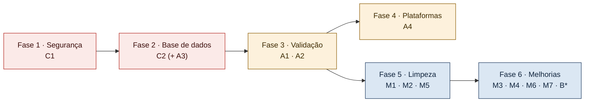

1. **Segurança (C1):** apagar o ficheiro com credenciais e mudar a palavra-passe. É rápido e não depende de nada.
2. **Base de dados (C2, A3):** rever, testar num esquema à parte e aplicar `correcoes.sql`; corrigir a auditoria se fizer parte dos requisitos. Confirmar o resultado em `/api/estado`.
3. **Validação (A1, A2):** alargar os testes de integração às escritas desbloqueadas e às funções/procedures com `COMMIT` (com limpeza). Repetir o teste ponta a ponta.
4. **Plataformas (A4):** executar em Windows.
5. **Limpeza (M1, M2, M5):** retirar os restos antigos, decidir sobre o código não usado e alinhar a documentação.
6. **Melhorias (restantes):** conforme o tempo disponível.

> [!tip] Porquê esta ordem
> O código Java está à frente da base de dados: quase todos os bloqueios desaparecem com a fase 2, sem tocar no Java. A fase 3 só faz sentido depois da fase 2, porque os testes de escrita falhariam hoje por causa dos *triggers*.


---

# Parte VII — Referência

## 23. Glossário técnico

| Termo | Significado |
|---|---|
| **API REST** | Interface de programação acessível por HTTP, organizada em recursos (rotas) e operações (métodos GET, POST, PUT, DELETE). |
| **Associativa (tabela)** | Tabela que liga duas outras numa relação "muitos para muitos" (ex.: `Operador_Turista`). |
| **Buffer** | Zona de memória temporária onde se acumulam dados (ex.: as linhas do `DBMS_OUTPUT`) antes de serem lidos. |
| **Cache** | Cópia guardada em memória de um resultado, para não o voltar a pedir (ex.: as listas de valores em `ConstraintCatalog`). |
| **CallableStatement** | Objeto JDBC para chamar funções e procedures armazenadas. |
| **Callout** | Caixa destacada do Obsidian (`> [!note]`), usada neste documento para notas e avisos. |
| **Chave composta** | Chave primária formada por várias colunas (ex.: `ID_turista` + `preferencia`). |
| **CHECK (restrição)** | Regra da base de dados que limita os valores de uma coluna (ex.: `regiao in (...)`). |
| **COMMIT / ROLLBACK** | Confirmar ou desfazer as alterações de uma transação. |
| **Contexto (HttpServer)** | Prefixo de caminho associado a um *handler* (ex.: `/api/destinos`). |
| **CRUD** | *Create, Read, Update, Delete* — criar, ler, alterar e eliminar. |
| **DAO** | *Data Access Object*: classe que concentra o acesso à base de dados de uma entidade. |
| **DBMS_OUTPUT** | Pacote Oracle que permite ao PL/SQL escrever mensagens num *buffer*; as procedures do projeto usam-no para indicar o resultado. |
| **Design system** | Conjunto de componentes, cores e regras visuais reutilizáveis (pacote `ui`). |
| **EDT** | *Event Dispatch Thread*: *thread* única do Swing para desenhar e tratar eventos. |
| **Endpoint / rota** | Endereço da API com um significado (ex.: `GET /api/destinos/{id}`). |
| **FK / PK / UK** | Chave estrangeira / primária / única. |
| **FlatLaf** | Biblioteca de aparência (*Look and Feel*) moderna para Swing. |
| **Gson** | Biblioteca da Google que converte objetos Java em JSON e vice-versa. |
| **Handler** | Classe que recebe e responde a pedidos HTTP de uma rota. |
| **HikariCP** | Biblioteca de *pool* de ligações JDBC. |
| **HTTP status** | Código numérico da resposta (200, 404, 422, 503…). |
| **Ikonli** | Biblioteca de ícones de fonte para Java (aqui, Material Design). |
| **INVALID (objeto)** | Objeto PL/SQL que não compila; um *trigger* INVALID impede as escritas na sua tabela (`ORA-04098`). |
| **JDBC** | *Java Database Connectivity*: API Java para ligar a bases de dados e executar SQL. |
| **JSON** | Formato de texto para dados estruturados (objetos `{}` e listas `[]`). |
| **Listener (Oracle)** | Processo do Oracle que aceita as ligações de rede na porta 1521. |
| **LocalDate** | Tipo Java para uma data sem hora (`2026-10-20`). |
| **Maven** | Ferramenta de compilação e gestão de dependências Java (`pom.xml`). |
| **Mermaid** | Linguagem de texto para desenhar diagramas, suportada pelo Obsidian. |
| **Model / POJO** | Classe simples com campos, *getters* e *setters*, que representa dados. |
| **ORA-xxxxx** | Código de erro do Oracle (ex.: ORA-00001 chave duplicada). |
| **PL/SQL** | Linguagem procedimental do Oracle (funções, procedures, *triggers*). |
| **Pool de ligações** | Conjunto de ligações reutilizáveis à base de dados. |
| **PreparedStatement** | Instrução SQL pré-compilada com parâmetros `?`, que protege contra injeção de SQL. |
| **Procedure** | Bloco PL/SQL com nome que executa ações (não devolve valor como uma função). |
| **Proxy** | Objeto intermediário que se faz passar por outro e interceta as chamadas (ex.: `RollbackConnection`). |
| **Sequência** | Objeto Oracle que gera números crescentes (`NEXTVAL`). |
| **Shaded JAR** | `.jar` que inclui todas as dependências, executável com `java -jar`. |
| **Shutdown hook** | Código que a JVM executa quando o programa termina (a API usa-o para parar o servidor e fechar o *pool*). |
| **Singleton** | Classe com uma única instância partilhada (`AppConfig`). |
| **Skipped** | Estado de um teste que não foi executado por faltar uma condição (ex.: BD inacessível); não conta como falha. |
| **Surefire** | *Plugin* Maven que executa os testes e escreve os relatórios. |
| **Swing** | Biblioteca de interfaces gráficas incluída no JDK. |
| **SwingWorker** | Classe do Swing para executar trabalho em fundo e voltar à EDT (base de `Task`). |
| **Thread** | Linha de execução independente dentro de um programa. |
| **Timeout** | Tempo máximo de espera; ao fim desse tempo a operação é abandonada com erro. |
| **Toast** | Notificação breve que desaparece sozinha. |
| **Transação** | Conjunto de operações que é gravado ou anulado na totalidade. |
| **Trigger** | PL/SQL executado automaticamente num INSERT, UPDATE ou DELETE. |
| **try-with-resources** | Construção Java que fecha automaticamente recursos (ligações, instruções) no fim do bloco. |
| **View** | Consulta SQL guardada que se lê como uma tabela. |
| **VM** | Máquina virtual (aqui, CentOS em UTM com o Oracle). |

---

## 24. Guia rápido para novos programadores

### 24.1 Primeiros 30 minutos

1. Leia os capítulos [1](#1.%20Apresentação%20do%20projeto), [5](#5.%20Arquitetura%20geral) e [13.4](#13.4%20Operação%20completa%20—%20listar%20um%20módulo).
2. Configure a palavra-passe ([§16.3](#16.3%20Chaves%20de%20configuração)) e confirme que a VM Oracle está ligada.
3. Na raiz: `./executar.sh`. Abra o painel e veja a secção "Integridade dos dados".
4. Abra `backend/server.log` para ver o estado da BD no arranque.
5. Percorra os módulos; veja que os separadores "Relatórios" mostram "view não existe" (esperado enquanto [C2](#21.1%20Prioridade%20crítica) não estiver feito).

### 24.2 Onde mexer para…

| Quero… | Ficheiros |
|---|---|
| Acrescentar uma coluna à lista de um módulo | `Modules.java` (`.column(...)`); se o campo não existir no JSON, também o `SELECT` e o `map` do DAO e o *model* |
| Acrescentar um campo ao formulário | `Modules.java` (`.field(...)`), o *model*, o `read()` do *handler* (validação) e o `INSERT`/`UPDATE` do DAO |
| Mudar uma regra de validação | `Validator` e o `read()` do *handler* (servidor); `FieldSpec` / `crossValidation` em `Modules` (cliente) |
| Criar uma nova rota | Um *handler* que estenda `BaseHandler`; registá-lo com `createContext` e na lista `ENDPOINTS` de `TurismoApiServer`; o DAO (estender `BaseDAO`) |
| Criar um novo módulo (tabela) | *Model* + DAO + *handler* + registo no servidor + `ModuleSpec` em `Modules` + `all()` + `MainWindow.group(...)` |
| Mostrar uma nova *view* | `RelatorioDAO.VIEWS` (nome e `ORDER BY`) e `.report(...)` no módulo |
| Mudar uma mensagem de erro Oracle | `DbErrors.translate` |
| Mudar cores ou fontes | `Palette`, `Theme` |
| Mudar a porta ou a BD | `config/turismo.properties` (sem recompilar) |

### 24.3 Regras do projeto a respeitar

- O frontend **nunca** fala com a base de dados; só com a API.
- Pedidos à API **só** dentro de `Task.run(...)`.
- Os DAOs **propagam** a `SQLException`; não a escondem.
- Valores do utilizador **sempre** como parâmetros `?`.
- Escritas com várias instruções dentro de `inTransaction`.
- Funções e procedures PL/SQL que devolvem mensagens: `requireSuccess` ou `PlSqlOutput`.
- Nenhuma palavra-passe em ficheiros versionados.
- Testes de escrita contra o Oracle só com `RollbackConnection` (ou com limpeza explícita, se fizerem `COMMIT`).

### 24.4 Verificação antes de entregar alterações

```bash
mvn clean test          # a partir da raiz; integração fica "skipped" sem BD
mvn -q -DskipTests package && ./executar.sh
```

---

## 25. Referência de ficheiros importantes

| Ficheiro | Para quê |
|---|---|
| [`../pom.xml`](../pom.xml) | Versões de Java, dependências e *plugins* |
| [`../config/turismo.properties`](../config/turismo.properties) | Configuração da BD, da API e do cliente |
| [`../executar.sh`](../executar.sh) / [`../executar.bat`](../executar.bat) | Arranque completo |
| `../backend/src/main/java/com/turismo/api/TurismoApiServer.java` | Rotas registadas e arranque da API |
| `../backend/src/main/java/com/turismo/api/handler/BaseHandler.java` | Tratamento comum de pedidos e erros |
| `../backend/src/main/java/com/turismo/api/dao/BaseDAO.java` | JDBC comum, transações, PL/SQL |
| `../backend/src/main/java/com/turismo/api/util/DbErrors.java` | Tradução de erros Oracle |
| `../backend/src/main/java/com/turismo/api/util/DatabaseConnection.java` | *Pool* de ligações |
| `../frontend/src/main/java/com/turismo/frontend/modules/Modules.java` | Definição dos 15 módulos |
| `../frontend/src/main/java/com/turismo/frontend/modules/CrudPage.java` | Ecrã genérico |
| `../frontend/src/main/java/com/turismo/frontend/modules/FormDialog.java` | Formulário genérico |
| `../frontend/src/main/java/com/turismo/frontend/api/ApiClient.java` | Cliente HTTP |
| [`../database/tabelas.sql`](../database/tabelas.sql) | Esquema das 15 tabelas |
| [`../database/main.sql`](../database/main.sql) | Corre todos os scripts da BD pela ordem certa |
| `../backend/server.log` | Último estado da BD visto pela API (gerado; pode não existir noutra cópia) |
| [`../README.md`](../README.md) | README original (resumo) |
| [`../backend/README.md`](../backend/README.md) | Referência curta da API |
| [`../IMPLEMENTATION_PLAN.md`](../IMPLEMENTATION_PLAN.md) | Auditoria e decisões |
| [`../PROGRESS_CHECKLIST.md`](../PROGRESS_CHECKLIST.md) | Estado por módulo |
| [`../RELATORIO_TESTES.md`](../RELATORIO_TESTES.md) | Relatório de testes |
| `../frontend/target/screenshots/` | Capturas da interface (geradas pelos testes) |

> [!note] Ligações relativas
> As ligações desta tabela são relativas a `documents/`. No Obsidian só funcionam se o *vault* abrir a pasta `Trabalho_turismo/` inteira (e não apenas `documents/`). Os ficheiros `.java`, `.log` e as pastas aparecem como caminhos de texto, porque o Obsidian não os abre como notas.

---

## 26. Notas sobre esta análise

| Aspeto                  | Detalhe                                                                                                                                                                                                                                                                                                                          |
| ----------------------- | -------------------------------------------------------------------------------------------------------------------------------------------------------------------------------------------------------------------------------------------------------------------------------------------------------------------------------- |
| Data                    | 20-10-2026                                                                                                                                                                                                                                                                                                                       |
| Método                  | Leitura integral do código-fonte próprio (backend, frontend, testes), dos `pom.xml`, scripts, configuração, documentação existente, relatórios Surefire, `backend/server.log` e dos cabeçalhos e definições dos scripts SQL                                                                                                      |
| O que **não** foi feito | Não foram executados testes, compilações, a aplicação nem consultas à base de dados; não foi analisado o conteúdo dos PDF, do `.drawio` e das páginas HTML de `documents/`; não foi lido o corpo completo de todas as funções, procedures e *views* SQL (apenas os nomes, as tabelas/eventos dos *triggers* e as partes citadas) |
| Informação sensível     | O nome do utilizador Oracle e as palavras-passe encontradas não são reproduzidos neste documento                                                                                                                                                                                                                                 |
| Destino                 | `documents/README.md`. Não existia uma pasta `Documentos`; a pasta equivalente `documents/` (documentação do trabalho prático) foi usada e não tinha nenhum `README.md`                                                                                                                                                          |
| Alterações ao projeto   | **Nenhuma.** O único ficheiro criado é este documento. O código da aplicação, a configuração, os scripts e a base de dados não foram alterados                                                                                                                                                                                   |
